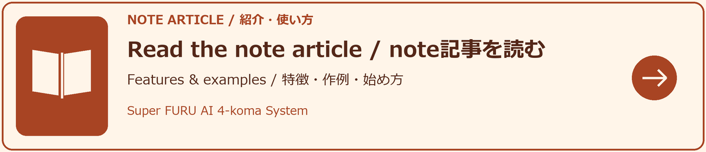
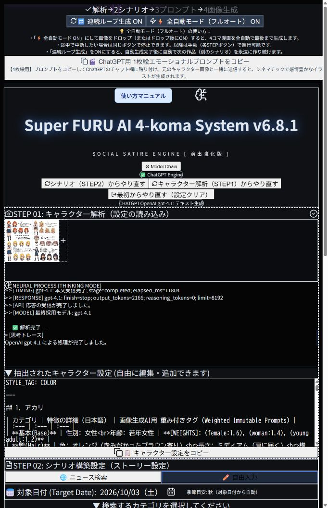
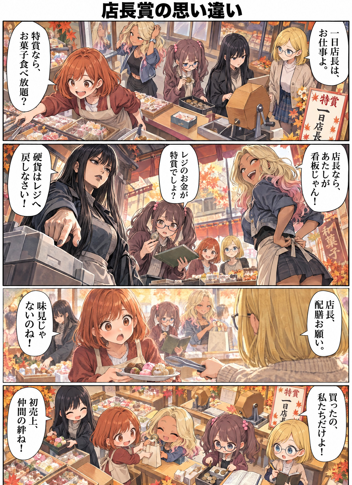
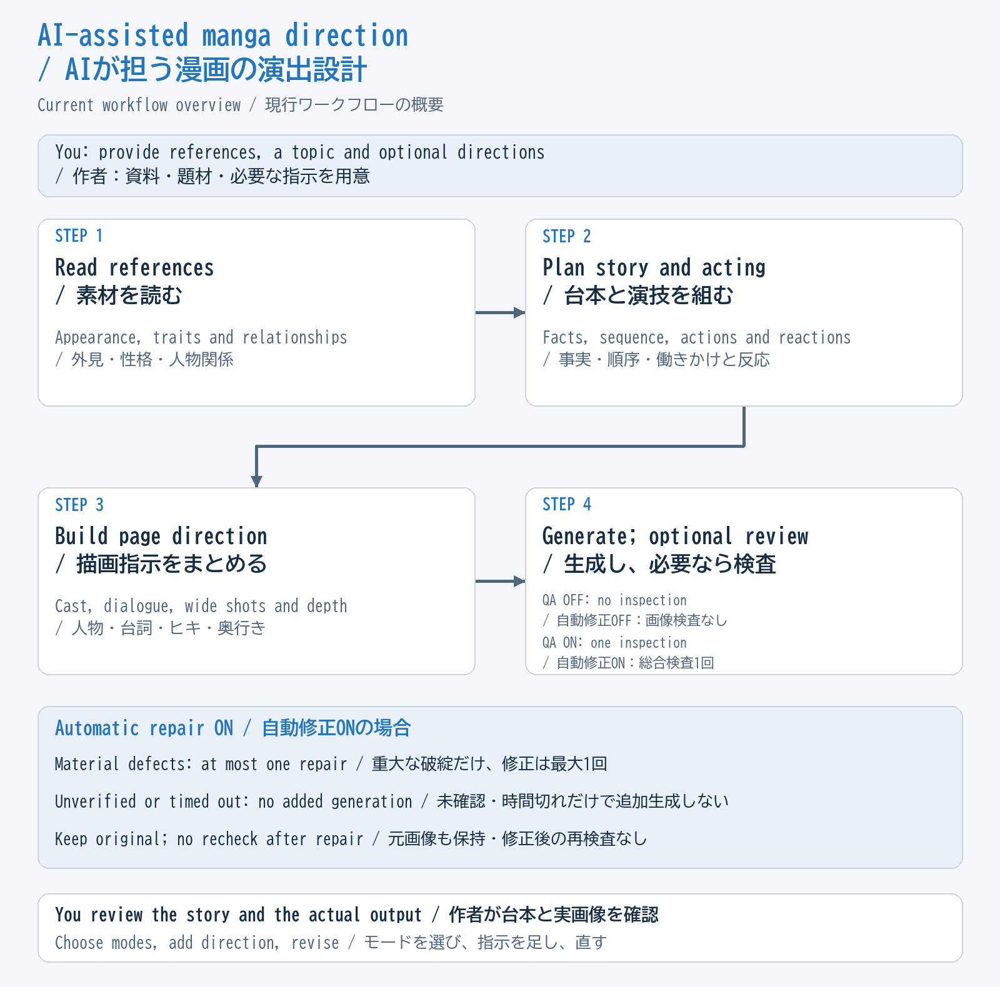
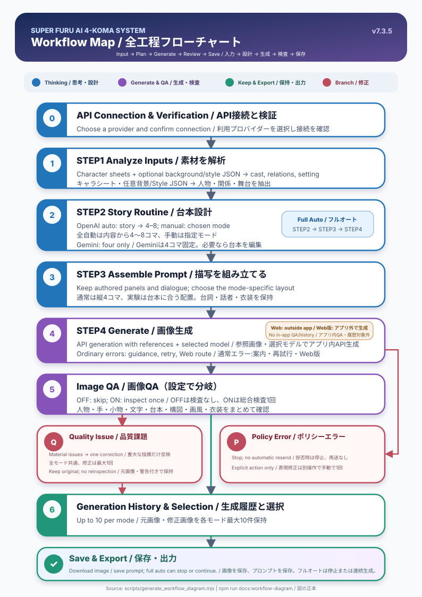
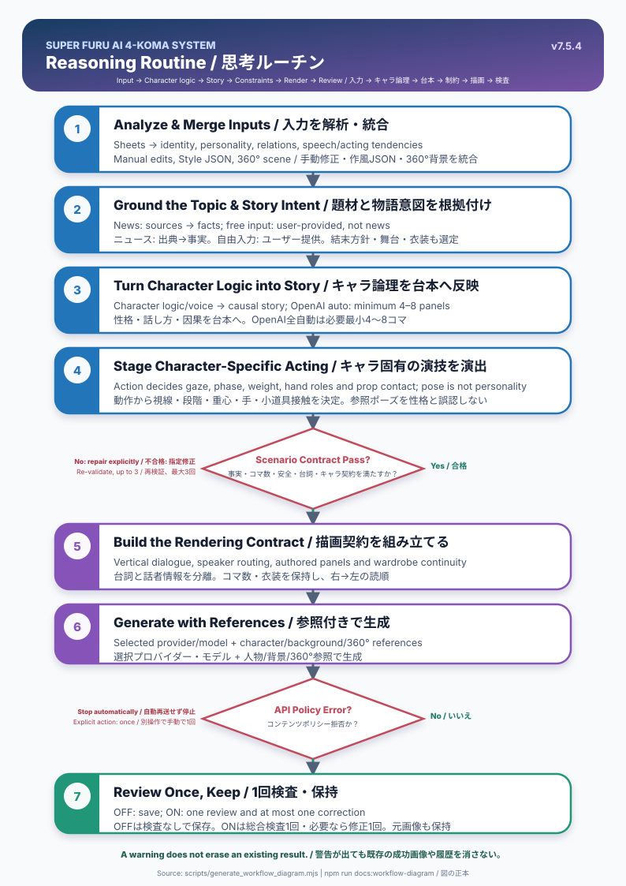

# Super FURU AI 4-koma System / Super FURU AI 4コマシステム

> **MIT License; your outputs remain yours.** You may use, modify, redistribute and sell the app, including in paid products and services, without individual permission from FURU. Retain the copyright and MIT license notices in copies or substantial portions of the software. External API fees and third-party terms are separate. / **アプリはMITライセンス。成果物の権利は従来どおり利用者に帰属します。** アプリの利用・改変・再配布・販売、有料商品やサービスへの組み込みに、FURUへの個別許可は不要です。ソフトウェアの複製または重要な部分には著作権表示とMITの許諾表示を残してください。外部API料金と第三者の条件は別です。


> Current source version: **v7.5.2** / 現在のソース版: **v7.5.2**


An AI-assisted manga production and direction system that turns character references and a topic into a scenario, acting, camera directions and image instructions. Its focus is an interacting cast: consistent identities, actions and reactions grounded in the story, and wide shots with readable spatial depth. AI plans part of the direction between the author’s input and the final image; the author can review and edit each stage. / キャラクター資料と題材から、台本・演技・カメラ・画像用の指示を組み立てるAI漫画制作・演出支援システムです。多人数の人物整合性、物語を踏まえた働きかけと反応、ヒキを含む奥行きのある構図を重視します。作者の入力から画像化までの間にある演出判断の一部をAIが担い、作者は各工程を確認・編集できます。

OpenAI starts in free-layout mode with four to eight panels and also supports a fixed four-panel strip; Gemini supports four panels in color or monochrome. Full-auto can continue through the stages, while post-generation quality review runs only when automatic image repair is ON. / OpenAIの初期選択は「4～8コマ生成」で、「4コマ生成（横長コマ）レガシー」にも対応します。Geminiはカラー・白黒とも4コマ固定です。全自動で各工程を続ける使い方も選べ、生成後の品質検査は画像自動修正がONの場合だけ行います。

[](https://furuyan1234.github.io/nano-banana-pro/)

Demo URL / デモサイト: [https://furuyan1234.github.io/nano-banana-pro/](https://furuyan1234.github.io/nano-banana-pro/)

[](https://note.com/happy_duck780/n/ndf063558c1f5)

### Character text without reference images / 人物参照画像なしの人物設定

Background, prop and panorama images require at least one registered character; valid Story Maker character text counts, and character plus background images may be added together. Ordinary images are checked after recognition; panorama-only input is rejected before an API call. Removing all characters while backgrounds remain blocks the next stage until a character is restored. Style JSON alone is unaffected. / 背景・小物・360°背景の追加には登録人物が1人以上必要です。Story Makerの有効な人物テキストも人物として数え、人物画像と背景は同時追加できます。通常画像は認識後に検査し、360°背景だけの追加はAPI前に拒否します。人物をすべて削除して背景だけが残ると次工程を止め、人物追加で再開します。作風JSON単独は対象外です。

Drop reference images anywhere inside the blue dashed STEP1 frame, including over the shared six-line white character-information field. Per-image names and descriptions appear above the white character field; recognized images open these details automatically, while text-only or empty input keeps them collapsed. White fields marked editable let you adjust STEP1 information, STEP2 scenario and the final prompt in STEP4; rebuild STEP3 after scenario edits. The API dialog groups the application, OpenAI and Gemini PDF guides for use before connection. / STEP1の青い破線枠全体へ画像をドロップでき、基本6行の白い共通「人物情報」欄の上でも受け付けます。画像別の名前・説明は白い人物欄の上の「素材ごとの認識詳細」に表示し、認識済み画像があれば自動で開き、テキストのみ・空のときは閉じます。白い欄は人物情報だけに使います。「編集できます」と示す白い欄でSTEP1情報・STEP2台本・STEP4の最終プロンプトを編集でき、台本を変えたらSTEP3で作り直します。API入力画面では使い方・OpenAI・Geminiの3冊を同じグループから接続前にも読めます。

The main path is to drop character sheets anywhere inside STEP1’s blue dashed border, including the white character field. The whole border is highlighted while dragging files. Recognized characters and pasted Story Maker profiles share that same multiline field; per-image names and material details are available in a collapsible section below it. / 基本操作はキャラクターシート画像のドロップです。STEP1の青い破線枠内は、白い人物情報欄も含めて全体がドロップ範囲で、ドラッグ中は枠全体を強調します。画像の認識結果とStory Makerの人物情報は同じ複数行欄を使い、画像ごとの名前や素材の詳細は下の折りたたみから確認・編集できます。


Paste Story Maker’s STEP1 character information into the multiline character field, or drop a character-sheet image directly onto the same field. Text must use named character headings with Appearance and Clothing fields; scenarios belong in STEP2. Character Maker’s text copy is a sheet-design prompt, not character information for this field. / 複数行の人物設定欄にはStory MakerのSTEP1用人物情報を貼り付けるか、同じ欄へキャラクターシート画像を直接ドロップします。テキストは人物名の見出しと「外見:」「服装:」を含む形式が必要です。台本はSTEP2へ貼り付けます。キャラクターメーカーの「テキストCopy」はシート作成用の指示文なので、この欄には使いません。

You can paste usable character descriptions into STEP1 “人物情報” (`#reference-recognition-editor`) without uploading character images. The names, appearance and clothing are retained in API prompts and Web copy. Backgrounds and style examples do not count as character references; when character images are supplied, their identity remains the priority. Blank or insufficient settings still fail validation. / 人物画像をアップロードせず、STEP1「人物情報」（`#reference-recognition-editor`）へ十分な人物説明を貼り付けて制作できます。名前・外見・服装をAPI指示文とWebコピーへ残します。背景・描法見本は人物参照画像に数えず、人物画像がある場合はその同一性を優先します。空欄や不十分な設定は引き続き検査で拒否します。

For Story Maker integration, paste its STEP1 character information here and its scenario into STEP2 “生成されたシナリオ”, build the prompt in STEP3, then generate in STEP4. Story Maker outputs a scenario alone after a character sheet has actually been imported and its character registered; provide the same sheets for all cast members in this app. Without imported sheets, Story Maker generates separate character information and offers full, scenario-only and character-only copies. Image identity is not automatically compared between apps. / Story Makerとの連携では、STEP1用の人物情報をここへ、台本をSTEP2「生成されたシナリオ」へ貼り、STEP3で指示文を作ってSTEP4で画像化します。Story Makerでシート画像を読み込み人物登録した場合は台本だけを出し、漫画側にも全人物分の同じシートを読み込みます。未取り込み時だけ人物情報を追加生成し、全文・台本だけ・人物情報だけのコピーを使えます。両アプリの画像の同一性は自動照合しません。

Open Character Maker from STEP1 to prepare character sheets, or Story Maker from STEP2 to create a scenario. The outlined buttons explain the destination and return path and open a separate tab, preserving this page. The same links are available on the initial API connection screen. / STEP1のキャラクターメーカーボタンで人物シートを、STEP2のStory Makerボタンで台本を準備できます。枠線付きボタンには用途と戻し先を説明し、作業中の画面を残して別タブで開きます。初期のAPI接続画面からも同じリンクを使えます。

### PDF manuals / PDFマニュアル

Click an image button to open its PDF. The full manual covers application features and the workflow through saving; the two API guides cover account preparation, billing, API keys and connection checks. / 画像ボタンをクリックすると各PDFが開きます。全機能マニュアルはアプリの機能と保存までの操作手順を、API取得マニュアル2冊はアカウントの準備・課金・APIキーの取得・接続確認を説明します。

[](https://furuyan1234.github.io/nano-banana-pro/downloads/super-furu-ai-4koma-full-manual-2026-10-01.pdf)

[](https://furuyan1234.github.io/nano-banana-pro/downloads/openai-api-beginner-guide-2026-09-30.pdf)

[](https://furuyan1234.github.io/nano-banana-pro/downloads/gemini-api-beginner-guide-2026-10-01.pdf)

Application terms are in [LICENSE](LICENSE). / 利用条件は [LICENSE](LICENSE) をご確認ください。

## Application screen and output / 操作画面と生成例

| Application / 操作画面 | Generated manga / 生成例 |
|---|---|
|  |  |

The left image shows previous-release connection and reference controls; current recognition fields are described below. The right image is an inspected example generated with the OpenAI API (GPT Image 2.5 Sunburst / max). Inspect styles, character scale and dialogue in the actual image. Unconfirmed automated findings and minor crops remain caveats; equal quality on every generation is not guaranteed. / 左は以前の版の接続・素材操作画面で、現在の認識欄は後述します。右はOpenAI API（GPT Image 2.5 Sunburst / max）で生成して目視確認した作例です。画風・人物の縮尺・台詞は画像を見て確認し、自動検査の未確認項目や軽微な見切れは注意事項として扱います。生成ごとに同じ品質を保証するものではありません。

https://github.com/user-attachments/assets/15608ccc-8d86-4b78-9ff3-785201b42629

## Single-page design approach / 1ページ制作の設計方針

### AI handles intermediate direction decisions / 演出の中間工程をAIが担う

The author supplies references, a topic and any explicit directions. The workflow connects three kinds of decisions rather than requiring every panel to be specified separately. / 作者は資料、題材、必要な明示指定を渡します。次の三つの判断を制作工程でつなぎ、コマごとの細部を毎回すべて指定する負担を減らす設計です。

| Direction decision / 演出判断 | How the workflow handles it / 制作工程での扱い |
|---|---|
| A consistent multi-person cast / 多人数の描き分け | Carry appearance, clothes and identity from references into the scenario and drawing instructions; optional image QA checks material cast defects. / 資料の外見・衣装・人物対応を台本と描画指示へ引き継ぎ、任意の画像QAで重大な人物不具合を検査します。 |
| Acting through sequence and relationships / 出来事の順序と関係性を踏まえた演技 | Plan whose action prompts whose response, including gaze, posture and action phase. Documentary fact/timeline checks preserve source events, dates and causality. / 誰の働きかけが誰の反応につながるかを、視線・姿勢・動作段階とともに計画します。ドキュメンタリーでは資料の出来事・日時・因果も照合します。 |
| Wide shots and spatial direction / ヒキと空間演出 | Combine camera position, height, framing and lens cues with character action; organize foreground, middle ground, background and the focal subject. / 撮影位置・高さ・寄り引き・レンズ感を人物の動作と組み合わせ、前景・中景・背景と注視点を整理します。 |



The figure summarizes the normal page workflow. The detailed [story algorithm](#story-construction-algorithm--物語アルゴリズム) and [visual direction rules](#visual-direction-and-reading--演出と読みやすさ) explain its constraints. The author retains control of intent, explicit instructions and output selection. Automatic repair OFF skips image QA; ON permits one review and at most one material repair, without post-repair reinspection. / 図は通常のページ制作工程の概要です。制約の詳細は[物語アルゴリズム](#story-construction-algorithm--物語アルゴリズム)と[演出と読みやすさ](#visual-direction-and-reading--演出と読みやすさ)で説明します。意図・明示指定・出力の採用は作者が決めます。画像自動修正OFFでは画像QAを行わず、ONでは検査1回と重大修正最大1回で、修正後の再検査は行いません。

These are implemented instructions and checks, not a guarantee that the model understands every relationship or renders it consistently. Timeline fidelity is distinct from natural acting, and the app does not provide persistent emotional or relationship state across an entire long-form series. Other manga tools also offer character references, story generation and automation; no exclusive-feature or comparative-quality claim is made here. / ここで説明するのは実装した指示と検査であり、モデルがすべての人間関係を理解し、一貫して描けるという保証ではありません。時系列の保持と自然な演技は別で、長編全体の感情・関係性を永続的に追跡する機能も提供していません。他の漫画ツールにも人物参照・ストーリー生成・自動化があり、機能の独占性や比較品質を主張するものではありません。

### One page as the production unit / 1ページを制作の単位にする

The app uses one manga page as its unit of story planning, direction and image generation. When automatic image repair is ON, quality review also runs per page. The aim is to concentrate these steps on a coherent story and readable visual detail within that page. / 本アプリでは、物語の構成、演出、画像生成を1ページ単位で組み立てます。画像自動修正がONの場合は品質確認もページ単位で行い、各工程をその1ページの物語のまとまりと、読み取れる絵の密度に集中させる方針です。

- **Story density / 物語の密度:** Give page space to events, choices and reactions that advance the story. Monologues, action scenes and quiet beats serve the story's pacing; adding pages or repeating similar beats is not a quality target. Panel-count and layout rules are described in [Panel modes](#panel-modes--固定4コマと自由コマ割りの選び方). / 出来事、人物の判断、相手の反応に必要な紙面を配分します。モノローグ、バトルシーン、静かな間も物語上の役割に応じて扱い、ページ数や類似場面の反復そのものを品質の指標にしません。コマ数と配置の具体的なルールは、[固定4コマと自由コマ割りの選び方](#panel-modes--固定4コマと自由コマ割りの選び方)で説明します。
- **An interacting cast / 複数人物の相互作用:** Use registered appearance, personality and relationships to guide the topic's scenario and each character's acting. When several people share a panel, plan whose action prompts whose response in the same scene. Cast size follows the story and available space. See [Story construction algorithm](#story-construction-algorithm--物語アルゴリズム) and [Visual direction and reading](#visual-direction-and-reading--演出と読みやすさ) for the acting and continuity rules. / 登録した外見、性格、人物間の関係を、題材のシナリオと各人物の演技へ反映するよう指示します。複数人が同じコマに登場する場合は、同じ場面で誰の働きかけが誰の反応につながるかを設計します。人数は物語と使える紙面に応じて扱います。演技と連続性の詳細は、[物語アルゴリズム](#story-construction-algorithm--物語アルゴリズム)と[演出と読みやすさ](#visual-direction-and-reading--演出と読みやすさ)を参照してください。
- **Page boundaries / ページの外枠:** Plan on an A4 portrait page and instruct the model to keep all four outer frame sides and corners inside the canvas with visible margins, unless full bleed is explicitly requested. Intentional panel-breaking effects remain available. Exact API canvas sizes and Web-copy differences are described in [API routes and settings](#api-routes-and-settings--api経路と設定). / A4縦の紙面を基準とし、明示した断ち切りを除き、外枠の四辺・四隅と余白を画像内に残すよう指示します。意図した人物の枠越え演出は利用できます。API出力の正確な画像サイズとWeb貼り付け時の違いは、[API経路と設定](#api-routes-and-settings--api経路と設定)で説明します。
- **Automatically constructed instructions / 指示文の自動構築:** AI builds the scenario and image instructions from character references and a topic. The normal workflow does not require hand-written YAML or other structured data; review and optional editing remain available in the [four-step workflow](#what-this-project-does--このプロジェクトでできること). / キャラクター資料と題材から、AIが台本と画像生成用の指示文を組み立てます。通常の制作手順でYAMLなどの構造化データを手書きする必要はなく、[4ステップの制作工程](#what-this-project-does--このプロジェクトでできること)で内容を確認し、必要に応じて編集できます。

The achievable cast size and detail depend on panel space, dialogue volume and the image model. These are design goals; inspect the generated image for the actual framing, character depiction and readability. / 実現できる人数と描写の細かさは、コマの広さ、台詞量、画像モデルの能力に依存します。これらは設計上の目標であり、実際の枠の収まり、人物描写、読みやすさは生成画像で確認してください。

## Panel modes / 固定4コマと自由コマ割りの選び方

OpenAIでは両モードを使えます。Geminiはカラー・白黒とも4コマ固定で、4～8コマへの切り替えはありません。以下のスイッチはOpenAI接続時だけ表示します。 / Both modes are available with OpenAI. Gemini is fixed to four panels in color and monochrome; the switch below appears only for OpenAI.

With full-auto OFF, choose the mode using the slide switch above STEP2 before writing a scenario. The left, light-blue position selects the legacy layout: exactly four full-width horizontal panels stacked in one column. The right, green position selects four to eight panels with free page composition and is the default. Four panels in the right mode can use large or vertical panels, full bleed and characters extending across frame borders. Both routes follow topic input, STEP2 scenario, STEP3 image instructions and STEP4 image generation. / フルオートOFFでは、STEP2の上にあるスライドスイッチで選びます。左・水色の「4コマ生成（横長コマ）レガシー」は、横長4コマの縦一列を厳守します。右・緑色の「4～8コマ生成」は自由配置で、初期選択です。右側なら4コマでも、大コマ・縦長・タチキリ・キャラクターの枠からのはみ出しを使い、物語に合うページを設計します。どちらも題材入力→STEP2で台本作成→STEP3で画像指示文→STEP4で画像生成の順です。

| Item / 項目 | Left: four panels / 左：4コマ生成（横長コマ）レガシー | Right: four to eight panels / 右：4～8コマ生成 |
|---|---|---|
| Scenario / 台本 | Four fixed beats: setup, development, turn and conclusion / 起・承・転・結の4コマ固定 | Author a complete 4–8-panel page from the start / 最初から4〜8コマの1ページを構成 |
| Count requests / コマ数指定 | Ignore conflicting total counts in free input / 自由入力に総コマ数を書いても無視 | Specify 4–8, or let AI choose from the story / 4〜8の範囲で指定でき、未指定なら内容に合わせてAIが選択 |
| Layout / 配置 | Exactly four full-width horizontal panels in one vertical column / 横長4コマの縦一列を厳守 | Choose varied sizes and horizontal/vertical panels to suit the scenario; exclude all-full-width horizontal strip stacks for every count from 4 through 8 / 台本に合う大小・横長・縦長などの配置を選択。4～8コマすべてで全横長縦積みは除外 |
| Per-panel style and direction / コマ別の画風・演出 | Specify panels 1–4 / 1〜4コマに指定可能 | Specify any authored panel / 作成する各コマに指定可能 |
| After generation / 生成後 | Automatic repair OFF: no review; ON: one comprehensive review and at most one material correction / 自動修正OFFは検査なし。ONは総合検査1回・重大な不具合の修正は最大1回 | Automatic repair OFF: no review; ON: one 4–8-panel review and at most one material correction / 自動修正OFFは検査なし。ONは4～8コマ用の総合検査1回・重大な不具合の修正は最大1回 |

### Automatic selection with full-auto ON / フルオートONでの自動選択

During the existing STEP2 scenario request, OpenAI full-auto reads the topic and chooses the smallest clear story of four to eight panels, with a fixed strip or free page composition. Four beats can use free layout too; more beats are used when intermediate actions, decisions, dialogue or scene changes need them. Selection is neither random nor alternating and does not depend only on text length. STEP2 shows the reason and passes the selected count to STEP3 and STEP4. An empty reason, out-of-range count or invalid numbering blocks continuation. Automatic switching retains separate scenarios and image histories for both modes. Gemini remains four-panel only. With full-auto OFF, the manually selected mode applies. / OpenAIのフルオートでは、STEP2のシナリオ生成時にネタの内容を読んで固定4コマまたは自由配置の4〜8コマを選びます。4コマで必要な出来事と結末を読みやすく描けるなら4コマ、途中の行動・判断・会話・場面転換を省く必要があるなら5〜8コマの必要最小数にします。ランダム、交互、文字数だけでの判定は行いません。選択理由をSTEP2の進捗欄へ表示し、選んだコマ数をSTEP3・STEP4へ引き継ぎます。理由が空、コマ数が範囲外、番号が不正な応答は先へ進めません。自動切り替えでも両モードの台本と画像履歴を分けて保持します。Geminiは4コマ固定です。フルオートOFFでは従来どおりスイッチで選んだモードを使います。


### Why the modes are separate / モードを分けている理由

The fixed four-panel mode retains four horizontal strips. Free-layout mode chooses four to eight story beats and plans their space around the main visual moment. Panel count and composition are separate choices: four beats can still form a bold page. / 固定4コマは従来の横長4段です。自由コマ割りは内容に合う4～8場面を選び、見せ場の周囲に各場面の空間を設計します。コマ数と構図を分け、4場面でも大胆な一ページにできます。

Four- to eight-panel generation authors the required panels from STEP2. It does not add silent panels merely to reach a count; silent beats that convey action or feeling remain available. STEP3 preserves the completed scenario's panel count, order, dialogue, styles and camera directions when planning the layout, rather than stretching a four-panel strip. For every count from four through eight, a vertical stack consisting entirely of full-width horizontal strips is excluded from layout selection and adoption. If the image model produces it anyway, enabled quality review warns and retains the image. More small panels can make drawings and lettering smaller; for a crowded cast or much dialogue, organize the content rather than merely adding panels. / 「4～8コマ生成」ではSTEP2から必要な4～8コマを作ります。コマ数を満たすだけの無言コマを加える方針は取りません。動作や気持ちを見せるための無言コマは使えます。STEP3では、できた台本のコマ数・順番・台詞・画風・カメラを保って配置を作り、4コマを4～8コマへ引き延ばしません。4・5・6・7・8コマすべてで全コマを横長の帯にして縦積みする配置を選択・採用しません。実画像でその形になった場合は品質検査で警告し、画像を保持します。小さいコマが増えると一場面の絵や文字が小さくなるので、人物や台詞が多い話は、コマ数だけを増やさず内容を整理してください。

### Input examples and switching / 入力例と切り替え

Four- to eight-panel image prompts separate printable dialogue from speaker, balloon-tail and placement instructions. The same contract applies to API generation and Web copy. Names spoken in dialogue, such as an address or self-introduction, remain printable text. For example, 'Akari, how are you feeling?' keeps the spoken name. Because the image model may miss an instruction, check the actual lettering after generation. / 4～8コマの画像指示文は、吹き出しに印字する台詞本文と、話者・吹き出しの尻尾・配置の指示を分けます。API生成とWeb貼り付けで共通です。「アカリ、顔色はどう？」のような呼びかけや名乗りは本文として残します。画像モデルが指示を外す可能性はあるため、生成後は実際の文字も確認してください。

In free-layout mode, STEP2 designs the whole page from an ordinary topic: a dominant full or half figure, smaller story panels, connected overlaps across several panels and suitable full bleed. Four-panel pages can use this too. The script authors its own frame proportions instead of being limited to fixed layouts; STEP3 keeps the story, cameras and dialogue. The image can adjust boundaries naturally while preserving readability and the large/small contrast. A numerical ratio mismatch alone does not trigger regeneration. Foreground continuity is checked from visible evidence, separately from later appearances of the same character. Legacy scenarios and the fixed four-strip mode remain supported. / 「4～8コマ生成」では、題材だけの通常入力から、ページを大きく占める全身・半身、周囲の小コマ、複数コマに重なる一続きの人物、タチキリを設計します。4コマでも使用できます。固定配置だけに限定せず、シナリオがコマの位置と比率を決め、STEP3が物語・カメラ・台詞とともに保持します。大小の対比と可読性を保つ自然な境界調整を許容し、数値比率の差だけでは再生成しません。前景の身体の連続性と、同じ人物の別時点の登場を区別して検査します。旧台本と従来の横長4段も使用できます。

A foreground figure can be a silent guest without a reference sheet when the source panel explicitly stages that person. A figure inside a screen or picture stays a depicted figure, separate from live visitors and tiny replicas. Quoted names, text-only labels and explicitly absent people do not establish a foreground. / 前景には、参照シートがなくても元コマに描画が明記された無言のゲストを指定できます。画面や絵の中の人物は、現場の来館者や小さな複製像と区別して保持します。引用中の名前・文字表示だけ・明示された不在は、前景人物の根拠にしません。


In four-panel mode, enter directions such as 'Panel 2 POP, panel 4 GEKIGA.' The four-panel count takes priority even if you also request six panels. Story numbers inside dialogue ('This manga had five panels') or props ('eight sheets') remain intact. In four- to eight-panel mode, you can request 'Six panels; panel 2 watercolor and panel 5 GEKIGA.' Without a count, AI plans four to eight panels from the topic. / 「4コマ生成（横長コマ）レガシー」では「2コマ目はPOP、4コマ目は劇画」のように指定できます。「全6コマで」と併記しても4コマ固定を優先します。台詞中の「この漫画は5コマだった」や、小物の「8枚」といった物語の数値は、そのまま扱います。「4～8コマ生成」なら「全6コマ。2コマ目は水彩、5コマ目は劇画」のように書けます。コマ数を書かず題材だけ入力しても4～8コマの範囲で構成します。

Scenario enhancement supports both modes and retains the source panel count. Rebuild STEP3 after enhancement or manual scenario edits. When only color/monochrome changes in four- to eight-panel mode, STEP3 retains the approved layout and updates color and medium instructions. The switch alone makes no API call. Its selection lasts until reload; reload resets the switch to the right, 4–8-panel position. Scenarios and history last only while the page remains open. If shared conditions such as topic or references change, rebuild instead of using instructions from the old conditions. Save needed images and production records before reloading. / シナリオ強化は両方のモードに対応し、元台本のコマ数を保ちます。強化・手編集の後はSTEP3を作り直します。カラー／白黒だけを変更した4～8コマ生成のSTEP3では、決定済みのコマ割りを保って色と画材の指示を更新します。スイッチの操作だけではAPIを呼びません。選択は再読み込みまで保持し、再読み込み後は右の「4～8コマ生成」です。台本・履歴は画面を開いている間だけ保持します。題材や素材などの共通条件を変更した場合は、古い条件の指示文を使わず再構築します。必要な画像と制作情報は再読み込み前に保存してください。


## Art styles / コマごとの絵柄

The overall `Outfit` and clothing stated in scene/action directions take priority. Carry each person's clothing through the same scene even when later panels omit its description, while retaining explicit costume changes and panel-specific overrides. API and Web-copy routes share these instructions. Wardrobe continuity does not require freezing the camera, action, expression or per-panel style. It is an instruction rather than a guarantee of matching generated clothes; inspect the final image. / 衣装は、全体の `Outfit` と状況・動作に書かれた指定を優先します。同じ場面で後のコマに衣装の説明がなくても、その人物の衣装を引き継ぐよう指示します。明示された着替えやコマ限定の指定は保ちます。API用とWeb貼り付け用で共通の指示を使い、衣装の継続のためにカメラ、動作、表情、コマごとの絵柄を固定することは求めません。生成画像での衣装の一貫性を保証するものではないため、最終画像を確認してください。

In free input, write directions such as 'Panel 1 NORMAL, panel 2 POP, panel 3 watercolor, panel 4 GEKIGA.' Apply the same notation to the panels in four- to eight-panel mode. Numbers identify story panels, not style-menu choices. English style names also work. Each panel's `[EMOTION: ...]` records its style, so you can check or edit it before STEP3. / 自由入力に「1コマ目は通常、2コマ目はPOP、3コマ目は水彩、4コマ目は劇画」のように書けます。4〜8コマモードでも、作成するコマに合わせて同じ書き方を使います。数字は選択肢の番号ではなく、物語のコマ番号です。英語名でも指定できます。台本では各コマの `[EMOTION: ...]` に画風が記載されるので、STEP3へ進む前に確認・編集できます。

Monochrome NORMAL panels request fewer redundant hair strands, incidental fabric wrinkles and background micro-textures. Existing deep shadows are grouped into coherent black shapes, with white gaps around faces, hands and focal silhouettes. GEKIGA keeps its directional crosshatching; character identity, skin/material tone assignments, dialogue, camera and acting remain part of the same instruction. The finalized document is shared by API generation, Web copy and TXT export. Targeted repairs keep their local scope. / 白黒の通常コマでは、不要な髪の細線、服のしわ、背景の微細模様を整理する指示を加えています。深い影はまとまった黒ベタへ寄せ、顔や手、主役の輪郭の周囲に白い隙間を残します。劇画の方向性のあるカケアミ、人物の特徴、肌・素材のトーン、台詞、カメラ、演技は同じ指示文で保持します。確定した全文をAPI生成・Webコピー・TXT保存へ共通で渡し、部分修正は指定箇所の範囲を保ちます。

| Style / 画風 | Identifier / 英語名 | Appearance / 見た目の特徴 |
|---|---|---|
| Normal / 通常 | NORMAL | Everyday manga drawing based on the registered character references / 登録した人物資料の絵柄を基準にした、普段の漫画表現 |
| Pop art / POP（ポップアート） | POP_ART | Bold black contours, vivid opaque flat colors and large Ben-Day dots, like a printed poster / 太い黒い輪郭、鮮やかで不透明な平面色、大粒の網点を使う印刷ポスターのような表現 |
| Watercolor / 水彩 | WATERCOLOR | Pale transparent color, bleeding and pooled pigment that preserve paper white / 淡い透明色、にじみ、色溜まり、紙の白を生かした柔らかな描写 |
| Gekiga / 劇画 | GEKIGA | Model eye sockets, nose, cheeks and jaw with fine layered crosshatching and varied pen weight / 目のくぼみ、鼻梁、頬骨、顎の立体を、細い斜線を重ねるカケアミと強弱のある描線で描く表現 |
| Sketch / スケッチ | SKETCH | Pencil lines, hatching and paper texture with a drawn-study appearance / 鉛筆の線やハッチング、紙の質感を見せる素描のような表現 |
| Chibi gag / ちびギャグ | CHIBI_GAG | Large heads, short bodies and limbs, with exaggerated comic action and reactions / 頭を大きく、胴や手足を短く描き、動作や反応を誇張するコミカルな表現 |

Style instructions apply to faces, hair, clothes, props and backgrounds while preserving identity, wardrobe, dialogue, camera and acting. GEKIGA does not require changing a calm face to a severe expression. Monochrome translates color characteristics into ink lines, black/white shapes and halftone dots. AI chooses unspecified panels to suit the topic and direction. Results vary, and small panels or distant faces may show weaker distinctions; inspect the image and specify necessary corrections. / 画風は顔・髪・服・小物・背景へ適用する指示です。人物の同一性や衣装、台詞、場面のカメラと演技は保ちます。劇画だから険しい表情にする、といった変更は求めません。白黒では色の特徴を墨線、白黒の面や網点へ置き換えます。指定しないコマは題材と演出に合わせてAIが選びます。生成にはばらつきがあり、小さなコマや遠い顔では描き分けが弱くなることもあるため、最終画像を見て必要な修正を指定してください。

POP requests printed color shapes and dots on faces too; watercolor requests transparent pigment layers on faces and hair; GEKIGA requests facial structure and intersecting pen lines. Ordinary four-panel and four- to eight-panel routes share these character-rendering instructions. The latter separates reference appearance data from each panel's drawing recipe: hair, skin, glasses and identifying facial features remain, while stylized eye size and painting follow the panel's medium. An explicit reference-style lock takes priority. / POPでは人物の顔にも印刷の色面と網点、水彩では顔・髪にも透明な顔料の重なり、劇画では顔の骨格と交差するペン線を指定します。通常4コマと4～8コマで共通の人物描画指示を使います。4～8コマでは参照シートの外見情報をコマの描画指示と分け、髪・肌・眼鏡・顔の識別点を残しながら、目の様式的な大きさや塗り方を各コマの画風に合わせます。参照絵柄を固定する設定では、その固定を優先します。

For OpenAI image generation, a built-in technique guide is attached automatically only when a color scenario includes POP, watercolor or GEKIGA. It guides the relevant panels' rendering; it does not supply identity, clothes, poses, composition or lettering. Monochrome, custom-style and reference-style-preserving modes, including SeriousDocumentary, omit it, as do scenarios containing only NORMAL, SKETCH and CHIBI_GAG. For OpenAI Web generation, save `nano-panel-media.png` from STEP4 and attach it last, after all STEP1 source images. A guide does not guarantee style compliance; inspect the cast and rendering afterward. / OpenAI画像APIでは、カラーのPOP・水彩・劇画を含む台本に、組み込みの描法見本を自動添付します。見本は該当コマの描き方だけに使い、人物の同一性・衣装・ポーズ・構図・文字は写さない指示です。白黒、カスタム画風、参照絵柄を保持する設定（SeriousDocumentaryを含む）では添付しません。通常・スケッチ・ちびギャグだけの台本にも添付しません。OpenAI向けWeb貼り付けでは、STEP4に表示される見本を nano-panel-media.png として保存し、STEP1の元画像をすべて添付した後、最後に添付してください。描法見本があっても指定どおりの描写を保証するものではないため、生成後の人物と画風を確認してください。


## Visual direction and reading / 演出と読みやすさ

Sound effects are drawn as part of the manga artwork, outside speech balloons. The scenario can place motivated Japanese lettering beside movement, impacts and everyday sounds in any ending mode. The image generator renders it in the selected medium; the app does not overlay typed text afterward. Explicit silence or no-SFX instructions take priority, and dialogue, faces and action contacts remain readable. / 擬音は吹き出しの外に、絵の一部として描きます。どの結末でも、動き・衝撃・生活音に合う描き文字を台本で指定し、画像AIが各画風で描画します。生成後に文字を重ねる処理ではありません。無音・擬音なしの明示指定を優先し、台詞・顔・動作の接触点を隠さないよう指示します。

GEKIGA panels request exaggerated facial relief through dense multidirectional fine pen hatching: deep eye sockets, a projecting nose and carved cheek/jaw planes, including calm or smiling faces. Line density builds the shadows; solid black supports only local occlusions. Color sits under the pen drawing; monochrome remains black and white. Other panel styles retain their own rendering. This is a drawing instruction, not a guarantee; inspect the generated faces. / 劇画コマでは、目のくぼみ・鼻梁・頬骨・顎の彫りを強め、顔や首に細い斜線を何方向にも重ねる濃いカケアミを指定します。影は線の密度で作り、黒ベタは局所を締める補助に留めます。穏やかな顔や笑顔も描き込みを弱めず、年齢や表情は保ちます。カラーはペンの描線の下に着色し、白黒は無彩色を保ちます。他の画風には適用しません。指示どおりになる保証ではなく、生成後の顔を確認してください。

POP panels redraw faces, hair, clothes, props and backgrounds with extra-bold black contours, vivid opaque flat colors and clearly separated large Ben-Day dots. Monochrome uses bold black/white shapes and dots only in permitted shadow/material regions. Camera, acting, identity and dialogue stay intact; inspect the actual output. / POPでは顔・髪・服・小物・背景に極太の黒い輪郭、鮮烈で不透明な平面色、大粒で明瞭な網点を指定します。白黒では大胆な白黒面と、許可された影・素材面の網点へ置き換えます。カメラ・演技・同一性・台詞を保つ指示ですが、実際の出方は生成画像で確認してください。

**Story-led page composition / シナリオに合うページ構成**: STEP2 first chooses the most effective story moment, then compares distinct page structures in the same request. The last six accepted session scripts provide geometry-only comparison data. Story impact and legibility take priority; novelty only breaks ties between suitable alternatives. Explicit layouts and meaningful repetition remain valid. No extra layout API call or similarity-only regeneration is added. The comparison resets on reload or full reset. / STEP2はシナリオの動き・表情・間・オチから最も効果的な見せ場を選び、上下の横長大コマ、左右の縦長、中央の見せ場などを同じリクエスト内で比較します。この画面で採用した直近6作品の構図を参考にしますが、内容への効果と読順を優先します。同程度に適した案があるときに偏りを抑え、違う構図にするためだけに話を変えたり、人物を小さくしたりしません。明示された配置や物語に必要な反復は使えます。比較専用のAPI呼び出しや、構図の類似だけを理由とする再生成は追加しません。比較履歴は再読み込み・全設定リセットで消去されます。横長4段のレガシーはこの変更の対象外です。

**Panel-count switch / 4コマ生成・4～8コマ生成**: The switch above STEP2 defaults to the right-hand 4–8-panel mode and retains the selection until reload. Four-panel mode shows a short guide; 4–8-panel mode shows detailed direction and operation guidance. Four-panel STEP2 creates four panels and ignores total-count requests such as "six panels", while preserving valid style and direction requests for panels 1–4. The other mode writes 4–8 panels from the start. STEP3 retains that script’s count and order while preparing layouts and drawing instructions. It may use large and small panels, tall panels and actors extending into adjacent panels. The last six layouts provide comparison material, including alternatives without merged panels. Story-motivated repetition is allowed; layout repetition alone never triggers paid regeneration. Candidates must have a clear reading order; arbitrary layouts are not guaranteed. / STEP2の上にあるスイッチは初期状態が右の「4～8コマ生成」で、選択はリロードまで保持します。4コマ生成では短い案内、4～8コマ生成では演出と操作の詳しい説明を表示します。4コマ生成はSTEP2で通常の4コマを作り、自由入力の「6コマ」などの総コマ数指定は採用しません。1〜4コマへの有効な画風・演出指定は保持します。4～8コマ生成は最初から4～8コマのシナリオを作ります。STEP3では台本と同じコマ数・順番を保って配置と描画指示を作ります。大小のコマ、縦のぶち抜き、隣のコマへの身体の枠越えを必要に応じて試します。直近6枚の配置を比較資料にし、結合コマを使わない構成も比較します。物語上必要な反復は許容し、配置の重複だけで有料再生成はしません。配置は読む順番が明確な候補から選び、自由な配置全般を保証する機能ではありません。

STEP3 reserves room for reference-image instructions. On monochrome overflow, compiler-owned drawing rules use equivalent Japanese wording. The source scenario and planned Action both remain verbatim, including dialogue, cameras, media and layout. Inputs still above the limit stop before the image API request; the failure log retains the assembled candidate. / STEP3は参照画像の説明用の文字数も予約します。白黒で上限を超える場合は、アプリ側の共通描画ルールを同じ条件の日本語で記載します。元台本とActionの全文、台詞・カメラ・描法・コマ割りは保持します。それでも超過する入力は画像APIの送信前に停止し、失敗ログへ組立後の候補全文を残します。

Quality review separates people inside screens or pictures from live actors, while still checking their presence and speech. Composition differences need visible material impact before an automatic edit; harmless border overlap remains advisory. Long source-image repairs share repeated instructions without clipping the approved content or individual fixes. / 品質検査は画面や絵の中の人物を現場の人物と分け、描像の有無と台詞の対応を確認します。構図の差で自動修正するには、絵や物語への具体的な実害を必要とし、無害なはみ出しは参考指摘として残します。長い画像修正では共通指示を一度だけ記載し、承認済み全文と個別の修正指示を保持します。

Experimental mode uses the usual STEP4, saving, history, automatic workflow and Web-copy controls. Switching modes alone makes no API call; each mode retains its own scenario and results. After only a color/monochrome change, STEP3 reuses the approved layout and updates color and medium instructions without another layout request. Changes to the script or references require reconstruction. Four- to eight-panel camera instructions use high and low angles and avoid looking at the camera. Inspect expression, dialogue and reading order in the actual image. / 4～8コマ生成も通常と同じSTEP4・保存・履歴・全自動・Webコピーを使います。スイッチだけではAPIを呼びません。4コマと4〜8コマそれぞれの台本・生成結果を保持します。4～8コマ生成では、カラー／白黒だけを変更した後のSTEP3は決定済みのコマ割りを保ち、色と画材の指示だけを更新します。この更新では配置を決めるAPIを再実行しません。台本や参照資料なども変わった場合は再構築します。4～8コマ生成のカメラは俯瞰・アオリとし、カメラ目線を使わない指示です。表現や台詞・読む順番が意図どおりかは実画像で確認してください。

Experimental STEP2 writes and reviews a complete 4–8-panel scenario. Each panel needs a distinct story contribution or necessary timing; genuine silent beats remain allowed without a silence or dialogue quota. STEP3 normally makes one text-model layout request and retains the exact panel count, order, dialogue, styles and camera directions. Inconsistent balloon counts, speakers or reading routes first receive one separate layout-only text-API repair using the ordinary four-panel safeguards; dialogue, situations, cameras and styles stay unchanged. Failure retains the original script and stops without repeated paid repairs. A repaired script also passes to subsequent full-auto stages. STEP3 does not stretch four panels or add dialogue, and rejects additions, omissions or reordered panels before image generation. Text-API charges apply; this validation cannot guarantee artistic direction. / 4～8コマ生成はSTEP2で4〜8コマの台本を作り、各コマの展開や必要な間を点検します。必要な無言コマは許容し、無言・台詞の数にノルマを設けません。STEP3では通常、文章AIを1回呼び、台本のコマ数・順番・台詞・画風・カメラを保った配置と描画指示に変換します。吹き出し配置と台詞の件数・話者・読順などに不一致がある場合は、先に配置だけを修復する文章APIを1回呼びます。通常4コマと同じ保護処理を使い、台詞・状況・カメラ・画風は変更しません。修復失敗時は元の台本を保持して停止し、有料の修復を繰り返しません。修復できた台本は全自動の後続処理にも引き継ぎます。4コマからの引き延ばしや台詞追加は行わず、コマの増減・入れ替えを画像生成前に拒否します。文章APIの利用料金がかかり、演出の良し悪しを完全に保証する検査ではありません。

Retain the count selected in STEP2 and choose a STEP3 layout suited to camera framing, dialogue space, highlights and pauses. A recent layout may be reused when it serves the story; do not alter cameras or content merely to create novelty. Large highlights, foreground/background contrasts, slanted frames, matched gestures, motion trails and rim light are selected as needed. Scripted silent panels may use pauses, silhouettes and negative space. These optional effects do not override authored cameras, styles or dialogue, need not all appear, and their absence alone does not trigger regeneration. Apply media such as watercolor to actors too rather than adding a universal heavy-ink or cel-shadow treatment. Check the actual result. Title and left/right footer instructions follow the selected options and also apply to Web copy. / STEP2で決まったコマ数を保ち、STEP3でカメラの画角、台詞を置く広さ、見せ場と間に合う構成を選びます。直近と同じ配置でも物語に適すれば使い、違いを作るためにカメラや内容を変えません。大きな見せ場、手前と奥の対比、斜めのコマ枠、同じ形をつなぐ動作、動きの軌跡、輪郭の光も場面に応じて選びます。台本にある無言コマでは、間・シルエット・余白を使えます。演出は元のカメラ・画風・台詞より優先せず、毎回すべてを使うものではありません。枠越えなどの任意演出が出なかったことだけで再生成はしません。水彩などの画風は人物にも適用する指示にし、全コマ共通の太い墨線やセル影を重ねません。実際の出方は生成画像で確認してください。タイトルと左右の透かしは既存設定に従い、Web貼付にも同じ指示を含めます。

Rerunning STEP3 in four- to eight-panel mode replans the layout even for the same script. A failed rerun retains the prior preparation and acquired images. Changed scripts or settings require rebuilding rather than generating from a stale plan. With automatic repair ON, one review API request observes the complete original page, individual panels and both footer crops, and compares observations with the script. Expected dialogue is withheld from the reviewing AI; the app compares its transcription against the source. Readable speech mismatches become exact source-based instructions in the same bounded repair; unreadable text remains unverified. Speech is transcribed one visible column or row at a time and joined locally, preserving malformed and repeated lettering instead of correcting it into a fluent sentence. / 吹き出しは見えている列・行ごとに転記して連結し、誤字や繰り返しを正しい文章へ補完して読み飛ばさないようにします。 Bodies are inventoried by visible position before names are assigned, so similar-looking duplicates are not intentionally merged. Balloon ownership is derived locally from independently observed tail roots/tips and head rectangles; ambiguous geometry stays unverified. Lettering repairs target only mismatched balloons and receive exact source glyphs grouped into vertical columns. / 読めた台詞の不一致は、元台本の全文を使う修正指示として同じ1回の画像修正へ渡します。判読不能は未確認を維持します。人物は名前への対応より先に画面の位置順で数え、別位置の似た身体を一つにまとめません。尾の付け根・先端と頭の矩形を別々に観察し、その座標から話者を照合します。曖昧な形は未確認を維持します。文字修正は不一致の吹き出しへ限定し、元台本の文字を順番通りの縦列に分けて渡します。 Priorities are duplicate actors, limb connections and directions, gaze, panel order, dialogue and speakers, and missing story-critical actions. Natural expression/pose or fine-shading differences alone are not corrected. Match dialogue by actual right-to-left position, and enabled titles/footers against their requested wording; punctuation and whitespace-only differences are allowed. Retain the original and combine material corrections into at most one repair, with no review or automatic repair after it. Both panel modes have a cumulative 600-second review limit, excluding original and repaired image generation. Display review time separately from total STEP4 time. At the deadline, stop review requests and later automatic repairs, retain the image and established findings, mark review incomplete, stop full-auto/loops and return to manual control. Do not treat timeout as success or accept late judgments. Uncertainty or harmless variations alone do not cause paid image regeneration; uncertain identity alone does not prove a duplicate. An unresolved finding does not erase a clearly evidenced defect elsewhere. / 4～8コマ生成のSTEP3を押し直すと、同じ台本でもコマ割りを再計画します。再実行に失敗した場合は前の準備案と取得済み画像を保持します。元台本や設定が変わった場合は古い案で生成せず、作り直します。自動修正ONの品質検査では、原画像全体・各コマ・左右の透かしの切り出しを使い、実画像の観察と台本との照合を1回のAPIで行います。期待する台詞本文は検査AIへ渡さず、転記した文字をアプリが元の台詞と照合します。人物の重複、手足の接続・向き、視線、コマ順、台詞・話者や物語に必要な動作の欠落を優先し、自然な表情・ポーズや細かな陰影の差だけでは修正しません。台詞は右→左の実位置で照合し、タイトルと透かしも指定文と照合します。句読点や空白だけの差は許容します。元画像を保持し、必要な重大修正だけをまとめて最大1回反映します。修正後の再検査・自動再修正は行いません。通常4コマ・4～8コマとも、総合検査の待ち時間は600秒を上限とします。画像生成・修正画像生成の時間はこの600秒に含めません。画面には検査の累計時間と、画像生成を含むSTEP4の合計時間を分けて表示します。上限到達時は検査通信と後続の検査・自動修正を止め、生成済み画像と確認済みの指摘を保持して「検査未完了」と表示します。全自動・連続生成も停止し、手動操作へ戻ります。時間切れを合格扱いにしたり、遅れて届いた判定で上書きしたりしません。未確認や作品が成立する軽微な違いだけでは、自動で画像を再生成しません。人物を同定できない場合は未確認のまま保持し、それだけで同一人物の重複とは断定しません。明確な欠陥がある項目は、別項目の未確認で取り消しません。

Four- to eight-panel generation is OpenAI-only; Gemini supports four panels in color and monochrome. Newly generated API images receive comprehensive quality review only when automatic repair is ON. There is no manual 'AI image reinspection' button. Actor review accounts for every observed body as a cast member, an evidenced background person or unresolved, without treating missing mappings as a pass. The reviewing AI can still miss a body entirely, so complete duplicate detection is not guaranteed. Inspect the final image yourself. / 4～8コマ生成はOpenAIのみで、Geminiはカラー・白黒とも4コマです。APIで新しく生成した画像は、自動修正ONの場合だけ総合検査されます。手動の「AIで画像を再検査」ボタンはありません。人物検査では、観測した身体をすべて登場人物・根拠のある背景人物・未確認のいずれかとして照合し、対応漏れを合格にしません。ただし、検査AIが身体そのものを見落とす場合があるため、人物重複の完全検出は保証しません。完成画像も目視で確認してください。

Rerunning STEP4 with the same preparation applies the configured review at most once to the new image. It does not reinspect the previous image or call a candidate-comparison API. Original and repaired images remain selectable from history; save required images before they leave the ten-entry limit. Unfinished review remains unresolved, and repaired images are not labeled as having passed a post-repair review. / 同じ準備案でSTEP4を再実行した場合も、新しい画像に対して設定どおりの検査を最大1回行います。前の画像の再検査や候補比較APIは呼びません。元画像・修正画像は履歴から選び直せます。履歴は直近10件までなので、必要な画像は先に保存してください。検査が終わらなかった場合は未確認として記録し、修正画像を再検査済みの合格画像とは表示しません。

Four- to eight-panel wardrobe review compares explicit clothing requirements with visible clothes and compares the same actor between panels. Explicit mismatches can be checked even when an actor appears in only one panel. Authored costume changes and panel-specific overrides take priority; occlusion, framing, light or wrinkles alone do not establish a defect. Unclear actor/clothing/requirement mappings remain unresolved. An older review is not evidence that the new wardrobe check passed. Reviewing models can misread images; actual output still needs inspection. / 4～8コマの衣装検査では、明示された衣装と実際に見える服を照合し、同じ人物のコマ間の衣装も比べます。登場が1コマだけでも、明示指定との不一致を検査します。台本にある着替えやコマ限定の衣装指定を優先し、隠れた部位、見切れ、光やしわだけの違いは欠陥と断定しません。人物・衣装・指定の対応を確認できない場合は未確認です。古い検査結果を新しい衣装検査の合格証拠には使いません。モデルの見誤りを完全に防ぐものではないため、生成画像の確認は必要です。

Experimental prompts place the full drawing recipe beside each panel to separate visual styles. Repeated cast/effect rules use explicit panel scope. Script text, dialogue, camera directions and required quality instructions remain intact. STEP3 reserves space for OpenAI attachment instructions, appended once for Web copy or API submission; oversized text stops construction without truncation and retains existing results. Each block combines its page position with the corresponding scene and dialogue, distinguishing positions within the scene from positions on the page. / 実験用プロンプトでは各コマに画風の描画指示を置き、隣のコマへ画風が混ざらないよう指定します。人物・演出の共通指示は適用コマを明示してまとめ、台本・台詞・カメラ指定・必要な品質指示を保持します。STEP3でOpenAIの参照画像説明分を先に確保し、WebコピーやAPI送信時に一度だけ加えます。上限を超えた文章は切り捨てず、構築を中断して既存の結果を保持します。各コマのページ上の位置と、そのコマに描く場面・台詞を同じブロックにまとめ、場面内の左右とページ上の左右を区別して指示します。

Character staging carries explicitly established scene relationships across crops or occlusion without locking screen-left and screen-right positions. High and low angles, reverse views, close-ups, telephoto shots and changes in framing remain available. Scripted movement, prop rotation and scene changes update those relationships. Unclear relationships alone do not trigger a paid repair. Image quality, camera design and acting take priority over placing everyone in one horizontal row. Actual spatial continuity in generated images is not guaranteed. / 人物配置は、明示された人物や物の相対関係を、接写や遮蔽を挟んでも参照します。画面の左右は固定せず、俯瞰・アオリ・背面への切り返し・アップ・望遠・寄り引きを使えます。台本に沿う人物の移動や物の回転、場面転換では関係を更新し、曖昧な位置関係だけでは有料修正しません。画質・カメラ・演技を優先し、全員を横一列に固定しません。実画像での位置維持を保証するものではありません。

Image retention and selection use the shared generation path. Quality-review entry points explicitly distinguish ordinary four-panel, single-image and four- to eight-panel requests and reject inconsistent types/counts. Ordinary four-panel drawing instructions, review items and correction thresholds remain separate from variable-panel experimental review. Ordinary review also has a deadline and retains images as unresolved on timeout. Experimental images cannot be sent to four-panel automatic repair. / 画像の保持・候補選択は通常生成と共通の処理を使います。品質検査の入口では「通常4コマ」「1枚絵」「4～8コマ生成」を明示し、種別とコマ数が一致しない要求を拒否します。通常4コマの描画指示・検査項目・修正基準は維持し、実験用の可変コマ検査を通常4コマへ適用しません。通常側にも検査待ちの上限を設け、時間切れは未確認として画像を保持します。実験画像を4コマ用の自動修正へ送ることも禁止しています。

Switch left to return to the saved four-panel scenario and result, or right to return to the four- to eight-panel work. Rebuild STEP3 if shared settings changed. The switch itself makes no API call. STEP2 incorporates count and direction requests from free input; STEP3 preserves the completed scenario. After experimental STEP3, review the layout and drawing instructions, then generate one image in STEP4 or copy the Web prompt. On the Web, attach STEP1 originals in their displayed order and paste numbered prompt segments in order. API generation, review and repair incur charges; automatic repair ON allows at most one correction of material defects. If layout, reading order, camera or style become incoherent, return to four-panel mode. Panel-count validity and visual direction/style quality are evaluated separately. / スイッチを左の「4コマ生成（横長コマ）レガシー」へ戻すと作成済みの4コマ台本・生成結果へ戻り、右の「4～8コマ生成」にすると4～8コマ側へ戻ります。共通設定が変わっていればSTEP3を作り直します。スイッチだけではAPIを呼びません。自由入力にあるコマ数・演出の希望はSTEP2でシナリオ作成に反映し、STEP3では完成した台本を保ちます。4～8コマ生成のSTEP3の後にコマ割り・描画指示を確認し、STEP4で1枚生成するかWeb貼付用プロンプトをコピーします。WebではSTEP1の元画像を表示順に添付し、分割指示を番号順に貼り付けます。APIの生成・検査・修正には料金がかかります。自動修正ONの場合だけ、重大な不具合に対して最大1回修正します。コマ割り・読む順番・カメラや画風などの結果が乱れる場合は左の「4コマ生成（横長コマ）レガシー」に戻してご利用ください。コマ数の成立とカメラ・画風の品質は別に評価します。

Automatic camera design / 自動カメラ設計: STEP2 requires a high or low viewpoint for every automatically designed panel; only an explicit user request can permit eye level. Missing elevation is rejected after bounded retries, with the unaccepted candidate retained in the progress log. Japanese camera-height phrases and positive pitch angles share the same projection parser used by assembly and QA. / STEP2の自動構成は全コマで俯瞰またはアオリを指定し、アイレベルはユーザーの明示指定があるコマだけに限定します。高さ未指定の候補は規定回数の検査後も未達なら次工程へ送らず、進捗欄へ保持します。「高めに撮る」「低めから」などの表現と正の仰俯角を共通判定し、画像QAでは指定文の丸写しを観察証拠にしません。高低の投影証拠が不足する画像は未確認として保持します。画像の出来を保証するものではなく、Webで別途生成した画像はアプリの自動QA対象にはなりません。

Camera parsing distinguishes prohibitions such as "no fisheye or eye-level shots" from positive instructions, recognizes face-to-chest framing and long lenses, and preserves upward face/body projection through compression. Inspected API examples show gekiga faces, pale watercolor and chibi differentiation; variation remains and unconfirmed findings are not shown as successful. Automatic direction retains rectilinear wide angles and excludes fisheye. Its six style candidates are normal, gekiga, watercolor, pop art, pencil sketch and chibi, selected for each scene and its acting without a fixed order or frequency. Selected-mode locks and imported styles remain supported. QA requires observed figure construction, linework and paint, not background effects or classification labels alone. / 「魚眼・アイレベルは使わない」などの禁止指定を採用指示と取り違えず、「顔〜胸の寄り」「長焦点」も画角として認識します。短縮後も顔・身体のアオリ投影指示を保持します。API作例では劇画の顔・淡い水彩・ちびキャラ等の描き分けを確認しています。生成ごとの差は残り、未確認項目を成功として表示しません。通常の広角は自動構成に残し、魚眼は自動候補から外しています。画風の自動候補は通常・劇画・水彩・ポップアート・鉛筆スケッチ・ちびキャラの6種類です。コマの内容と演技に応じて選び、順番や回数は固定しません。選択モードの画風固定を守り、取り込んだ台本の既存画風も保持します。画像QAは背景効果や分類名だけで合格にせず、人物の形・線・塗りを確認します。

Drawing options: STEP2 mosaic masking for existing copyrighted characters and STEP3 watermarking default to ON. The former adds a large-mosaic instruction to scenario and image prompts; disabling the latter removes both footer marks. The settings apply to OpenAI/Gemini API and Web-copy prompts. Rebuild from STEP2 for mosaic changes or STEP3 for watermark changes; toggling alone does not call an API. Settings last until a full reset or reload, do not alter existing images retroactively, and require visual confirmation. / 描画オプション：STEP2の「版権キャラクターにモザイクをかける」と、STEP3の「ウオーターマークを表記する」は初期状態でONです。前者はシナリオ構築と最終画像プロンプトに「版権キャラクターにおおきなモザイクをかける」を追加し、後者をOFFにすると左右のフッターの描画指示を外します。OpenAI／GeminiのAPIとWeb用コピーに共通で反映します。設定変更後はモザイクならSTEP2、ウオーターマークならSTEP3から再作成してください。変更だけでAPIは実行されません。選択は全設定リセットまたは再読込まで保持します。生成済み画像には遡って反映されず、AIの対象判断・描画は実画像で確認してください。

Bottom credits are lower priority than the manga artwork: they may overlay the image or be partly/fully obscured or clipped. These visibility differences alone do not trigger automatic repair. Dialogue, title and story-required lettering remain protected; turning watermarking OFF still removes both credit instructions. / 下部クレジットは漫画の絵より優先度を下げ、絵の上への重なりや、一部・全部の遮蔽、端の見切れを許容します。この見え方だけでは自動修正を行いません。台詞・タイトル・物語に必要な文字は引き続き保護し、ウオーターマークOFFでは左右のクレジット指示を外します。

The right footer keeps the scenario-model attribution and shows the current image engine first, for example `ChatGPT Images 2.6 / GPT-6.1 Sol / FURU AI 4-koma v7.3.8`. Changing image quality/model updates the image-engine prefix for API and Web-copy instructions; existing images are retained. / 右フッターはシナリオモデル名を残し、先頭に現在の画像生成エンジン名を記載します。例：`ChatGPT Images 2.6 / GPT-6.1 Sol / FURU AI 4-koma v7.3.8`。画像モデルを変更すると、API・Webコピー用の表記をその選択へ同期します。生成済み画像は保持します。


Mosaic targets are existing-work characters actually depicted in the scripted Action. Reference sheets, art style, resemblance or a shared name alone do not authorize masking original cast members. An intentional source instruction applies only to its specified person and region. Check both masked and unmasked subjects in the final image. The independent OpenAI model selectors before STEP1 start STEP1, STEP2 and STEP3 at GPT-6 Luna. Local Luna validation stops on failure without automatic model substitution for STEP2 and STEP3. / モザイク対象は台本のActionで実際に描く既存作品の人物描写です。参照キャラクターシートの存在、画風、外見の類似、同名だけを根拠にオリジナルの登場人物を隠しません。原文で本人への意図的なモザイクを指定した場合は、その対象・領域だけに適用します。最終画像で対象と非対象の両方を確認してください。STEP1の前にある独立したOpenAIモデル選択はSTEP1・STEP2・STEP3ともGPT-6 Lunaが初期値です。ローカル検証版でSTEP2・STEP3にLunaを選んだ場合、失敗しても別モデルへ自動切替しません。

STEP2の「✏️ 🎙️ 自由入力　文章／音声」では、文章を直接入力するか、入力欄右下のマイクで最大60秒録音できます。停止すると選択中のOpenAIまたはGemini APIに音声を送り、文字起こし結果を既存の文章の末尾に追記します。送信時にAPI料金が発生します。結果はSTEP2を実行する前に編集できます。録音データはアプリの履歴に保存しません。 / In STEP2 free input, type normally or record up to 60 seconds with the microphone inside the text field. Stopping sends the audio to the selected OpenAI or Gemini API for paid transcription and appends editable text without replacing what you typed. Recordings are not added to app history.

STEP1の上にある「サンプルキャラシート２枚を読み込む」は、同梱JPEG２枚を通常の素材登録へまとめて渡します。自分の資料を使う場合は押す必要がありません。読み込み後のSTEP1解析には接続中APIの料金が発生する場合があります。 / The sample button above STEP1 loads two bundled JPEG character sheets through the ordinary material path. It is optional; subsequent STEP1 analysis may use the connected paid API.

Dialogue and page-layout safeguards / 台詞とコマ割り: Printable dialogue is kept separate from speaker routing metadata, with malformed quotes rejected before copying or API submission. In four-panel mode, both provider prompts retain four full-width horizontal panels in one vertical column, including after long-prompt compaction. Rebuild STEP3 after changing the script or settings. Both image generation and QA can make mistakes; visual inspection of the actual image remains necessary. / 台詞本文と話者メタデータを分離し、括弧が壊れた本文はコピー・API送信前に拒否します。4コマモードでは両provider・長文圧縮後も、横長4コマを縦1列に積む指定を保持します。台本や設定を変更したらSTEP3でプロンプトを再構築してください。生成AIの描画と画像QAには誤りが残り得るため、実画像の目視確認は必要です。

In standard Gemini four-panel mode, quality review compares the image transcription and balloon order against the dialogue in the final prompt, including edits made there before generation. / Geminiの通常4コマでは、画像から転記した台詞と吹き出しの読順を、生成に使った最終プロンプトと照合します。生成前に最終プロンプトで編集した台詞も照合対象です。

Quality review checks visible surfaces for camera elevation and checks the direction of a balloon tail and nearby speakers. It distinguishes an explicitly vertical shot from a diagonal view, using visible cues such as receding edges on a level surface. Missing evidence remains unverified. When a Japanese Camera instruction explicitly rejects one angle and chooses another, projection follows the chosen angle while retaining the original wording. STEP3 accepts an explicit silent beat in the action field. In OpenAI 4–8-panel STEP3, unsupported optional effects are omitted without changing panel order, camera or dialogue. If a returned layout is rejected, the diagnostic export records the response and validation reason under `failureContext` with its usual privacy and size limits. / 画像検査では実画像の上面・下面からカメラの上下角を確認し、吹き出しの尾は向きと周囲の人物を調べます。水平面の平行な辺が奥に向かって狭まっているかなどを手がかりに、真俯瞰と斜め俯瞰を区別します。根拠が足りなければ未確認とします。Cameraで「俯瞰ではなく、床近くから見上げる」と指定されたときは、元の文を保って、選ばれた角度で描画指示を組み立てます。STEP3では「状況」欄に明記した無言も認識します。OpenAIの4～8コマでは、使えない任意演出だけを除き、コマ順・カメラ・台詞は保持します。配置案の検査で止まった場合は、調査JSONの `failureContext` に応答と理由を記録します。秘匿処理と容量上限は従来どおり適用します。

Quoted source text / 出典の引用: Wording identified as an article or document quotation, including a quoted passage followed by "という記述", remains scene text rather than a nearby character's speech. VisualEvidence labels and quoted sign text stay in visual action, never becoming a speaker or extra bubble. Explicit speaking or reading aloud still gets a bubble. Balloon-layout errors identify the panel and mismatch without assuming user error. Rebuild STEP3 for existing scripts. / 「という記述」などで資料の文言を示す引用は状況描写に残し、近くの人物の吹き出しへ入れません。VisualEvidence欄の看板文字も視覚描写として保持し、話者や余分な台詞として数えません。人物が実際に発話・音読する引用は台詞として保持します。配置エラーでは対象コマと不一致の内容を示し、入力の誤りと決めつけません。既存のシナリオへの反映にはSTEP3を作り直してください。

Balloon speaker labels / 吹き出し配置の話者表記: STEP3 accepts complete-name bracket, spacing and middle-dot variants, and acting annotations repeated on the same dialogue line. Collective labels with named members and lists of complete cast names retain their member routing instead of being assigned to one person; members may include background actors without reference sheets. Different owners, conflicting member lists, empty owners, count/order errors and missing tail routes stop assembly. Speaker errors display both the layout and dialogue labels. / 話者名の外括弧・空白・中黒の表記差と、同じ台詞行にある演技注記を照合します。「全員（構成員の列挙）」や人物名を列挙した合唱は内訳を配置情報に残し、一人の人物へ置き換えません。参照シートのない店員なども内訳に含められます。別人・内訳の食い違い・空の話者・台詞件数や読順の不一致・尾の経路の欠落は引き続き停止し、話者エラーでは配置側と台詞側の表記を表示します。

Dialogue lettering / 台詞の書字方向: Fit vertical Japanese first by adjusting line breaks, columns and balloon shapes in available space. Horizontal lettering remains an exception for an unreadable vertical arrangement, obscured essential artwork or an explicit request. Preserve artwork, composition and character detail; direction alone does not trigger paid regeneration. Background actors count as physical people; a depicted replica does not substitute for them, and occluded identity remains unverified. / 台詞は短句・叫び・横長コマでも縦書きを優先し、余白内で改行・列数・フキダシ形状を先に調整します。横書きは縦組では読めない、重要な絵を隠す、または明示指定がある場合に限り許容します。構図・人物の描き込みを保ち、文字のために絵を縮小・簡素化しません。書字方向だけでは有料再生成しません。背景の人物も実体の人数へ含め、紙・画面内の像で代替しません。遮蔽や識別困難な人物は未確認とし、明確な欠落と区別します。

Camera and panel styles / カメラと各コマの絵柄: Cast counting does not require exposed faces or a lineup and does not override the scripted projection or panel medium. Relative low camera positions and worms-eye views receive upward projection cues; a character looking over another's shoulder is distinct from an over-the-shoulder camera. / 人数を満たすために顔を見せたり横並びにしたりせず、指定した投影と各コマの絵柄を保持します。基準より低い撮影位置とワームズアイにも投影の補助指示を出し、人物の「肩越しに見る」視線と肩越しカメラを区別します。指示とローカル検査が通っても、実画像が指定を満たすとは限りません。

Single-speaker balloon / 発話が一つのコマ: A lone balloon stays near its mapped speaker while the cast retains the scripted camera positions. A distant body with only a claimed tail connection remains unverified for visual inspection; it does not trigger image regeneration by itself. Rebuild STEP3 for an existing scenario, then inspect the rendered page before publishing. / 発話が一つならフキダシ本体を話者の近くに置き、人物のカメラ指定位置は保持します。本体が話者から大きく離れ、ヒゲ接続の申告だけがある場合は目視確認待ちとし、それだけで再生成しません。既存シナリオはSTEP3から作り直し、公開前に実画像を確認してください。

Balloon planning / 吹き出しの配置設計: STEP2 scenarios plan speaker positions, balloon space and tail routes together. When a layout is present, STEP3 checks speaker order, completeness and right-to-left placement before image submission. Scenarios without layout metadata are supported. Generated images still require visual review. / STEP2では人物位置・吹き出しの余白・尾の経路を一緒に設計します。配置データがある場合、STEP3で話者順・記入漏れ・右から左の配置を検証してから画像へ進みます。配置データのないシナリオも使えます。生成画像の目視確認は引き続き必要です。

Explicit camera fields / 明示カメラ指定: Both `[Camera: ...]` tags and standalone `Camera:` lines take precedence over fallback shots for either provider. / 角括弧タグと独立したカメラ指定行のどちらも、既定の画角より優先します。

Rear camera geometry / 後方カメラの見え方: Preserve the stated room, prop or actor as the camera-position reference. Each actor keeps the scripted orientation; front, side and back planes follow the Camera/Action geometry without requiring an explicit back-view label. This instruction correction has not yet demonstrated improved first-generation gaze in the real API. / 後方の基準が部屋・道具・人物のどれかを保ち、人物の指定向きと撮影位置から正面・側面・背面を描き分けます。「後ろ姿」の明記がないことを理由に、自然に見える背中を禁止しません。この指示修正による一発生成の視線改善は、実APIでは未確認です。

Scene-led selection / 場面に応じた選択: STEP2 chooses art styles and endings from the story, without fixed tag quotas or character rotations. A coherent, motivated payoff takes priority over novelty. Up to six recent accepted endings from the current screen session are sent as comparison data during scenario generation and review; they are cleared by the full settings reset or reload. The same ending type, intentional repetition or an uncertain comparison alone does not trigger repair. / 絵柄・決め役・オチの型を固定配分せず、伏線と人物の動機・行動から成立する結末を優先します。同じ画面セッションの直近採用作から最大6件の結末要約を、生成・監査時に接続先AIへ比較資料として送ります。全設定リセットまたは再読込で消去されます。同じ型、意図した反復、不確かな比較だけでは修正しません。画風固定など選択モードの条件は保持します。

STEP2 offers **9 serious endings and 13 gag endings**, plus automatic and documentary choices, with either OpenAI or Gemini. The action options also apply to ordinary news: they preserve reported facts while staging relevant actions by the fictional cast with strong whole-body weight shifts, twists and follow-through. Action staging and the selected action payoff are reviewed separately from causal continuity, with dialogue-preserving direction repairs. Unrelated combat or accidents are excluded, and explicit stillness and composition instructions remain binding. Other endings may include a dynamic panel when the scene supports it, without a fixed quota. / STEP2は **シリアス9種類・ギャグ13種類** と、おまかせ・ドキュメンタリーに対応します。アクションは一般的なニュースにも適用し、報道事実を保ちながら登場人物の行動で動きを出します。通常の結末にも場面に合う大胆な動きのコマを織り交ぜますが、固定の回数や必須条件にはしません。アクションは途中からの動作をつなぎ、場面に沿った踏み込み・重心移動・ひねり・反動を全身で描く選択肢です。身体演技の不足とアクションとしての結末は因果関係とは別に検査し、台詞を保った演出修正を行います。無関係な戦闘や事故を加えず、静止・構図の明示指定を守ります。他の結末でも、話に必要な動きは描けます。

| Mode / 分類 | Ending / 結末 | Direction / 描く変化 |
|---|---|---|
| Serious / シリアス | Anger / protest / 怒り・抗議 | A concrete objection to unfair treatment. / 不当な扱いに対して異議を示す。 |
| Serious / シリアス | Earned reversal / 逆転・反撃 | Earlier choices and actions turn the situation around. / 積み上げた選択や行動で局面を変える。 |
| Serious / シリアス | Action / アクション | An action begins before the ending and changes the situation across panels. / 途中からの動きがコマをまたいでつながり、局面や人物の選択が変わる。 |
| Gag / ギャグ | Comic rage / 激怒・逆ギレ | Anger or blame shifting creates a comic contrast. / 怒りや責任転嫁の落差で笑いを作る。 |
| Gag / ギャグ | Self-inflicted consequences / 自業自得・ブーメラン | A character's own action comes back to them. / 自分の行動が自分へ返ってくる。 |
| Gag / ギャグ | Role reversal / 立場逆転 | Roles or the balance of power switch at the payoff. / 役割や力関係の反転をオチにする。 |
| Gag / ギャグ | Action / アクション | The setup and movement unfold across panels and lead to a visible comic payoff. / 途中から動き始め、人物や物の変化が目に見えるオチにつながる。 |

Spanning panels / 縦2段のコマ: In four- to eight-panel mode, a right-hand frame can span two frames on the left. An explicit vertical frame in the accepted Camera restricts the layout choices; an incompatible plan gets one bounded layout correction. Hands, feet or heads may intentionally cross internal borders. / 4～8コマでは、右の1コマを左の上下2コマと同じ高さに連結できます。確定したCameraに縦長コマが明示されていれば、その条件を満たす配置に限定し、指定が抜けた配置案は1回だけ修正します。手足や頭の意図した枠越えも可能です。

Dialogue ownership / 吹き出しの話者: Native page review compares transcribed lines, physical right-to-left order and tail endpoints bound to observed characters separately. Correct text with swapped speakers fails; unreadable tails stay unverified. Coherent minor pose, expression and shading variation is acceptable when the action and drawing remain clear. / 4～8コマの検査では、台詞全文・右から左の順序・実際の人物へつながる尾を別々に照合します。文面が正しくても話者の入れ替わりは不合格、尾が読めない場合は未確認です。動作が伝わり絵の品質が保たれていれば、軽微な姿勢・表情・陰影の差は許容します。

Whole-page review / 全体画像での検査: When a breakout joins locally detected frames, one review observes actual boundaries and checks camera, style, action, anatomy and lettering together. No crops are invented from the plan; ambiguous boundaries stay unverified and cannot trigger repair. Camera-hidden faces remain hidden despite expression or balloon instructions; telephoto retains its specified pitch. Rendering still needs visual verification. / はみ出しで枠検出がつながる場合は、全体画像から実際の境界とカメラ・画風・動作・身体・文字を1回で検査します。計画座標で仮のコマ画像を切り出さず、境界が不明なら未確認として修正しません。隠れる顔を表情や吹き出しのために露出させず、望遠でも指定の俯角を保つよう指示します。効果は実画像で確認してください。

Focus / ピント: Focus follows the scripted speaker, reaction or main action; a cast-count check does not require equal sharpness for every person. Nonessential foreground and background may soften or use thinner, paler detail. Required text, contacts and reactions remain readable, and explicit deep focus wins. Directional motion blur is optional for scripted movement. / 人数確認は全員を同じ鮮明さにする指定ではありません。話者・反応・主動作に合わせ、非重要な前後景はボケや薄描きを使えます。必要な文字・接触・反応の判読と明示した深いピントは守ります。動きがある場面では方向に沿ったモーションブラーを使えます。実画像で描画を確認してください。

Shoulder-view identity / 肩越しの人物: Registered aliases resolve to one person across camera, balloon tails and cast count. Unresolved or ambiguous names are not replaced by a speaker chosen from dialogue order. Camera-side position alone does not assign the operator of a prop. Keep each actor's scripted gaze and connect tails to contours visible from the specified view. / 登録された別名は、カメラ・吹き出しの尾・人物数で同じ人物として扱います。名前を解決できない場合や別名が重複する場合、台詞順から別人へ置き換えません。カメラに近い人物を小道具の操作者と決めつけず、各人物の指定された視線と、その画角で見える輪郭への尾の接続を保ちます。

Panel art styles / コマごとの画風: Compact prompts retain concrete linework, facial shading and material directions. Automatic chibi deformation yields to camera, acting and expressions; explicit user style and proportion requests remain. Rebuild STEP3 for existing scenarios and inspect the rendered result. / 短縮後も描線・顔の陰影・質感の指示を保持します。自動のちび化よりカメラ・演技・表情を優先し、明示された画風・頭身指定は守ります。既存シナリオはSTEP3から再構築し、実画像で効果を確認してください。

Head direction and gaze / 顔の向きと視線: For high and low shots, an explicit gaze target guides a natural head direction only when the script leaves that direction unspecified. Authored side glances, eye-only movements, raised faces, rear views, expressions and occlusion take priority. This instruction requires checking the generated image. / 俯瞰・アオリでは、注視対象が明示され、顔の向きが未指定の場合だけ、対象に応じた自然な頭の向きを補う指示を加えます。指定された横目・目だけの移動・顔上げ・後ろ姿・表情・遮蔽を優先します。指示の追加だけで視線の改善を保証せず、生成画像で確認してください。

Camera and visual direction / カメラと画作り: Scenarios carry positions, actions and prop states between panels and stage how one character affects another. STEP2 compares the selected mode’s panel views and their story roles; material, unintended repetition can receive one direction repair, while meaningful repeats and minor differences are retained. Camera position, elevation, framing, lens perspective and Dutch tilt are designed separately. A contextual pullback normally reveals body action, space and actor distances; large foreground figures, natural crops and intentional close-only pages remain valid. Initial Web/API prompts preserve that framing, use contour and contrast for readability, and allow taller panels for body action. Repeated decorative detail or already-read text alone does not justify zooming in during scenario review; explicitly required text remains protected. Rebuild from STEP2 to change an existing camera plan. Shoulder views retain scripted gaze, and balloon order does not assign horizontal actor slots. Low shots preserve the requested height and project faces, bodies and setting from the same viewpoint. QA requires localized underside evidence for an upward-shot pass; uncertainty alone does not trigger regeneration. Compression preserves expressive acting and layered lighting, with local value, color and contour contrast separating faces and hands from busy settings. Verify the result in the rendered image. / シナリオ段階から位置・動作・小道具をコマ間で引き継ぎ、働きかけと相手の反応を設計します。STEP2で選択モードの全コマの視点と役割を比較し、意図しない反復が見せ場の差を失わせる場合は演出を1回修正します。意味のある反復や軽微な差は保持します。撮影位置・仰俯角・寄り引き・レンズ遠近・ダッチの傾きは分けて設計します。原則一コマは身体演技・空間・人物間の距離が伝わる引きを設けますが、手前の人物を大きく描ける構図や自然な見切れ、意図した寄りだけのページも保持します。全員の足先や一律の縮小は強制しません。Web/API共通の初回指示で画角を保ち、輪郭と明暗で読みやすくし、身体演技には十分なコマ高を配分します。既出の文字や補助細部を再び大きく読ませるためだけに、シナリオ監査で寄りへ変更しません。ユーザーが明示した可読文字は保持します。既存のカメラ設計を変える場合はSTEP2から作り直してください。肩越しでも台本の視線を保ち、台詞順から人物の左右位置を固定しません。アオリは指定された撮影高さを保ち、顔・身体・背景へ同じ見上げの投影を指定します。検査で下面の具体的な位置を確認できない場合は未確認とし、それだけでは再生成しません。圧縮後も演技と光を残し、局所的な明暗・色・輪郭の差で顔や手を背景から見分けやすくします。効果は実画像で確認してください。

Wardrobe continuity: Clothing and attachments are specified once per character and shared between panels. Scripted dressing or removal remains valid; occlusion and offscreen placement are not missing items. API QA requests repair only with clear evidence of the same person and body region in two panels. Complete visual consistency is not guaranteed. / 衣装の連続性: 4コマ・4～8コマとも人物ごとに服と付属品の有無・数・形・取り付け位置を一度決め、コマ間で共有します。台本にある着脱等は保持し、遮蔽や画面外を欠落とは扱いません。API検査は、同じ人物・部位が明瞭に見える2コマの根拠がある場合だけ衣装変化を修正対象にします。生成結果の完全一致を保証する機能ではありません。

[Open the application](https://furuyan1234.github.io/nano-banana-pro/) / [アプリを開く](https://furuyan1234.github.io/nano-banana-pro/)

[Read the detailed note article](https://note.com/happy_duck780/n/ndf063558c1f5) / [詳しいnote記事を読む](https://note.com/happy_duck780/n/ndf063558c1f5)

Panel media and projection / コマ別の画材と投影: Watercolor applies transparent pale washes to figures, clothes, props and backgrounds. Normal, gekiga and chibi use their own opaque color treatment; explicit pale palettes still take priority. Subsequent panels reset inherited chibi anatomy. High/low camera review needs localized evidence on actors, not scenery alone. Explicitly offscreen continuity actors are excluded from physical on-screen counts. / 水彩は人物・服・小道具・背景まで淡い透明な薄塗りを指定します。通常・劇画・ちびキャラは各画風の不透明な塗りを使い、明示した淡色指定は保持します。ちび化の次のコマは頭身を戻します。俯瞰・アオリの検査は背景だけでなく人物の具体的な投影根拠を必要とし、画面外で位置を保持する人物は画面内人数へ数えません。既存の台本はSTEP3から再構築してください。

## A4 workflow map / A4縦フローチャート



This diagram covers the full path from source analysis through scenario thinking, prompt assembly, API image generation, quality review, explicit policy-repair actions, history, and saving. It is generated from `scripts/generate_workflow_diagram.mjs`; `npm run build` regenerates it, and the generator checks the orchestration points it documents. When the workflow changes materially, replace both this README diagram and the matching uploaded image in the note article. / この図は、素材解析から台本の思考ルーチン、プロンプト組み立て、API画像生成、品質検査、手動のポリシー表現修正、履歴、保存までを一枚にまとめています。正本は `scripts/generate_workflow_diagram.mjs` です。`npm run build` 時に再生成され、図が参照する処理の制御点も検査します。フローを大きく変える際は、この図も更新し、公開リリース時にREADMEとnoteの画像を同じ内容へ差し替えます。

### Reasoning routine / 思考ルーチン



This companion map shows how the system classifies a source, builds and validates the four-panel plan, locks required details, builds the rendering prompt, and handles quality or policy branches without discarding an existing successful result. / この補助図は、入力根拠の分類、4コマ設計と検証、保持条件の固定、描写指示の構築、品質・ポリシー分岐時にも既存の成功結果を残す流れを示します。

When a workflow or reasoning rule changes materially, run `npm run docs:workflow-diagram` and replace this README image and its matching note image in the same release. / ワークフローまたは思考ルールを大きく変更した際は、同一リリースで `npm run docs:workflow-diagram` を実行し、このREADME画像とnoteの対応画像を差し替えます。

## What this project does / このプロジェクトでできること

The application provides one continuous four-step workflow. / アプリは次の4ステップを一続きで実行します。

1. **Material recognition / 素材の認識:** Read character sheets, backgrounds and props, and extract their roles and traits. / 人物・背景・小物の参照画像から種類と特徴を抽出します。
2. **Scenario / シナリオ:** With full-auto OFF, choose four panels or the experimental 4–8-panel mode before STEP2, then generate the scenario and optionally strengthen its direction. / フルオートOFFではSTEP2の前に「4コマ生成（横長コマ）レガシー」か「4～8コマ生成」を選び、シナリオを生成します。必要に応じて演出を強化できます。
3. **Prompt / プロンプト:** Build and directly edit the complete final prompt, including reference instructions, for both four-panel and 4–8-panel pages. / 4コマ・4～8コマとも、参照指示を含む最終プロンプトの全文を直接編集できます。
4. **Image / 画像:** Generate through Google Gemini or OpenAI; automatic image repair ON adds one review and at most one material correction. / Google GeminiまたはOpenAIで画像を生成します。画像自動修正ONの場合は総合検査1回と重大な破綻の修正を最大1回行います。

The editable final prompt is the single document used by ordinary API generation, full/split copy, TXT and Web companion JSON. STEP3 adds reference and rendering instructions before editing; sending or exporting does not append, trim or rewrite them. API size limits still apply. Image-repair requests separately replace the reference manifest to identify the repair source. / 最終プロンプトは一つの編集欄です。STEP3で参照・描画指示まで組み立て、編集後の全文を通常のAPI生成・全体／分割コピー・TXT・Web版制作情報JSONへそのまま渡します。送信・保存時に自動追記・削除・書き換えをしません。API文字数上限は維持します。画像修正の依頼だけは、修正元画像を識別する参照説明を別途組み立てます。

In STEP4, **Simplify and stylize backgrounds** starts OFF. When ON, establishing, movement and clue scenes retain location landmarks in a few large shapes; reaction and conversation scenes can use bold color fields and geometric abstraction. The direction protects each panel's usual character detail, assigned art style, story props and lettering. The app uses the same editable final prompt for ordinary API generation and Web paste, with no mandatory image-edit stage. Turning it OFF restores the original prompt; a new STEP3 prompt starts OFF. Check the actual result for both background reduction and character detail. / STEP4の「背景を簡略化・デザイン化」は初期OFFです。ONでは場所紹介・移動・手掛かりのコマに必要な目印を少数の形で残し、反応や会話のコマでは大胆な色面・図形まで背景を抽象化するよう指定します。人物はコマ固有の絵柄と通常の描き込みを維持し、物語の道具・文字を保つ指示です。同じ編集可能な最終プロンプトを通常API生成・Web貼り付けに使い、生成後の画像編集は必須にしません。OFFで元の指示へ戻り、STEP3で新しく作るとOFFになります。生成後は背景の省略度と人物の細部を両方確認してください。

During four-panel A4 placement, if fitting the panels edge to edge would create unusually wide gaps, the app fits the whole source page instead and retains its panel spacing. / 4コマをA4に配置するとき、コマを横幅いっぱいに並べると間隔が広がりすぎる場合は、元ページ全体を収めてコマの間隔を保ちます。

### Complete current feature map / 現行機能の全体像

| Area / 領域 | Current behavior / 現在の動作 |
|---|---|
| Provider connection / API接続 | Choose Google Gemini or OpenAI, verify the selected provider before work, and keep STEP1–4 on that provider. A ChatGPT subscription and OpenAI API billing are separate. / Google GeminiまたはOpenAIを選択し、処理前に接続を確認します。STEP1～4は選択したプロバイダーへ統一されます。ChatGPTの契約とOpenAI APIの課金は別です。 |
| STEP1 material recognition / 素材の認識 | Drop character, expression, turnaround, background and prop images together. AI recognizes material roles and identities, with optional later additions or individual removal. Reference-sheet pose, labels and layout are not copied into the manga. / 人物・表情集・三面図・背景・小物をまとめて読み込み、AIが種類と人物の同一性を認識します。後から追加・個別削除でき、参照画像のポーズ・ラベル・紙面構成は漫画へ流用しません。 |
| Optional style and space / 任意の画風・空間 | Load a style-setting JSON. A 2:1 equirectangular image is separated from character sheets, analyzed as a 360-degree background, assigned a panel camera direction and cropped for generation. / 作風設定JSONを読み込めます。2:1の全天球画像はキャラシートから分離し、360°背景として解析し、コマ別の撮影方向とクロップを生成へ渡します。 |
| STEP2 topic / 題材 | Use category news search or free input. Free input treats only the supplied subject or successfully retrieved URL text as story material: interface/input-mode labels, news-only search and date rules, internal placeholders, and prior-session topics are excluded. If a model still emits an internal label, the bounded improvement loop compares candidates and keeps the best one, then deterministic cleanup removes only the leaked labels and revalidates the result instead of aborting the scenario. Explicit location and outfit overrides take priority. A short editable SNS explanation and source links are kept outside the manga script. The target date includes its Japanese weekday in parentheses; the seasonal hint appears beside it. / カテゴリニュース検索または自由入力を使えます。自由入力では、入力した題材または取得に成功したURL本文だけを物語材料として扱い、UI・入力モード名、ニュース専用の検索・日付規則、内部プレースホルダー、前回題材を除外します。モデルが内部ラベルを残した場合も、改善ループで候補を比較して最良を保持し、漏れたラベルだけを決定処理で除去して再検査するため、シナリオを打ち切りません。明示した場所・衣装を優先し、編集可能なSNS説明文と出典リンクは漫画台本の外で管理します。対象日付の括弧内に曜日を表示し、右側に季節目安を添えます。 |
| Story-required guests / 物語上必要な新キャラ | A role character required by the script, such as a merchant or receptionist, is included in the per-panel cast count even without a reference sheet. If that person recurs, identity, adult age, clothing, props, position and action continuity stay fixed; the system must not clone, replace or silently omit the role. / 商店主や受付係など台本上必要な役職人物は、参照画像がなくても各コマの登場人数へ含めます。再登場時は同一人物として、成人年齢、服装、小道具、位置、動作の連続性を保ち、複製・別人化・理由のない省略を防ぎます。 |
| Ending selection / 結末 | Automatic, Gag automatic, individual gag endings, Serious automatic, individual serious endings, Gag Documentary and Serious Documentary. Automatic choice is resolved once and carried into STEP3–4; an incompatible label returned by the text model cannot replace the resolved selection. / 全体おまかせ、ギャグ内おまかせ、個別ギャグ、シリアス内おまかせ、個別シリアス、ギャグ・ドキュメンタリー、シリアス・ドキュメンタリーを選べます。自動選択の結果はSTEP3～4へ固定して渡し、文章モデルが返した非互換のオチ名で上書きしません。 |
| Scenario enhancement / シナリオ強化 | Select expression, body, effects, background, camera, dialogue and story direction independently. The selected model compares each candidate with the original in a separate text API call, checks exact evidence quotes and rejects regressions. At most two candidates are authored; gains, partial gains and retention of the original are shown separately. Extra text API fees apply. The review is not a guarantee of artistic quality; read the comparison and inspect the image. Revert remains available. Documentary direction preserves facts in both tones. / 表情、身体、演出、背景、カメラ、セリフ、物語演出を個別選択します。候補作成後、同じ選択モデルの別の文章API呼出しで元台本と比較し、引用を照合して退行を拒否します。候補作成は最大2回で、改善・一部改善・元台本保持を区別して表示します。追加の文章API料金がかかります。比較判定は絵の品質保証ではないため、比較ログと生成画像を確認してください。強化前へ戻す操作も使えます。ドキュメンタリーは両方の結末で事実を保持します。 |
| STEP3 prompt / プロンプト | Choose color/monochrome, assemble and review, then directly edit the full final prompt in either page mode. Copies, TXT, Web JSON and ordinary API generation use that edited document. / カラー／白黒を選び、組立・整合性確認後、両モードで参照指示を含む最終全文を直接編集できます。コピー・TXT・Web JSON・通常API生成は編集した全文を使います。 |
| STEP4 image / 画像 | Generate in the app, choose available quality and size settings, stop subsequent automatic correction, or use the copied prompt manually on the provider's Web UI. API-generated PNG downloads automatically embed a separate API-image production record with the actual model and output hash. / アプリ内で生成し、利用可能な品質・サイズを選択し、後続の自動修正を停止できます。コピーしたプロンプトを公式Web画面で手動利用する経路もあります。API生成PNGには、実際のモデルと出力画像ハッシュを含むAPI画像専用の制作情報を自動保存します。 |
| Review and history / 検査・履歴 | Automatic repair OFF skips image QA. ON inspects panel count, dialogue, balloon order and speaker tails, character identity, anatomy, camera, props, surface orientation and medium compliance in one request. It observes readable and partly readable text separately from expected dialogue; printed objects are not speech balloons. Coherent environmental text is allowed unless it materially changes the story. Missing evidence remains unverified. At most one correction addresses material defects; there is no second camera audit, reinspection or candidate-comparison API. Original and corrected images remain in each mode’s latest-ten history. / 自動修正OFFは画像検査なし。ONはコマ数、台詞、吹き出し順・尻尾、人物同一性、人体、カメラ、小道具、面の向き、画風を1回のAPIで総合検査します。画像の全文字・部分文字を台詞の期待値と区別して観察し、作中文字を吹き出しと混同しません。話を大きく変えない自然な環境文字は許容し、一覧漏れや根拠不足は未確認です。重大な破綻だけ最大1回修正し、独立した追加カメラ検査・再検査・候補比較APIは呼びません。各モードの履歴に元画像と修正画像を直近10件まで保持します。 |
| Full-auto controls / フルオート | Turning ON resumes the unfinished STEP using retained work, including progress made manually. A completed script continues at STEP3; a completed prompt continues at STEP4. Interrupted requests restart that STEP. STEP2 retries preserve the topic, input mode and panel selection; interrupted STEP1 reuses its retained files. Once the current work is complete, ON starts a new news-based work, as does each endless-loop round. / 再度ONにすると未完了のSTEPから再開し、手動で進めた内容も引き継ぎます。台本まで完成していればSTEP3、プロンプトまで完成していればSTEP4へ進みます。通信を止めた工程は再実行します。STEP2の再開は題材・入力方式・コマ構成を保持し、STEP1の再開は保持中の入力ファイルを再解析します。1作品の完了後と連続ループの次周回は、新しいニュース作品を始めます。 |
| Video handoff / 動画化 | Copy the generic MiniMax H3 prompt, or download the separate FourPanel ComfyUI workflow JSON and matching custom-node package. / 汎用MiniMax H3プロンプトをコピーするか、別配布のFourPanel ComfyUIワークフローJSONと対応カスタムノードを取得できます。 |

STEP1 moves to its live analysis log while character sheets are being read. STEP2 through STEP4 place the newly actionable main button near the lower edge after the preceding step completes. STEP4, its copy controls, image settings and history stay hidden until STEP3 has produced a non-empty final prompt. When STEP3 starts, the view moves to its live progress log; only after a final prompt is ready does it move to STEP4. Editing an already completed prompt does not move the view. Starting image generation scrolls once to the center of the image display area; subsequent progress updates leave manual scrolling alone. A single-line spinner, current phase and elapsed time appear in that area's center until processing ends. The history strip stays locked during STEP4 without a duplicate generation badge. The completed image fades in over 450 ms. STEP4 keeps its current phase and total elapsed seconds in the fixed log header until the run ends. After each step, the next available main STEP button slowly alternates between darker and brighter states; reduced-motion browser settings disable animation and smooth scrolling. / STEP1はキャラクターシート解析中に実際の進捗ログへ移動します。STEP2〜STEP4は前のSTEPが完了した時点で、次に操作できる主ボタンを画面下端寄りに表示します。STEP3が空でない最終プロンプトを作るまで、STEP4、コピーボタン、画像設定、履歴は表示しません。STEP3開始時は実際の進捗ログへ移動し、最終プロンプトが完成した時だけSTEP4へ移動します。完成済みプロンプトの手動編集では画面を移動しません。画像生成開始時は一度だけ画像表示予定枠の中央へ移動し、その後の進捗更新では手動スクロールを妨げません。その枠の中央に回転アイコン・処理名・経過時間を1行で表示し、処理終了時に消します。STEP4中は生成履歴の操作をロックし、履歴側には重複する「生成中」表示を出しません。完成画像は450ミリ秒でふわっと表示します。STEP4の進捗窓の固定見出しには、終了まで現在の処理と合計経過秒数を表示します。各STEP完了後は次に押せる主ボタンがゆっくり明暗変化し、ブラウザーの視差効果軽減設定ではアニメーションと滑らかなスクロールを止めます。

### Story construction algorithm / 物語アルゴリズム

The story routine is a constrained editor rather than a single request to “make a funny manga.” It processes the following layers in order. / 物語ルーチンは、単に「面白い漫画を作る」と依頼する一発生成ではなく、次の制約層を順に処理します。

**Adaptive story structure / 尺と題材に合わせた物語設計:** Generation, review and repair share guidance inspired by three-act structure: connect a character's aim or assumption, a trigger, action and response, and the outcome or changed meaning. Four-panel and four-to-eight-panel stories compress or combine only the beats they need; a midpoint, crisis, villain, subplot or personal growth is not mandatory. Opening/closing visual contrast is optional. Quiet and surreal endings retain their form, and documentary stories must not invent motives, inner thoughts or resolutions. Existing payoff review checks concrete gaps that make the outcome unreadable, not completion of a beat checklist; no separate API review stage is added. / 三幕構成を参考に、人物の目的・思い込み、きっかけ、行動と応答、帰結や意味の変化をつなぐ指針を、生成・監査・修正で共有します。4コマと4〜8コマでは必要な展開だけを圧縮・統合し、中間点・危機・敵・脇筋・成長は必須にしません。冒頭と最後の絵の対比も選択肢です。静かな余韻やシュールの形式を保ち、ドキュメンタリーでは動機・内面・解決を創作しません。既存の帰結監査は項目数ではなく、結末の理解を妨げる具体的な断絶を確認します。専用のAPI検査工程は追加しません。

1. **Normalize input facts / 入力事実の正規化:** Separate source/reference metadata, URLs, article titles, interface labels, input-mode names and internal placeholders from drawable events and real character dialogue. News-only category/date/freshness instructions never enter free-input prompts. Compound headings such as `出典・参考:` and their bullet lists remain posting metadata and never become a speaker, balloon or visible label. Explicit quotations spoken by a character and explicitly required prop lettering remain in the script. / 出典・参考メタデータ、URL、記事名、UIラベル、入力モード名、内部プレースホルダーを、描画する出来事と実際の人物台詞から分離します。ニュース専用のカテゴリ・日付・鮮度指示は自由入力プロンプトへ入れません。`出典・参考:`のような複合見出しと箇条書きは投稿用情報として扱い、話者・吹き出し・画面文字へ変換しません。人物が実際に話す引用と明示された小道具文字は保持します。
2. **Resolve tone once / 調子の確定:** Resolve automatic selection into one gag or serious ending policy. Serious topics protect consequence and restraint; documentary modes additionally lock facts, numbers, chronology and causality. / 自動選択をギャグまたはシリアスの結末方針へ一度だけ確定します。シリアス題材は結果と抑制を守り、ドキュメンタリーでは事実・数値・時系列・因果も固定します。
3. **Build a four-beat comic or dramatic spine / 4段階のギャグ・ドラマ設計:** Ordinary gag construction uses a character desire or contradiction, setup, readable escalation, then a visual reversal or payoff. A Surreal ending is deliberately different: it may use destruction, causal leaps, incoherence and absurd visual change without retroactive explanation, provided the absurd event is visible and the ending is not merely a slogan. Serious construction uses concrete loss, cost, choice, action and aftermath; it avoids manufacturing emotion with a lecture or abstract feeling words alone. / 通常ギャグは人物の欲望または矛盾、仕込み、読める増幅、視覚的な反転または回収で組みます。静寂型（シュール）は別契約で、物・設備・舞台の破壊、因果の飛躍、支離滅裂、不条理な画面変化を、後付け説明で合理化せず許可します。目で分かる出来事があり、標語だけの結末でなければ、論理的な伏線や回収を要求しません。シリアスは具体的な損失、代償、選択、行動、余韻で組み、説教や抽象感情語だけで深刻さを作りません。
4. **Apply documentary variants / ドキュメンタリー分岐:** Gag Documentary accumulates verified facts before the final panel and ends with a character reaction or fact-derived payoff without inventing an incident, statement, prize or failure. Serious Documentary strengthens the human consequence and aftermath while preserving the reference style and ordinary proportions. / ギャグ・ドキュメンタリーは最終コマまでに確認済み事実を積み、最終コマを人物の反応または事実由来の回収にし、事件・発言・受賞・失敗を捏造しません。シリアス・ドキュメンタリーは参照絵柄と通常頭身を守り、人への影響と余韻を強めます。
5. **Assign visual evidence, guests and props / 視覚証拠・新キャラ・小道具:** Select concrete objects, equipment and actions that prove this topic. Add a role character only when the story needs that person, count the guest in every applicable panel, and preserve identity and spatial continuity when recurring. Preserve each prop's owner, function, material, facing, contact and transfer. Do not mechanically turn every increase or shortage into longer paper, a scroll or an accordion object. / 題材を絵で証明する物、設備、行動を選びます。物語上必要な場合だけ役職人物を加え、該当コマの人数に含め、再登場時は同一人物と位置関係を維持します。小道具の持ち主、用途、材質、向き、接触、受け渡しを保持し、増減や不足を毎回長い紙・巻物・蛇腹へ機械変換しません。
6. **Design acting identity and contrast / 演技個性と緩急:** If a cast profile explicitly describes acting habits, the Acting Identity Lock keeps character-specific tendencies in lean, posture, gesture amplitude or frequency, gaze and object-check behavior. It expresses the tendency through different story actions instead of repeating one pose, and never infers personality from a reference-sheet pose alone. / キャラクター情報に演技癖が明記されている場合、Acting Identity Lockが前傾、姿勢、身振りの振幅・頻度、視線、物の確認動作を人物固有の傾向として保持します。同じポーズを反復せず、物語ごとの別動作で表し、参照画像のポーズだけから性格を推測しません。
7. **Pair camera and action / カメラと動作:** Write each `Camera` and action as one physical shot. Specify position, height, azimuth, crop, lens effect, visible surfaces, action phase, support leg or seat, center of gravity, left/right hand roles and contact target. Explicit camera and action always win. / 各`Camera`と動作を一つの物理ショットとして設計します。撮影位置、高さ、左右方向、範囲、レンズ効果、見える面、動作段階、支持脚・座面、重心、左右の手、接触先を具体化し、明示CameraとActionを最優先します。
8. **Control page rhythm and focus / 紙面リズムと注視点:** Give each panel one first-read subject or action and at most one supporting cue. The focal subject receives the strongest contour, contrast, placement and light; secondary people and background use thinner lines, lower contrast, selective omission or physically consistent depth of field. A quiet panel still retains enough setting shape and depth to understand the space. / 各コマの第一注視対象または動作を1つ、補助要素を最大1つに絞ります。主対象へ最も強い輪郭、コントラスト、配置、光を与え、脇役と背景は細い線、低コントラスト、選択的省略、物理的に整合する被写界深度で整理します。静かなコマでも空間が分かる場所の形と奥行きは残します。
9. **Lock script and lettering / 台本・文字固定:** In four-panel mode, keep four panels with content-driven heights, exact dialogue, speaker order and title. Reserve Japanese balloons from right to left independently of character placement: B1 is the rightmost body and later balloons move left. Tail roots leave the lower speaker-facing half of each bubble, use a clear route around heads/faces/hair/text, and end at the assigned speaker. Explicit object text remains exact. Unspecified posters, signs, packages, menus and book covers keep natural artwork, pictograms, color blocks, borders, material and layout; natural context-appropriate lettering may be readable or decorative, short or long, in any amount or density. Do not suppress or simplify a surface merely because its lettering was not scripted. Image QA transcribes every visible glyph from pixels rather than inferring correctness from this prompt. / 4コマモードでは内容に応じた高さの4コマ枠、台詞全文、話者順、タイトルを保持します。人物配置と独立して日本語吹き出しを右から左へ予約し、B1を最右、後続を左へ置きます。尻尾は吹き出し下半分の話者側から出し、頭・顔・髪・台詞文字を避けて指定話者へ接続します。明示された物体文字は正確に保持します。未指定のポスター、看板、包装、メニュー、書籍表紙は、自然な図柄・アイコン・配色・枠・材質・レイアウトを残し、場所に自然な文字を可読／装飾、短文／長文、量や密度を問わず自由に描けます。台本にない文字だからという理由で面を抑制・簡略化しません。画像QAではプロンプトから正しさを推測せず実画像に見える文字をすべて転記して照合します。
10. **Assemble, review and retain / 構築・検査・保持:** STEP3 composes provider-specific instructions, preserves the locks during compaction and reviews inconsistencies. STEP4 follows the image automatic-repair setting: OFF skips QA; ON inspects once and applies at most one material correction, retaining the original. A later scenario-enhancement failure keeps the strongest validated safe scenario; failure before any usable scenario remains an error. / STEP3はプロバイダー別指示を組み、長文短縮後も各ロックを残して矛盾を確認します。STEP4は自動修正OFFなら検査なし、ONなら総合検査1回・重大修正を最大1回行い、元画像も保持します。シナリオ強化の後続APIが失敗しても検証済みの安全な台本候補があれば保持し、候補が一つもない最初の失敗はエラーとして扱います。

### Image anatomy and drawing priorities / 人体・描線・情報整理

- The primary character, face, hand or story prop receives the strongest G-pen-like contour and clearest local contrast. Distant or secondary detail is lighter and thinner; decorative clutter may be omitted. / 主役の人物・顔・手・重要小道具へ最も強いGペン風輪郭と局所コントラストを与え、遠景・脇役は薄く細くし、不要な装飾を省略できます。
- Joint chains must remain coherent through neck, shoulders, elbows, wrists, hips, knees and ankles. Each visible hand belongs to one connected arm and each prop has a readable owner, grip, support and contact. / 首、肩、肘、手首、股関節、膝、足首の連鎖を整合させ、見える手を一本の腕へ接続し、小道具の持ち主・把持・支持・接触を読めるようにします。
- Rear and shoulder views retain the scripted head direction; reactions use visible head pitch, shoulder tension and weight. Explicit turns and profiles remain allowed. The shared prompt aligns skull, face, ears, neck and rigid headwear in one rotation, including visible front/back surfaces. Rear speakers' tails target their visible head contour without revealing a hidden mouth. / 後ろ姿・肩越しでは指定された頭の向きを守り、見える後頭部の傾き・肩の緊張・重心で反応を伝えます。明示された振り向き・横顔は保持します。共通プロンプトで頭蓋・顔・耳・首・固定された頭飾りの回転と表裏をそろえ、後ろ向きの話者の尾は見える頭の輪郭へ結びます。見えない口を出すための振り向きは加えません。
- Four identical conversational bust shots, identical distance in every panel, everyone looking into the lens, unclear space, unclear prop ownership, dialogue-only staging and an unexplained final-panel location jump remain prohibited. Camera movement, lighting, gaze, acting, expression, continuity, time and speaker clarity are reviewed together. / 会話人物のバストアップ4連続、全コマ同距離、全員カメラ目線、空間不明、小道具所有不明、会話だけの絵、理由のない最終コマの場所変更は引き続き禁止です。カメラ、照明、視線、演技、表情、位置、小道具、時間、話者の明確さをまとめて確認します。

These are generation and review constraints, not guarantees. Provider image models can still miss anatomy, Japanese glyphs or exact staging, so the actual output remains the acceptance evidence. / これらは生成・検査条件であり、結果保証ではありません。画像モデルは人体、日本語文字、厳密な構図を誤る場合があるため、採否は実際の出力画像で確認します。

STEP2 keeps the material story, acting and camera audit. For balloon-only defects it requests only existing BalloonLayout/Camera/situation field edits, validates their schema and speaker/order mapping locally, and re-audits the resulting scenario. Invalid edits retain the previous candidate; unchanged repairs stop without another audit. / STEP2は物語・演技・カメラの重大欠陥の監査を維持します。吹き出しだけの問題は既存のBalloonLayout・Camera・状況への差分だけを依頼し、書式・話者・読順をローカル検査してから修正後の台本を再監査します。不正な変更は前候補を保持し、無変更の修正案は追加監査せず停止します。処理時間の短縮や最終画像の正確さを保証するものではありません。

STEP3 distinguishes quoted descriptions from spoken dialogue, preserving quotations inside each utterance. If balloon layout data is inconsistent, the text AI repairs only the affected layout fields in one additional request, then continues assembly and review. Dialogue, camera, actions and other panels remain unchanged. If repair cannot complete, the original script is retained with the affected panel, exact dialogue and failure reason. / STEP3は状況説明中の引用と実際の発言を区別し、台詞の中の引用もそのまま保持します。配置データに不整合がある場合は、文章AIへの追加1リクエストで該当コマの配置だけを自動修復し、指示文の構築・精査へ進みます。台詞・カメラ・状況・正常なコマは変更しません。修復を完了できない場合は元の台本を保持し、該当コマ・台詞・修復できなかった理由を表示します。

Malformed text-review responses receive one format-repair request before adoption; still-invalid results remain unverified. Image QA does not make a second format-repair request. Force Stop cancels active image-stream reading as well as the request, removes the obsolete waiting indicator and preserves acquired work. / 文章精査の返答形式が不正な場合は、採用前にAIへ1回の形式修復を依頼します。修復後も不正な返答は未確認のままです。画像QAでは形式修復のための2回目のAPIを呼びません。解析・生成強制ストップはリクエストに加えて画像ストリームの受信待ちも中断し、古い待機表示を消して取得済みの作業を保持します。

Automatic endings are chosen from the topic rather than a random forced category. The story audit checks whether the final action makes the change readable, with evidence and a correction for material failures. A coherent dream, sleeping action, loop, silence or surreal contrast remains allowed; a selected ending is preserved. / おまかせの結末は型の抽選で強制せず、題材から選びます。構成監査は最後の行動から何が変わったか読めるかを確認し、重大な欠落には根拠と具体的な修正を求めます。成立する夢・睡眠・ループ・沈黙・シュールは残し、指定したオチを勝手に別の型へ変えません。実際の分かりやすさは生成台本・画像での確認が必要です。

### Models used by the scenario routine / シナリオルーチンのモデル

OpenAI reasoning models reserve up to 32,768 tokens for reasoning plus text; legacy models retain an 8,192-token text limit. These are ceilings, not fixed consumption. Both manual and news-search routes check completion before accepting text. A token-limit termination stops with its exact reason instead of treating it as an empty response, accepting a partial scenario, or cycling through other models. Logs show the finish status, output/reasoning usage and configured limit. Genuine completed empty responses retain the normal fallback route; scenario-quality review remains separate. / OpenAI推論モデルは推論＋本文の上限を32,768トークン、旧モデルは本文上限を8,192トークンに分けます。毎回その量を使う設定ではありません。自由入力・ニュース検索とも終了状態を確認してから本文を採用し、上限で途中終了した場合は理由を表示して停止します。空応答扱いでモデルを次々切り替えたり、途中のシナリオを成功扱いしたりしません。ログには終了状態・出力／推論使用量・設定上限を表示します。正常終了した本当の空応答のフォールバックと、シナリオ品質による修正は別に扱います。

| Selected provider / 選択API | STEP2 scenario and enhancement route / STEP2のシナリオ・強化経路 |
|---|---|
| OpenAI route / OpenAI経路 | `gpt-6-astra` → `gpt-6.1-sol` → `gpt-6.1-terra` → `gpt-6-sol` → `gpt-5.6-sol` → `gpt-5.6-terra` → `gpt-6-luna` → `gpt-5.6-luna` |
| Google Gemini route / Google Gemini経路 | `gemini-3.8-flash` → `gemini-3.6-flash` → `gemini-3.5-flash-lite` → `gemini-3.1-flash-lite` |

OpenAI STEP1, STEP2 and STEP3 each start at `gpt-6-luna` and can be selected independently before STEP1. Image quality review also uses the STEP1 selection, including the local Luna no-fallback route. STEP1 lists image-capable text models; STEP2 and STEP3 list the scenario and prompt models. The chosen model starts the corresponding route, and Model Chain shows each active route. Local Luna validation stops on failure without substituting another model for STEP1, STEP2 and STEP3; other choices try only the models below that selection in the displayed order. `gpt-6-astra` is unrelated to Google's Project Astra product name. The app does not inherit the Codex desktop task's High or Extra High reasoning setting. Model presence in a list is not proof of image quality; the rendered manga still requires visual review. / OpenAIのSTEP1・STEP2・STEP3はそれぞれ`gpt-6-luna`が初期値で、STEP1の前に個別に選択できます。画像生成後の品質検査にもSTEP1の選択とローカルLunaのフォールバック無効を適用します。STEP1には画像入力対応の文章モデル、STEP2・STEP3にはシナリオ・描画指示用モデルを表示します。選択モデルから各工程の経路を開始し、Model Chainにも各経路を表示します。ローカルのSTEP1・STEP2・STEP3でLunaを選んだ場合は失敗時も別モデルへ切り替えず、その他の選択では選択位置より下のモデルだけを表示順に試します。`gpt-6-astra`はGoogleのProject Astraという製品名とは別物です。アプリはCodexデスクトップ作業の「高い」「極高」推論設定を引き継ぎません。モデル一覧への表示は画像品質の証明ではなく、生成画像の目視確認が必要です。

GPT-6.1 Terra is available in all three OpenAI text and image-analysis selections. Its 2026-10-27 Standard short-context price is USD 1 input and USD 5 output per million tokens; cached input is USD 0.05 per million, while the app's simple estimate uses uncached input and output totals. Image generation is billed separately. / GPT-6.1 TerraはOpenAIの3工程の文章・画像解析モデルとして選択できます。2026-10-27時点のStandard短文料金は100万トークン当たり入力1米ドル、出力5米ドル、キャッシュ入力0.05米ドルです。アプリの簡易見積もりはキャッシュなしの入力・出力合計を使います。画像生成の料金は別です。

STEP3 shows `⏳ AI応答を待機中... (○秒経過)` directly below its build button while the connected text API reviews the prompt, then stops the counter when processing ends. / STEP3は接続中の文章APIがプロンプトを精査している間、構築ボタン直下に`⏳ AI応答を待機中... (○秒経過)`を表示し、処理完了時にカウントを停止します。

STEP2–STEP4 retain the final total elapsed time on the last line inside each progress window, including failed runs. STEP4 includes image generation and checks; these totals are not individual API response times. The STEP2 progress frame also stays visible when a pasted scenario has no execution log; it does not invent a completion. Starting a new run or resetting replaces the corresponding log. / STEP2〜STEP4は処理終了後も、それぞれの進捗窓内の最終行に合計所要時間を残します。エラーで終了した場合も記録します。STEP4は画像生成と検査を含む時間で、各API単体の応答時間とは区別します。手入力したシナリオで実行ログがない場合もSTEP2の進捗枠を残し、未実行を完了として表示しません。次の実行開始やリセット時には対応するログを置き換えます。

While STEP1 recognises materials, the page ends at its progress log; results and copying return when processing ends. Pending references cannot enable copying. STEP2/STEP3 also keep downstream output hidden during processing. Example images fit narrow material panels. Whole-STEP1 drop, file selection, manual editing and retained images remain supported. / STEP1の素材解析中は進捗窓までを表示し、認識結果・編集・コピーは処理終了後に表示します。未解析の素材はコピーできません。STEP2・STEP3も処理中は後続の出力を隠し、進捗を末尾に表示します。見本画像は狭い素材欄の幅に収まります。STEP1全体へのドロップ、ファイル選択、手入力、取得済み画像の保持は維持します。

Material changes rebuild per-image recognition and AI-derived cast from the remaining references. When the last reference for a person is removed, that person’s settings (including edits) are removed too. Replacement images are freshly analysed. Edits for retained people and manually added people stay intact; new or previously failed images are analysed without overwriting completed recognition. Re-selecting a failed image retries its recognition. Recognition names and descriptions are ordinary fields; no JSON editing is required. Character name fields and profile name headings synchronize in both directions, including other sheets for the same person. Empty or conflicting names remain editable and block copying until resolved. STEP2 reset retains STEP1 materials, including the panorama. / 素材の追加・削除後は、現在の画像から画像ごとの認識結果とAI由来の人物設定を組み直します。同じ人物の参照画像が1枚も残らなくなった場合は、手編集を含むその人物の設定も削除し、差し替え画像を新たに解析します。残る人物と手入力だけで追加した人物の編集は保持し、新規・前回失敗した素材を解析します。解析済みの背景・小物の説明を上書きしません。失敗した画像は同じ画像を選び直して再試行できます。認識結果は名前・説明の欄で編集でき、JSONの編集は不要です。人物名欄と人物設定の名前見出しは双方向に連動し、同じ人物の別シートにも反映します。名前を消して入力し直す間も対応を保持し、空欄や別人との同名は解消するまでコピーを止めます。STEP2からのやり直しでは360°背景を含むSTEP1の素材を残します。

STEP1 matches character names using the same known labels, such as `仮名` and `Temporary Name`, as the profile headings. Full names take precedence over aliases. Multiple candidates or unsupported names stop analysis and retain the uploaded images and existing settings. / STEP1は「仮名」「暫定名」などの既知ラベルを含む人物名も、人物設定の見出しと照合します。正式名を別名より優先し、候補が複数ある場合や対応する名前がない場合は、追加画像と既存の設定を保持して解析エラーを表示します。

Changing references or panorama participation invalidates dependent scenarios and prompts, and rejects results from earlier runs. Explicit unquoted image numbers in free input follow retained image identity; removed targets are marked, never redirected to another image. Review natural-language references where ambiguous. Web text and attachments already pasted elsewhere must be replaced with the rebuilt prompt and current numbered originals. An OFF panorama has no attachment number. / 素材の追加・削除・360°背景ON/OFF後は、シナリオ以降を作り直します。変更前の処理が遅れて完了しても採用しません。自由入力の「画像N」指定は残った画像に合わせて更新し、対象を外した指定は削除済み素材と表示して別の画像へ割り当てません。引用内の文章はそのまま残すため、曖昧な自然文の指定は確認してください。Webに貼付済みの文章・画像は、新しい指示文と現在の番号順へ差し替えてください。参照OFFの360°背景には添付番号を付けません。

Image-generation text avoids repeating automatic appearance descriptions already available in the reference images and scenario. Material names, roles and manually edited descriptions remain in the attachment manifest. Repair requests explicitly map STEP1 material IDs to actual attachment positions, including the extra repair source. Image-edit drafts remain associated with their image during temporary panel hiding. Copy success appears only after the clipboard write succeeds. / 描画用の文章では、参照画像と台本にある自動認識の外見説明を重複させず、素材名・用途・手編集した説明を添付一覧に残します。修復元画像が先頭に入る場合も、STEP1素材番号と実際の添付位置を対応づけます。画像への追加指示の下書きは画像ごとに保持し、処理中の一時非表示で消えません。コピー完了はクリップボードへの書き込み成功後に表示します。

### Image history and downloads / 生成履歴と保存

Normal and experimental modes each retain their latest ten images in session memory, including original and automatically corrected images. After each completed API generation or adopted manual edit, the final PNG is automatically downloaded with its generation-time production metadata. Manual, full-auto and endless modes share this save path. History selection and unadopted manual candidates do not trigger another download; retained images can be saved manually from history. A download request is issued before the next loop iteration. History disappears on reload. Use “Save to a chosen location” for an extra copy; canceling the picker does not download. Browsers without a save picker use the normal download destination. Automatic filenames append a unique suffix to `AI_4koma_comic_{API}_{title}_{YYYYMMDDHHMMSS}`. / 通常・実験それぞれの履歴に、元画像と自動修正画像を含む直近10件をブラウザーのメモリ内で保持します。API生成や手動修正の採用後、最終画像を生成時点の制作情報入りPNGで自動ダウンロードします。手動・全自動・連続モード共通です。履歴の選び直しや未採用の手動修正候補では保存せず、保持した画像は履歴から選んで手動保存できます。次の周回へ進む前にダウンロードを要求します。履歴は再読み込みで消えます。別の場所にも保存する場合は「保存先を選んで保存」を使います。選択をキャンセルしてもダウンロードしません。保存先選択に対応しないブラウザーでは通常のダウンロード先を使います。自動保存名にはAPI名・題名・日時と識別用の文字列を付けます。

**Chrome setup / Chromeの事前設定**

1. To change the automatic-save folder, open Chrome’s top-right menu → Settings → Downloads → Change beside Location. / 自動保存先のフォルダは、Chrome右上の「⋮」→「設定」→「ダウンロード」→保存先の「変更」で指定します。
2. In Settings → Downloads, turn “Ask where to save each file before downloading” OFF. This affects downloads from other sites too. / 設定 → ダウンロード →「ダウンロード前に各ファイルの保存場所を確認する」をOFFにします。他のサイトにも適用されます。
3. In Site settings, expand Additional permissions using the arrow at its right, then select Automatic downloads (if the menu is missing or cannot expand, copy chrome://settings/content/automaticDownloads, press Ctrl+L, paste it in the Chrome address bar and press Enter), then allow `http://localhost:5173`, `http://127.0.0.1:5173` and `https://furuyan1234.github.io`. / サイトの設定で「その他の権限」の右端の「∨」を押して展開し、その中の「自動ダウンロード」で、上記3つを「許可するサイト」に追加します。メニューが見つからない、または展開できない場合は、`chrome://settings/content/automaticDownloads` をコピーし、Chromeのアドレス欄（Ctrl＋L）に貼り付けてEnterを押すと直接開けます。
4. Use “Automatic save settings / check (required before first use)” at the top of the app. Keep the dialog open for about 12 seconds while it requests two test PNGs, six seconds apart, without an API call or a folder-selection window. The images display “Super FURU AI 4-koma System”. Verify both files in Chrome's configured download folder. / アプリ上部の「自動保存の設定・動作確認（初回確認必須）」から、6秒間隔で確認PNGを2枚保存します。合計約12秒、この画面を開いたまま待ってください。フォルダ選択の窓は開きません。画像には「Super FURU AI 4-koma System」と表示します。APIは使用しません。Chromeで指定した保存先に2枚ともあることを確認してください。

The required settings/check button uses a yellow-to-orange pulse with dark text. The single-image prompt copy button uses a white background with black text. Embedded browsers may not save downloads; run the check in the Chrome browser you will actually use. / 初回の設定・動作確認ボタンは黄色とオレンジが緩やかに切り替わり、濃い文字で表示します。1枚絵プロンプトのコピーボタンは白地・黒文字です。アプリ内ブラウザーでは保存できない場合があるため、実際に使うChromeで確認してください。

The guide highlights the reminder “After completing Chrome's automatic-save settings, click the test button below” in bold 18px text, blinking between bright yellow and near-dark every 1.6 seconds above the white test button. The reminder has no click action. Reduced-motion settings disable the pulse. / 案内内の白いテストボタンの上に「Chromeの自動保存設定を完了したら、下記テストボタンをクリックしてください。」と表示します。文章は18pxの太字で、明るい黄色とほぼ消える明るさが1.6秒周期で切り替わる注意表示で、クリック操作はありません。アニメーションを控える設定では点滅を止めます。

`127.0.0.1` and `localhost` refer to the current PC on every computer. In the browser address bar, the number after the host's colon is the port (normally 5173). For example, if the app opens at `http://localhost:5174/`, also allow `http://localhost:5174`. / `127.0.0.1` と `localhost` は、どのPCでもそのPC自身を指します。ブラウザーのアドレス欄で、その後の「:」に続く番号がポート番号です（標準は5173）。例えば `http://localhost:5174/` で開いた場合は、`http://localhost:5174` も許可してください。

With these settings, final API images can be downloaded without pressing Save each time. The guide remains beside the PNG save button. Before first use, open the highlighted, gently pulsing save-settings button and run the free two-PNG test. After the test ends, confirm that both PNGs are saved and close the dialog; no extra checkbox is required. This hides the settings button and lets full-auto/endless start without another dialog until page reload. Closing before the test ends or after a request failure keeps confirmation required. The pulse stops when reduced motion is requested. Disabling a mode or stopping processing is immediate. Settings are manual and specific to each browser/profile; the app cannot change them. The app can request downloads but cannot detect disk completion. Check the two PNGs in the download list or save folder before closing. If the browser blocks downloads, adjust its settings and save retained images manually. Encoding/preparation errors stop automatic progression while keeping the image. Images generated on the ChatGPT/Gemini website must be saved there. / 設定後は保存ボタンを毎回押さずに最終画像を自動保存できます。同じ案内はPNG保存ボタンの近くにもあります。初回は、黄色で緩やかに点滅する「自動保存の設定・動作確認（初回確認必須）」を開き、無料の2枚保存テストを実行します。テスト終了後、保存先に2枚あることを確認して「閉じる」を押すと確認完了になります。追加のチェック欄はありません。以降、リロードまでは設定ボタンが隠れ、全自動・連続ループは確認ダイアログなしで使えます。テスト未実行・途中終了・失敗時に閉じた場合とリロード後は再確認が必要です。WindowsなどのOS側でアニメーションを控える設定が有効な場合は点滅を止め、黄色の配色を残します。モード解除・停止は即時に行えます。ブラウザー・プロファイルごとに手動設定が必要で、アプリからブラウザーの設定変更はできません。アプリはダウンロード要求まで行います。実際の保存完了は自動検出できないため、ダウンロード一覧・保存先で確認してください。ブラウザーに拒否された場合は設定を直し、保持中の画像を手動保存してください。PNG変換などの保存準備に失敗した場合は、画像を保持して自動進行を止めます。ChatGPT／GeminiのWebサイトで生成した画像は各サイトから保存します。

**Edit the displayed image:** Open the collapsed “ページ全体／コマを選んで修正” button and choose a panel or the whole page. Current API output and images selected from history are used directly. Whole-page editing sends the displayed image and a free instruction to the connected provider; it can affect other panels. Failed edits keep the source and instruction, while successful edits retain the source in history. Manual editing does not regenerate the scenario or invoke automatic AI inspection/repair. / **表示中の画像を修正:** 折り畳みボタン「ページ全体／コマを選んで修正」を開き、「コマごと／絵全体」を選びます。API生成画像や履歴で選んだ画像をそのまま使えます。絵全体では自由入力の指示を接続中のAPIへ送り、ページ全体を修正します。他のコマも変わる場合があります。失敗時は元画像と指示を保持し、成功時も元画像を履歴に残します。手動修正で台本の再生成や自動AI再検査・再修正は行わず、結果は目視で確認します。

**Panel editing (OpenAI / Gemini image API):** OpenAI supports 4–8 panels; Gemini supports four-panel color and monochrome pages. The current image's frames appear automatically. Thumbnails follow Japanese right-to-left, top-to-bottom reading order; stored layout is checked against actual frame geometry. Ambiguous order is labelled unconfirmed rather than assigned a definite panel number. Select a thumbnail, choose Style or Free instruction, and send with the button naming the selected panel. The style options are Normal, POP, Watercolor, Gekiga, Sketch and Chibi. The complete native panel is sent without page padding. The whole returned image is fitted proportionally into exactly the original panel coordinates, width and height; a different aspect ratio adds white margins inside that box rather than cropping or stretching. Pixels outside it remain exactly equal. Compare and directly choose Adopt or Discard without an extra checkbox. Adoption automatically downloads a separate production-metadata PNG while preserving the original; the source remains selected until adoption and is retained in history afterwards. Changing the displayed image clears stale selections and candidates and rebuilds the panel list for that image. / **コマ別修正（OpenAI／Gemini画像API）:** OpenAIは4〜8コマ、Geminiはカラー・白黒の4コマに対応します。現在の画像からコマを自動で読み取り、右から左・上から下の読順でサムネイルを表示します。保存された配置も実際の枠と照合します。順番を確定できない場合は未確認と表示します。コマを選んだら「絵柄／自由入力」を選び、内容を指定して「○コマ目を修正」で送信します。絵柄は通常・POP・水彩・劇画・線画・ちびから選べます。余白を加えず元のコマ全体をAPIへ送り、返却画像も全体を保って、元コマと同じ座標・幅・高さの範囲へ縦横比を保って収めます。比率が違う場合はコマ内に白い余白を加え、拡大して中央を切り抜いたり引き伸ばしたりしません。他コマ・題字・フッターの画素が同一であることを検査します。Geminiはコマに近い対応縦横比と、コマの大きさに応じた1K／2K／4Kを使います。API料金はサイズによって異なります。元コマと候補を比較し、追加の確認チェックなしで採用または破棄を選びます。採用までは元画像を表示し、採用後も元画像を履歴に残します。採用した修正画像は制作情報入りPNGとして別名で自動ダウンロードし、プレビューや破棄では保存しません。表示画像の更新や履歴切替時には古い選択・未採用候補を破棄し、その画像のコマ一覧を読み直します。

Each edit submission incurs API usage, as indicated on its button. There is no automatic paid retry. Both free-instruction fields provide six lines and can be resized vertically. Editable text fields throughout the app, including location and outfit, use square white backgrounds and black text. Buttons and dropdowns share rounded corners. The navigation dropdown describes each STEP1–4 destination without resetting inputs, images or history. / 送信ボタンに表示されるとおり、修正の送信にはAPI利用料がかかります。自動再試行は行いません。自由入力欄は6行分あり、縦に広げられます。指定場所・指定服装を含む編集可能な入力欄は、角丸なしの白地・黒文字です。ボタンとプルダウンの角丸は統一しています。下部のプルダウンには各STEPの説明を表示し、入力・画像・履歴を保持したままSTEP1〜4へ移動できます。


If a rear-view repair still distorts the head, explicitly request natural occlusion for that panel, with hidden facial features left unseen and the reaction conveyed by head and shoulder posture. This is an optional local direction change, not a ban on profiles or expressive turns. / 後ろ姿の頭部が修正後も崩れる場合は、そのコマだけ「頬や目を無理に見せず、自然な後頭部と耳の裏側を描く」と追加指定できます。反応は頭の傾きや肩の姿勢で残します。これは任意の局所演出変更で、横顔や振り向きを一律に禁止するものではありません。

### Machine-readable AI production metadata / 機械可読なAI制作情報

PNG saving uses a temporary Blob URL so large images can be downloaded without a long data URL. The encoded image and embedded metadata bytes are preserved. / 大きな画像も保存できるよう、PNG保存には一時的なBlob URLを使用します。画像と埋め込み制作情報のバイト列はそのまま保持します。


The two production-record paths are deliberately separate. The Web companion JSON becomes available when the final prompt is ready and records the intended Web provider, preparation time, final prompt, scenario, selected settings, and SHA-256 fingerprints of reference images. Because Super FURU AI 4-koma System does not receive the image produced on the provider's Web UI, this record does not invent a model ID, API fallback state, generation time, generation ID, output object, or output-image hash. / 制作情報は2経路を意図的に分離しています。Web版用の別添JSONは最終プロンプト完成時点で保存でき、貼り付け先のWebプロバイダー、準備日時、最終プロンプト、シナリオ、生成設定、参照画像のSHA-256指紋を記録します。Super FURU AI 4-koma Systemは公式Web画面で生成された画像を受け取らないため、モデルID、APIフォールバック状態、画像生成日時、生成ID、出力オブジェクト、出力画像ハッシュを推測・捏造しません。

API-generated image downloads are saved as PNG and embed a separate canonical UTF-8 JSON API-image record. It includes the actual API provider/model, generation time, final sent prompt, scenario, selected settings, fallback state, the SHA-256 of the PNG before the self-referential metadata chunk is inserted, and reference-image fingerprints. Both paths automatically redact high-confidence API-key strings and local user paths. API keys, reference-image bodies and processing logs are excluded. An application iTXt chunk retains long Japanese prompts, and re-embedding replaces this app's older record rather than accumulating stale copies. / API生成画像はPNGでダウンロードし、別系統のUTF-8正本JSONを画像内へ埋め込みます。実際のAPIプロバイダー／モデル、生成日時、実送信した最終プロンプト、シナリオ、生成設定、フォールバック有無、自己参照になるメタデータチャンク挿入前の出力PNGのSHA-256、参照画像の指紋を記録します。両経路ともAPIキーらしい文字列とローカルのユーザーパスを自動マスキングし、APIキー、参照画像本体、処理ログは保存しません。アプリ専用iTXtで長い日本語プロンプトも保持し、再保存時は古い同アプリ情報を置換して重複蓄積しません。

Schema 4 also records STEP1 image numbers, image fingerprints, recognized material names/types/descriptions, manual material edits, character settings and enabled panorama analysis. Web JSON uses the current material order and exactly the prepared Web copy text, including the attachment manifest. API records retain the context captured for that generation; later edits or deletions never replace it with current settings. Older images without a recorded context are marked unavailable rather than reconstructed. These files record production conditions; they do not contain the original reference images or automatically restore a project. Recognition and character-setting text is included in shared JSON and downloaded image metadata. / スキーマ4では、STEP1の画像番号・画像指紋・素材の名前／種類／認識内容・素材の手編集・人物設定・有効な360°背景の認識も記録します。Web用JSONは現在の素材順と、添付一覧を含む実際のWebコピー文を保存します。API生成の記録は生成時点で固定し、後の編集・削除で現在の設定へ置き換えません。記録のない過去画像は推測で補完しません。これは制作条件の記録であり、元の参照画像の同梱やプロジェクトの自動復元ではありません。JSONやダウンロード画像の制作情報には、認識内容と人物設定の文章が含まれます。

The schema maps its AI-system, prompt, digital-source and human-oversight fields to [IPTC Photo Metadata 2025.1](https://www.iptc.org/std/photometadata/specification/IPTC-PhotoMetadata-2025.1.html) and the [C2PA 2.4 `c2pa.ai-disclosure` model](https://spec.c2pa.org/specifications/specifications/2.4/specs/C2PA_Specification.html#_ai_disclosure). It is designed to support the machine-readable transparency direction of [EU AI Act Article 50](https://eur-lex.europa.eu/legal-content/EN/TXT/PDF/?uri=CELEX%3A02024R1689-20260727). This is an application audit record, not a cryptographically signed C2PA Content Credential, legal certification or proof that every downstream service will preserve the metadata. / AIシステム、プロンプト、デジタル生成種別、人の関与度は、[IPTC Photo Metadata 2025.1](https://www.iptc.org/std/photometadata/specification/IPTC-PhotoMetadata-2025.1.html)と[C2PA 2.4の`c2pa.ai-disclosure`](https://spec.c2pa.org/specifications/specifications/2.4/specs/C2PA_Specification.html#_ai_disclosure)へ対応付け、[EU AI Act第50条](https://eur-lex.europa.eu/legal-content/EN/TXT/PDF/?uri=CELEX%3A02024R1689-20260727)が示す機械可読な透明性の方向を意識しています。これはアプリの監査用記録であり、暗号署名済みC2PA Content Credential、法的認証、または投稿先サービスがメタデータを保持する保証ではありません。

STEP2's scenario rules discourage plots that keep extending the same prop across unrelated topics. They derive objects and consequences from the topic while preserving explicit facts, props, camera work and acting. Direction enhancement does not replace an existing plot or invent an expandable prop. Regenerate from STEP2 to change a premise; STEP3 preserves objects already scripted. / STEP2では、別の題材でも同じ小道具を延々と伸ばす展開を避け、題材に沿った行為・小道具・結果を組み立てます。明示された事実・小道具・カメラ・演技は保持します。演出強化で既存の筋を置き換えたり、伸縮する小道具を新設したりしません。構想を変える場合はSTEP2から再生成してください。STEP3では台本に書かれた小道具を保持します。

### Clothing selection / 衣装選定

STEP2 excludes labelled reference-clothing fields while retaining identity, personality and relationships. Automatic outfits follow each person's role and activity: required uniforms, workwear and protective equipment take priority for on-duty staff; visitors and off-duty people keep appropriate separate clothes. User-entered outfits take priority. When an explicit outfit intentionally conflicts with the setting era, culture or genre, the character keeps that outfit as the contrast; the background cannot restyle it into period-appropriate clothing. When no outfit is specified, clothing is inferred naturally from the setting. Unsupported school attire triggers the existing bounded retry and warning mechanism. The image-prompt safety conversion preserves occupational uniforms, and both providers keep character/role-specific Outfit assignments in color and monochrome, including Serious Documentary. To change an existing casual outfit, regenerate from STEP2 or edit Outfit and matching actions; then rebuild STEP3. / STEP2へ渡すキャラ情報から参考衣装欄を除外し、外見・性格・関係性を維持します。自動衣装は各人物の役割と行為から選び、勤務中に必要な制服・作業服・安全装備を優先し、来訪者や非勤務者と区別します。手入力の衣装を最優先します。明示した衣装が時代・文化・ジャンルと意図的に食い違う場合は、そのミスマッチを対比として保持し、背景側の服装へ同化させません。衣装指定がない場合は、場所と時代から自然に推定します。根拠のない学校制服は既存の上限付き再試行・警告の対象です。画像生成前の安全変換で職業制服を消さず、両プロバイダのカラー・白黒・シリアスモードへ人物別・役割別のOutfitを渡します。既存の私服指定を変えるにはSTEP2から再生成するかOutfitと対応するト書きを編集し、STEP3を再構築してください。

### Four-panel prompt priorities / 4コマプロンプトの優先順位

Four-panel prompts protect cast count, identity markers such as glasses, wardrobe, exact script, selected medium and page layout before optional decoration. Outfit continuity includes visible inner layers and the wearer's anatomical side for shoulder-worn accessories, even when the camera reverses. QA treats only clear, unscripted changes in visible construction as repair targets; hidden regions and screen-side changes alone do not qualify. Acting, expressions and camera variety remain free. When the scene leaves direction open, the app may vary camera angle or staging; it does not impose a numeric quota or override a scripted frontal, quiet or repeated shot. Rebuild STEP3 after changing the scenario so the current prompt reflects this rule. / 4コマの指示では、人数、眼鏡などの識別要素、衣装、台詞を含む台本、選択した媒体、ページ構成を、任意の背景装飾より先に守ります。衣装の継続性には見えている内側の服と、肩掛け小物を付けた人物自身の左右を含み、視点が反転しても保持します。QAは明確に見える構成が台本の理由なく変わった場合だけ修正対象にし、隠れた部分や画面上の左右の変化だけでは再生成しません。演技・表情・カメラの変化は保ちます。台本が演出を指定していない部分だけ、カメラ角度や見せ方を変えます。数値ノルマで、正面・静かなコマ・繰り返す構図を上書きしません。台本を変えた後はSTEP3を再構築して、現在の指示文へ反映してください。

### Expressive readability / 漫画としての表現と読みやすさ

Focus follows each panel's story. Nonessential near and far objects may use depth blur or reduced linework, detail and contrast appropriate to the chosen medium. Required signs, monitors and warnings remain readable, and explicit deep-focus views remain sharp. Focus organization does not impose uniform background blur or change camera position, framing, acting, expressions or panel styles. Check focus in the rendered image and existing QA; minor or uncertain differences alone do not trigger paid regeneration. / 焦点はコマの物語に合わせて決めます。重要ではない極近景・遠景は、被写界深度のぼかしや、選択した画風に応じた線・細部・コントラストの低減で主焦点より弱くします。読む必要がある背景の看板・モニター・警告文や、明示した全域にピントの合う構図は鮮明に残せます。一律の背景ぼかしは行わず、カメラの位置・画角・演技・表情、通常／水彩／劇画／チビなどの画風を焦点整理のために変更しない指示です。実画像の焦点差は既存の品質検査と目視で確認し、軽微・不確かな差だけで有料再生成を開始しません。

Normal-style focal figures use varied G-pen line weight; watercolor and other styles retain their own medium. Outer contours, hair groups, jaw, shoulders and overlaps use stronger lines, while eyes, mouths and fingertips stay fine and clear, avoiding uniform heavy outlines and crushed blacks. Backgrounds and lesser subjects use reduced detail, contrast, saturation or depth blur, while story-critical reactions, props and text stay legible. Bodily acting and camera height, tilt and perspective guide attention; motion lines do not replace movement. Explicit stillness, neutral expressions, silence and style remain. Screens and paper face their in-story users rather than turning their backs for the viewer. Shared quality instructions cover both four-panel providers, compacted prompts and single-image copy. Direction goals are not automatic regeneration gates; minor differences do not add API generations. Props, displays and text stay within their panel unless a panel-breaking effect is explicit. Rebuild STEP3 to apply prompt changes; use STEP2 or selected scenario enhancement to change existing direction. Rendered results vary and improvement is not guaranteed. / 通常画風の人物の焦点には強弱のあるGペン線を使い、水彩などでは選択した画材を優先します。外輪郭・髪の束・顎・肩・重なりは太く、目・口・指先は細く鮮明に描き、一律の太線や黒つぶれを避けます。背景や重要度の低い人物・小物は線密度、明暗、色の濃さ、奥行きに応じたぼかしで整理します。話の理解に必要な反応・小道具・文字は鮮明に残します。漫画らしい大きな身体演技とカメラの高低・傾き・遠近で視線を誘導し、動線だけで動きの代用をしません。明示された静止・真顔・沈黙や画風は保持します。画面や紙の表は作中の操作者・読み手へ向け、読者に見せる都合で裏表を反転させません。4コマの両プロバイダ、圧縮後、1枚絵コピーに共通の画質指示を使います。演出の目標は再生成の合否条件ではなく、軽微な差だけでAPI再生成は増やしません。小道具・画面表示・文字は所属コマに収め、明示した演出以外では隣の場面へはみ出させません。変更はSTEP3を再構築して反映し、既存の台本の演出を変える場合はSTEP2または選択式シナリオ強化を使います。実画像への反映には生成ごとの差があり、改善を保証するものではありません。

### Story endings / ストーリーの結末

STEP2 groups endings into Automatic, Serious and Gag. Automatic chooses the tone from the topic; clear loss, disaster and victim-related topics use serious endings. Each tone has its own automatic choice and an action option, with a short explanation beside each ending. / STEP2の結末は「おまかせ」「シリアス」「ギャグ」に分類しています。全体のおまかせは題材に応じて調子を選び、明白な喪失・災害・被害などはシリアスへ振り分けます。両カテゴリに専用のおまかせとアクションがあり、括弧の説明を見ながら選べます。

General serious endings use serious story construction, enhancement and image direction without forcing a gag or chibi transformation. They retain the selected art style; the all-panel reference-style lock remains specific to Serious Documentary. The resolved automatic ending is retained through STEP3 and STEP4. / 一般シリアスでは物語設計・シナリオ強化・画像演出をシリアス用に切り替え、ギャグやちび化を強制しません。選んだ画風を使い、全コマの参照絵柄固定はシリアス・ドキュメンタリー専用です。自動選択で決まった結末はSTEP3・STEP4へ引き継ぎます。

#### Documentary endings / ドキュメンタリーの結末

The documentary options are listed inside their respective Serious and Gag groups. / ドキュメンタリーは、それぞれシリアスとギャグの分類内にあります。

STEP2 offers two source-faithful documentary choices. **Serious Documentary** keeps the character-sheet art style in every panel and turns only the ending into a serious manga conclusion. **Gag Documentary** keeps the source facts while turning only the ending into a gag-manga beat. / STEP2には原文忠実のドキュメンタリー選択肢が2つあります。**シリアス・ドキュメンタリー** は全コマでキャラクターシートと同じ絵柄を維持し、オチだけをシリアス漫画として締めます。**ギャグ・ドキュメンタリー** は原文の事実を守り、オチだけをギャグ漫画化します。

Changing the ending mode clears the prior scenario, final prompt and current image and requires rebuilding STEP2 and STEP3. STEP3 and automated policy revisions validate the selected ending contract. Subsequent manual edits to the final prompt remain authoritative for ordinary API generation and exports. / 結末設定を変更すると旧台本・指示文・画像をクリアし、STEP2・STEP3を再構築します。STEP3とAIによるポリシー修正文は選択した結末条件を検査します。その後の最終プロンプトの手編集は、通常API生成と各出力にそのまま反映します。

Documentary source text is assigned to panels as internal reminders; only the generated scene counts as evidence of fidelity. Clear drawing-only requests in free input remain production instructions and need not be quoted verbatim. Factual numbers, quotations, reported events, ambiguous prose and retrieved article text remain subject to the source checks. Mixed input retains its factual text; instruction-only input keeps the selected ending and reference-style policy. / ドキュメンタリーでは本文を各コマの内部メモに割り当てますが、原文忠実性の検査では生成された場面だけを証拠とします。自由入力の明確な制作・演出指示は生成への指定として保持し、逐語転載を要求しません。数値を含む事実・引用・報道・曖昧な叙述・取得済み記事本文は引き続き検査対象です。混合入力では事実本文を保ち、指示だけの場合も選択した結末と参照画風の方針を維持します。

The STEP2 ending selector uses a compact 28px-high light selection face, a fixed chevron and a visible `▼ Selection menu` cue, with a 12px gap before the STEP2 execution button. STEP4 uses 11px labels and 26px-high selects for API image quality and size. / STEP2の結末選択欄は、高さ28pxのコンパクトな明るい選択面・常時表示の矢印・`▼ 選択メニュー`表示を備え、STEP2実行ボタンとの間に12pxの余白を確保します。STEP4のAPI画像品質・サイズは見出し11px、選択欄高さ26pxです。

### SNS posting explanation / SNS投稿用の解説

Source/reference metadata is excluded before dialogue, cast, staging and image-prompt extraction; actual character dialogue and explicitly scripted prop lettering remain intact. / 出典・参考リンクのメタデータは台詞・人物・構図・画像プロンプトの抽出前に除外します。人物の実際の台詞や、明示された小道具の文字は保持します。

STEP2 now requests a short topic explanation alongside the scenario for both category search and free input. The finalized manga title is added as a heading before the explanation, so copied SNS text does not begin abruptly with body text. Free-input posting copy is sanitized by the same source-boundary rules as the manga script, so input-method labels and phrases such as “user-provided topic” do not appear unless the source itself contains them. Above STEP3, edit the explanation and copy it together with reference links. Links come from search-provider citations or user-entered URLs; missing sources are indicated, and input URLs are not treated as verified. The explanation is excluded from the manga prompt. A new scenario or reset clears the previous copy; copy edited text before regenerating or reloading. Existing scenarios need a fresh STEP2 run for automatic copy. / カテゴリ検索・自由入力とも、STEP2でシナリオと一緒に題材の解説を作成します。確定した漫画タイトルを解説の前へ見出しとして付けるため、コピーしたSNS投稿文がいきなり本文から始まることはありません。自由入力の投稿文にも漫画本文と同じ入力境界を適用し、原文にない入力方式ラベルや「ユーザー提供トピック」等の制作メタ語を残しません。STEP3の上で編集し、参考リンクごとコピーできます。リンクは検索APIの出典または入力URLから取得し、取得できなかった場合は表示します。入力URLの内容確認を保証するものではありません。解説は漫画の画像用プロンプトに入りません。新規生成・リセットで前の文章は消えるため、再生成・再読み込み前に必要な文章をコピーしてください。既存のシナリオへの自動追加にはSTEP2の再生成が必要です。

### STEP3 output mode / STEP3の出力モード

**Title / タイトル:** The STEP3 **Show title** checkbox defaults to ON. Turn it OFF and rebuild STEP3 to omit both the printed page title and its reserved band, giving that space to the panels while retaining A4 portrait, outer frame margins and gutters. The scenario title stays available for filenames and production metadata. The selection applies to four-panel and 4–8-panel prompts, API generation, Web copy and image repair; changing it starts no API call and keeps the scenario and image history. The selection persists through steps and mode changes within the session; reloading or fully resetting settings returns it to ON. Inspect actual frame containment and lettering in the output. / STEP3の **「タイトルを表示」** は初期ONです。OFFにしてSTEP3を再構築すると、題字と専用の空白帯をなくし、その領域をコマに使います。A4縦、外枠の余白、コマ間の溝は保ち、台本のタイトルはファイル名や制作情報のために残します。固定4コマ／自由配置4〜8コマの指示文、API生成、Webコピー、画像修正へ同じ設定を反映します。選択変更だけではAPIを呼ばず、台本と画像履歴を保持します。同じセッション内のSTEP移動やモード変更では選択を保持し、リロードまたは全設定リセットでONへ戻ります。生成画像の枠の収まりと文字は、実際の出力で確認してください。

Choose **Color** (default) or **Monochrome**, then press STEP3 to rebuild the same scenario. Changing the selection clears the previous prompt without starting generation. Normal mode also clears the current image preview; experimental mode retains acquired images and reuses the layout when only color changes. Generation history stays available. The selection survives STEP1/STEP2 resets in the current session; the full settings reset returns it to Color. / 初期値は **カラー** です。**白黒** に切り替えてSTEP3を押すと、同じシナリオから指示文を再構築します。選択変更時は古い指示文をクリアしますが、自動生成はしません。通常モードは現在の画像表示もクリアし、4～8コマ生成は取得済み画像を保持します。色だけの変更ならSTEP3で配置を再利用し、両モードとも画像履歴は残します。起動中はSTEP1・STEP2からのやり直しでも選択を保持し、全設定リセットでカラーに戻ります。

API generation and Web copy share a native manga contract: pen strokes, bounded black shapes and screentones assigned to material, canonical dark skin or motivated shadows. Lit light skin and light materials stay paper white; middle shadows use screentone, deepest shadows solid black. Flat-gray paint is not a replacement for screentone. Canonical dark-skin bases stay assigned. Tone coverage alone is not a defect, and natural ink-edge antialiasing is retained. Each panel keeps its selected ink style, camera, acting and verbatim lettering through compaction and AI review. / API生成とWeb貼付は、墨線・形のある黒ベタ・肌の地色や素材と影に割り当てたトーンを共通の指示にします。白肌と明るい素材の明部は白地、中間の影はスクリーントーン、深い影は黒ベタとします。平坦なグレー塗りでトーンを代用せず、褐色肌の地色は保持します。トーンの面積だけで不合格にせず、自然な線の縁も保持します。短縮やAI精査でコマごとの絵柄・カメラ・演技・台詞と印字を消さないよう検査します。

The reference, script-priority and ink-only checks survive Web prompt compaction: reference color boundaries and accents become fixed black/white/screen regions. Monochrome also preserves camera perspective, full-body acting and dramatic lighting through directional black shadows, white rim highlights and contrasting screen masses. Background simplification retains perspective and contact shadows; color-independent style proportions remain active, except when Serious Documentary locks reference proportions. After this update, rebuild with STEP3 and copy the newly displayed prompt. / Web用の長文短縮後も、参照の解釈・シナリオとの優先順位・各コマの白黒指示を保持します。白黒でもカメラの遠近感と全身演技を保ち、強い照明は方向のあるベタ影・白い輪郭光・網点の明暗差へ変換します。背景整理でも遠近と接地影を残し、細密コマと抽象コマに強弱を付けます。色に依存しない画風別の頭身指定も保持しますが、シリアス・ドキュメンタリーでは参照の頭身を優先します。更新後はSTEP3で再構築して新しい指示文をコピーしてください。実画像の迫力がカラーと同等になることを保証するものではありません。

API-generated monochrome manga also removes residual hue after generation, preserving native dimensions, alpha and neutral ink tones. Panel edits apply this only inside the chosen crop. Color and Web-generated images bypass this finishing step. This does not threshold the art or certify print readiness. There is no finishing-image import. / APIで生成した白黒漫画は、返却画像の残った色成分を除き、原寸・透明度・中立な墨の濃淡を保持します。コマ修正では対象内だけに適用し、対象外の画素は保持します。カラーとWeb生成には適用しません。二値化や入稿適合の保証ではなく、「仕上げ用画像読込」もありません。

The four primary actions for STEP1 through STEP4 use the same full-width light-blue treatment so the required path is easy to identify; secondary settings, copy, download, and reset controls keep their separate styles. / STEP1～STEP4の主操作を同じ横幅・薄い青色に統一し、最低限押す操作を見つけやすくしました。設定・コピー・ダウンロード・やり直し等の補助操作はそれぞれの表示を維持します。

## Quick start / すぐに使う

**Return to a completed STEP / 完了したSTEPへ戻る:** Click a completed tile in the top progress bar, or focus it with Tab and press Enter. Your inputs and generated work stay in place. Current and unfinished steps are informational; navigation is disabled during processing, stopping, full-auto mode or disconnection. To regenerate after editing, use the destination STEP's execution button. The lower STEP4 return menu uses the same navigation. / 上部の進行表示で、完了したSTEPをクリックすると、その工程へ戻れます。Tabキーで選んでEnterキーを押す操作にも対応します。入力・台本・生成物は保持されます。現在の工程と未完了の工程は表示のみで、処理中・停止処理中・全自動ON・未接続時は移動できません。編集を反映するには、移動先の実行ボタンで再生成してください。STEP4下部の移動メニューも同じ動作です。

1. Open the [published application](https://furuyan1234.github.io/nano-banana-pro/). / [公開アプリ](https://furuyan1234.github.io/nano-banana-pro/)を開きます。
2. Choose Gemini API or OpenAI API and enter that provider's API key in the application. / Gemini APIまたはOpenAI APIを選び、対応するAPIキーをアプリへ入力します。
   The connection dialog is centered within the viewport and includes Gemini and OpenAI API manual PDFs beside their key acquisition links. The user manual to the left of STEP1 in the top progress bar opens the full application guide. All PDFs open in a separate tab. / 画面中央の接続窓にあるGemini・OpenAIキー取得リンクの右側から、それぞれのAPIマニュアルを開けます。上部の解析ボタン左側の「使い方マニュアル」はアプリ全体の操作ガイドです。同梱PDFは別タブで開き、表示方法はブラウザーの設定に依存します。
3. Select character-sheet images with the STEP1 button or drop them into its drop zone; multiple images can be added together or later, within the limits below. If you do not have your own sheets, the sample button above STEP1 loads two example sheets through the same analysis flow. Optional 360-degree background images and style-setting JSON files can be loaded there too. / STEP1ボタンでキャラクター設定画像（キャラシート）を選ぶか、ドロップ領域へ読み込みます。自分のシートがない場合は、STEP1の上のサンプルボタンで2枚の見本を同じ解析経路に読み込めます。以下の上限内で複数枚を同時または後から追加でき、任意で360°背景画像や作風設定JSONも読み込めます。
   Alternatively, paste sufficient names, appearance and clothing into STEP1 “人物情報” without character images. For Story Maker output, paste its separate scenario into STEP2 “生成されたシナリオ”, then build STEP3. / 人物画像を使わない場合は、十分な名前・外見・服装の説明をSTEP1「人物情報」へ貼り付けます。Story Makerの出力は、別途コピーした台本をSTEP2「生成されたシナリオ」へ貼ってからSTEP3を実行します。
4. Before STEP2, choose "4コマ生成" (left, light blue) or "4～8コマ生成" (right, green), then run STEP2. Four-panel generation ignores a free-input total such as six panels while retaining valid style/staging directions for panels 1–4. In 4–8-panel generation with no requested count, the AI chooses 4–8 panels to suit the story. While the scenario request is active, the app keeps its real progress or error log directly below the STEP2 button and hides the stale result, preview and STEP3. A completed scenario reveals those controls and highlights STEP3. / STEP2の上のスイッチで「4コマ生成（横長コマ）レガシー」（左・水色）か「4～8コマ生成」（右・緑色）を選んでから実行します。4コマ生成は自由入力の総コマ数指定を採用せず4コマを保ち、1〜4コマへの有効な画風・演出指定を残します。4～8コマ生成でコマ数を指定しない場合は、AIが話に合う4～8コマを選びます。シナリオ処理中はSTEP2ボタン直下の実際の進捗・エラーログだけを表示し、古い結果・プレビュー・STEP3を隠します。シナリオ完成後に各欄を表示し、次のSTEP3を案内します。

#### Drop materials together / 素材をまとめて投入する

Add images either with the “Select material images” button or by dropping them anywhere inside STEP1; both methods also support later additions. Hover over a thumbnail to see its current image number and recognition. Per-image recognition and character settings share one scroll area; each recognized item uses a compact row without empty category slots. Names and descriptions remain editable, and all results can be copied together. After addition or deletion, numbers follow the current images while edits stay attached to their source image. / 「素材画像を選択」ボタン、またはSTEP1の枠内全体へのドロップで追加できます。後からの追加も同じ操作です。画像にマウスを重ねると、現在の画像番号と認識内容を表示します。画像ごとの認識と人物設定は同じ枠内でスクロールし、認識した項目だけをコンパクトな行で表示します。空の種類別欄は作りません。名前・説明は編集でき、結果全体をまとめてコピーできます。追加・削除後は現在の画像順に番号が更新され、編集内容は元の画像との対応を保ちます。

Drop character sheets, expression sheets, turnaround views, ordinary backgrounds and key props together. AI recognizes their types, groups views of the same person and determines coherent scene use without asking you to classify them. Recognition is carried into the scenario, both image APIs and the Web paste prompt. Images containing several material types are kept as one image with several roles. / 人物設定・表情集・三面図・通常背景・キーになる小物をまとめてドロップしてください。AIが素材の種類、同じ人物、関係、場面での使いどころを判断するので、分類や番号指定は不要です。認識結果をシナリオ、OpenAI／Geminiの画像API、Web貼付文へ引き継ぎます。1枚に複数種類の素材が載っている場合も、画像は1枚のまま用途を分けます。

AI tries to reflect the references, but can fail to recognize them, confuse details or leave them unused in the current manga. It does not guarantee that every material appears or is reproduced exactly. Unknown ownership or relationships are not treated as established facts. Approved user instructions take priority; the scenario determines each prop's holder/state and the backgrounds actually used. / AIで認識して極力反映しますが、認識できない場合や取り違える場合、今回のまんがには使用しない場合もあります。素材全点の登場や完全再現は保証しません。持ち主や関係が分からない場合は事実として断定せず、明示されたユーザー指定を優先しながら、台本に合う背景と小物の持ち主・状態を決めます。

In STEP2 free input, use material names or their current image numbers to request inclusion/exclusion, holders, actions or states. AI keeps clear exclusions and the main intent while arranging unclear or conflicting wishes into coherent scenes, as far as it can. Unspecified details remain automatic; exact recognition or complete fulfillment is not guaranteed. / STEP2の自由入力では、素材名や現在の画像番号で「使う・使わない」「誰が持つ」「何をする・どう変化する」を指定できます。AIは明確な除外と主な希望を保ち、曖昧・矛盾する要望も可能な範囲で成立するシナリオへ整理します。未指定部分はおまかせで調整します。認識やすべての要望の実現を保証するものではありません。

When ordinary 2D backgrounds and an enabled panorama coexist, the panorama is the default setting anchor. Explicit free-input material and panel-location directions take priority, and ordinary backgrounds can still be used where they fit the scene. Attachment order maps image numbers; it does not set background priority. / 2D背景と360°背景が両方ある場合、指定がなければ360°背景を舞台の基準にします。自由入力の素材・コマ別指定を優先し、2D背景も場面に合う範囲で使います。添付順は画像番号との対応づけのためで、背景の使用優先度を決めるものではありません。

For Web generation, attach all the same STEP1 originals in their current displayed number order. An enabled panorama is always displayed last, regardless of when it was added; adding ordinary materials later moves it to the new final number. Follow the current display order rather than the drop order. The copied text includes material names, roles and manually edited descriptions; the scenario and source images carry visual details. Web uses the original panorama, while Gemini API may use four panel crops. Web service limits still depend on its plan and current availability. / ChatGPTやGeminiのWeb版で生成するときは、STEP1で読み込んだ素材画像をもう一度添付します。順番はSTEP1に現在表示されている「1、2、3…」の番号順です。360°背景は途中で追加しても最後に表示され、通常素材を後から追加すると最後へ繰り下がり、番号も更新されます。投入した順番ではなく、現在の表示番号に合わせて添付してください。API画像生成ではアプリが対応づけて送信するので、並べ直しや再添付は不要です。コピー文には素材名・用途・手編集した説明を含め、外見の詳細は台本と元画像を参照します。Gemini API用の4枚の切り出し画像をWebへ用意する必要はありません。Web側の添付上限は、利用サービスのプラン・提供状況に従います。

#### Reference image counts and people / 参照素材の画像枚数と人数

STEP1 accepts **14 reference material images in total without a 360° panorama**. With an enabled panorama, it accepts **10 other reference images plus the one original panorama (11 originals)**. Character, expression, turnaround, ordinary background and prop images share the same budget; ordinary backgrounds do not independently reserve four slots. Gemini API reserves four panorama crops, making at most 14 API inputs; OpenAI keeps room for its repair source. Style JSON uses no image slots. / STEP1は **360°背景なしなら参照素材を合計14枚まで** 読み込めます。360°背景ONでは **その他の参照素材10枚＋元の360°背景1枚＝元画像合計11枚まで** です。人物・表情集・三面図・通常背景・小物を同じ枠で数えます。通常背景を入れただけでは4枚分の枠を確保しません。Gemini API用の360°背景切り出し4枚で最大14入力となり、OpenAIの修正元画像にも余裕を残します。作風JSONは枚数に含めません。

STEP1 shows the count and remaining capacity. If a drop or file selection would exceed the limit, the entire new addition is rejected before analysis API calls; existing images, style and background are retained. Background activation is also rejected if it would exceed the 10-sheet limit. Remove unnecessary sheets and select again. Byte-identical duplicate sheets use one slot. / STEP1に枚数と残り枠を表示します。ドロップ・ファイル選択で上限を超える場合は、解析APIを呼ぶ前に今回の追加全体を拒否し、既存の画像・作風・背景を保持します。背景ONへの切り替えで10枚を超える場合も切り替えを拒否します。不要なシートを削除して選び直してください。画像データが同一の重複シートは1枚として扱います。

**Image count is not person count.** One sheet containing several people counts as one image. The app has no fixed rejection threshold based on the number of people, but more people or dense sheets can cause identity confusion, omissions, drawing errors or incorrect dialogue assignment. Fitting the image limit does not guarantee accurate generation of every person. Use clear names and distinct appearances, check the STEP1 cast list and final image, and choose only the references needed for the scene. / **画像枚数と人数は別です。** 1枚に複数人が載っていても画像は1枚です。アプリは人数による固定上限で拒否しませんが、多人数や情報の密集したシートでは、人物の混同・欠落・描き分け・台詞対応の誤りが起こることがあります。枚数上限内でも全員の正確な生成は保証されません。名前と外見を明確にし、STEP1のキャストリストと完成画像を確認して、場面に必要な資料を選んでください。

Official specifications / 公式仕様: [OpenAI image editing](https://developers.openai.com/api/reference/resources/images/methods/edit), [Gemini Nano Banana 2.1](https://ai.google.dev/gemini-api/docs/models/gemini-nano-banana-2.1).

Next-action guidance: after rebuilding STEP2, STEP3 pulses; after rebuilding STEP3, STEP4 pulses even when an earlier image is retained; after image generation finishes, the repair button pulses. Busy actions do not pulse. The fixed top bar contains Force Stop for STEP1–4, image repair, full-auto and loop mode. It aborts the current API communication, discards late responses and cancels automatic continuation while keeping received text and images. Already-submitted provider work may still be billed. / 次の操作を点滅で案内します。STEP2再生成完了後はSTEP3、STEP3再生成完了後は以前の画像を保持したままSTEP4、画像生成完了後は修正ボタンが点滅し、処理中は点滅を止めます。上部の固定枠にある「解析・生成強制ストップ」はSTEP1～4・画像修正・全自動・ループに共通です。API通信を中断し、停止後の応答と自動進行・次の周回予約を無効にします。取得済みの文章・画像は保持します。送信済みの処理には課金が発生する場合があります。

Acceptance policy / 採用基準: Harmless, physically coherent differences with grounded impact evidence remain warnings; uncertain observations alone do not trigger paid image regeneration. Anatomically reversed hands, extra/missing limbs, incorrect dialogue or speakers, and broken cast/story structure remain repair targets. A foot outside the frame is advisory when the intended action and dramatic angle remain readable. Warning acceptance is not a claim that every detail was verified. / 物理的に自然で作品の理解や演技に影響しない違いは、根拠を添えて注意事項として採用します。判定不能だけでは有料の画像再生成を行いません。手の左右逆、手足の増減、台詞・話者・人数・物語の破綻は修正対象です。アオリや演技が成立する足先の見切れは注意事項とし、全項目を確認済みとは表示しません。

Each STEP log reports its own checks and outcomes. STEP4 reports whether inspection was skipped, the single comprehensive inspection findings, and any one-time image correction. It does not run a separate critical-camera inspection or candidate comparison. / 各STEPの進捗窓は、その工程の検査と結果を表示します。STEP4では検査を省略したか、1回の総合検査の指摘と1回の画像修正を表示します。重要カメラ構図の追加検査や候補比較を別APIでは行いません。

STEP3 now names why a proposed edit was rejected and states clearly when none was applied. STEP4 lists concrete repair reasons before uncertain observations. A timed-out repair with no returned image is reported as retaining the original, without claiming a comparison. Repair prompts keep the approved script and each correction strategy/check, while omitting repeated diagnostic prose from the outset; oversized repair instructions retain the original image. A QA response cut off by its output limit remains unverified and cannot authorize image regeneration. / STEP3は精査案を見送った理由を示し、適用0件も明示します。STEP4は未確認事項より先に具体的な修正理由を表示します。修正画像のAPIがタイムアウトして画像を受信していない場合は、比較済みとせず元画像の保持を表示します。修正指示は台本と修正方法・確認方法を残し、診断文の重複を最初から省き、修正指示が長すぎる場合は元画像を保持します。検査応答が出力上限で途切れた場合は未確認とし、その応答から画像を再生成しません。

Automatic correction OFF displays and saves the generated image without any quality-review API call. ON performs one comprehensive inspection and, only for concrete material failures, at most one corrected image. This applies to four-panel, single-image and OpenAI 4–8-panel workflows. There is no automatic reinspection or candidate-comparison call. Remaining changes use free input or panel editing. / 自動修正OFFでは、品質検査APIを呼ばず生成画像を表示・保存します。ONでは画像・台本・人物・文字・構図・画風・衣装・手・小道具を1回で総合検査し、明確で重大な不具合があれば修正をまとめて最大1回だけ画像へ反映します。4コマ・1枚絵・OpenAIの4～8コマで共通です。修正後の再検査や候補比較APIは呼びません。残る修正は自由入力・コマ修正で行います。

The diagnostic JSON records image review outcomes in image.review, including repair failures before an API request. Failed or unverified results retain the invocation text, review findings and observed panel evidence; prompt-budget failures include the actual and allowed lengths. A repaired image remains unverified until separately checked. / 調査JSONの image.review に、API送信前の修正失敗も含めた画像検査の採否を記録します。不合格・未確認時は実行時の文章、指摘、コマの観察を保持し、送信上限の失敗には実際の文字数と上限を残します。修正画像の受信を再検査の合格とは扱いません。

Generated images retain the image API's original lettering. The app does not repaint balloons with a local font. Confirmed text defects are sent through the existing bounded image repair, preserving the source typeface, weight, size and density; correct balloons remain unchanged. Original and repaired API images remain in history. / 生成画像の文字は画像APIの出力を保持し、ローカルの別フォントで吹き出しを上書きしません。確認できた文字の不具合は、既存の最大1回の画像修正で、元の書体・太さ・大きさ・密度を保ちながら直します。正しい吹き出しは変更せず、元画像とAPI修正画像を履歴へ残します。

Text-repair instructions suggest Japanese phrase boundaries without splitting words or changing the exact dialogue. They use [BudouX](https://github.com/google/budoux) locally to plan columns, not to repaint pixels; its [Apache-2.0 license](public/third-party-notices/budoux-LICENSE.txt) is included. / 文字修正の指示には、台詞全文を保ちながら単語を分断しない文節の区切りを添えます。BudouXは列の案を作るためにローカルで使用し、画像の文字を描き直す処理には使いません。Apache-2.0ライセンスを同梱します。

A provider policy rejection stops the current generation and preserves existing images and prompts. It never starts hidden wording analysis or resubmission. The separate, explicit wording-repair button permits one proposal and at most one image request after contract validation; unchanged, previously rejected or invalid proposals are not sent. Provider safety rules remain in force. / 画像APIのポリシー拒否時は、その生成を停止し、取得済み画像と指示文を保持します。表現解析や再送を自動開始しません。別の「表現修正を検討して再生成する（1回）」ボタンを押した場合だけ、修正案を1回作り、必須条件を満たす有効な変更があれば画像APIへ最大1回送信します。無変更・拒否済みの文・不正な案は送信せず、プロバイダーの安全判定を尊重します。

STEP3 keeps quoted article headings and document titles as scene text rather than extra dialogue. Explicit speech, including reading aloud, remains dialogue; invalid balloon counts, owners or coordinate order still stop prompt construction. After updating the app, rebuild STEP3 from the saved scenario. / STEP3は、引用された記事見出し・文書タイトルを作中文字として保持し、余分な台詞にしません。「読み上げる」などの明示発話は台詞に残し、吹き出しの件数・話者・座標順が不正なら構築を停止します。修正版へ更新後、保存済み台本からSTEP3を再実行してください。

Speaker-labelled dialogue appended to an action line is extracted with its original owner and order, including unregistered guest names. Printed labels and direction-only notes stay out of bubbles; malformed dialogue quotes still stop processing. / 状況説明と同じ行に続く話者付き台詞も、ゲストの発話を含め、元の話者・順番で抽出します。看板などの文字や演出だけの注記を吹き出しにせず、台詞の括弧が壊れている場合は停止します。

Speaker names retain bracketed aliases and titles (for example, `名前【別名】`); registered names are not discarded merely for being long. / `名前【別名】` などの括弧付き話者名を保持し、登録済みの人物名を長さだけで台詞から除外しません。

Registered sheet characters are explicitly excluded from automatic copyright mosaics in generation and review. Only a scripted mask of a named character/region overrides that exclusion. Rebuild STEP3 if the exclusion no longer matches the cast. QA resolves registered full names and aliases across bracket styles, while still rejecting another person's balloon tail. / 登録済みシートの人物は、生成・品質検査の両方で自動モザイクの対象外にします。台本に本人・領域への遮蔽指定がある場合だけ例外です。除外指定と現在のキャストが一致しない場合はSTEP3の再構築が必要です。品質検査も登録済みの正式名・別名・括弧表記を照合し、別人への吹き出し接続は引き続き検出します。生成モデルが指定を守る保証ではないため、実画像の確認は必要です。

5. Review the scenario and prepared prompt, then run STEP4. For experimental changes, edit the source script or settings and rebuild STEP3 first. / シナリオと完成した指示文を確認し、STEP4を実行します。4～8コマ生成の内容を変える場合は、元台本や設定を編集してからSTEP3を再実行します。
6. Inspect the actual image, especially dialogue, hands, props, character identity, and panel order. / 実画像の台詞、手、小物、人物の同一性、コマ順を確認します。

The app can also produce a prompt for manual use on the Gemini or ChatGPT website; a ChatGPT subscription does not include OpenAI API usage, and API billing is separate. / GeminiまたはChatGPTのWeb画面へ手動で貼り付けるプロンプトも作成できます。ChatGPTのサブスクリプションにOpenAI API利用料は含まれず、API課金は別です。

Explicit shoulder-camera ownership survives clothing descriptions and Web-prompt compaction. When a generic shoulder-view camera names who is in the foreground or on the camera side, that person remains the foreground shoulder owner instead of being replaced by dialogue order. Low-angle cues preserve the scripted proportions; a chest-held document may be hidden by a rear-facing holder instead of appearing through their back. These are prompt constraints; the rendered result still needs visual review. / 肩越しカメラの人物指定は、衣装の修飾語やWeb用の短縮後も保持します。一般的な肩越し構図でも、手前・前景・カメラ側の人物が明記されている場合は、その人物を前景の肩として固定し、台詞順で別人へ置き換えません。アオリでも指定頭身を維持し、背面から見た人物が胸元に抱える書類は、背中を透けて見せず自然に隠してよいと指示します。これらは生成指示であり、描画結果は目視確認が必要です。

Supporting actors keep physical scale consistent with depth, overlap and the ground plane, including after Web compaction. Lower visual emphasis does not mean miniature bodies. Real distance, scripted size differences and chibi remain allowed; image QA compares size with visible depth cues and leaves ambiguous depth unverified. / 脇役も遠近・重なり・地面に合う大きさを保ち、Web短縮後も目立ち方を抑えるためだけの小人化を指示しません。遠方の人物、台本で指定した身長差やちび表現は許容します。画像検査は縮尺と見える前後関係を照合し、判断できない奥行きは未確認とします。描画結果の保証ではありません。

### Run locally from the GitHub ZIP / GitHubのZIPからローカル起動（Windows）

Git is not required. The source ZIP runs this application locally; it is separate from the ComfyUI custom-node ZIP described below. / Gitのインストールは不要です。アプリのソースZIPを使ってローカル起動できます。後述のComfyUI用カスタムノードZIPとは別のファイルです。

1. Install the LTS version of [Node.js](https://nodejs.org/) for Windows, including npm. / Windows用の[Node.js LTS](https://nodejs.org/)を、npmを含めてインストールします。
2. Open the [GitHub repository](https://github.com/FURUYAN1234/nano-banana-pro), choose **Code → Download ZIP**, and save the ZIP. For a fixed release, use **Source code (zip)** on its GitHub Release page. / [GitHubリポジトリ](https://github.com/FURUYAN1234/nano-banana-pro)の **Code → Download ZIP** から保存します。版を固定する場合はGitHub Releaseの **Source code (zip)** を使います。
3. Extract the entire ZIP, then double-click `start_app.bat` in the extracted folder. Do not launch it from inside the ZIP viewer. / ZIP全体を解凍し、展開先フォルダーの `start_app.bat` をダブルクリックします。ZIPを開いた画面の中から直接実行しないでください。
4. The first launch installs dependencies with `npm install`; internet access is required. The browser then opens the local application. If it does not, open the **Local** URL shown in the launcher window (normally `http://localhost:5173/`). / 初回は `npm install` で必要な部品を取得するため通信が必要です。その後ブラウザーが開きます。開かない場合は起動窓に表示された **Local** のURL（通常 `http://localhost:5173/`）を開きます。
5. Keep the launcher window open while using the app. Enter your API key in the app; AI generation still needs internet access and incurs the selected provider's API charges. / 使用中は起動窓を開いたままにします。APIキーはアプリに入力します。ローカル起動でもAI生成にはインターネット接続と選択ProviderのAPI料金が必要です。

To update, save needed images and text, stop the old launcher, extract a fresh source ZIP into a separate folder, and run its `start_app.bat`. Do not mix old and new source files. / 更新時は必要な画像・文章を保存し、旧版の起動窓を終了してから、新しいソースZIPを別フォルダーへ解凍して起動します。新旧ファイルを混在させません。

## API routes and settings / API経路と設定

| Route / 経路 | Main use / 主な用途 | Notes / 注意 |
|---|---|---|
| Google Gemini API / Google GeminiのAPI | Text analysis and Gemini image generation. / 文章解析とGemini画像生成。 | Availability and model names depend on the connected account. / 利用可否とモデル名は接続アカウントに依存します。 |
| OpenAI API / OpenAIのAPI | Text analysis, category-news search, and GPT Image generation. / 文章解析、カテゴリニュース検索、GPT Image生成。 | Category-news scenarios use OpenAI Responses Web Search; no Gemini key is required. / カテゴリニュースのシナリオはOpenAI Responses Web Searchを使い、Geminiキーは不要です。 |
| Web copy / Web貼り付け | Manual use in Gemini or ChatGPT. / GeminiまたはChatGPTでの手動利用。 | The finished Web image does not return automatically for app-side post-generation QA. / Webで完成した画像はアプリ側の生成後検査へ自動では戻りません。 |

Generation prompts retain a per-person limb ownership check even after Web-copy compaction: trace hands to shoulders and feet to hips, distinguish natural occlusion or cropping from missing limbs, and reject ownerless limbs near furniture or other bodies while preserving the scripted pose and camera. This is a drawing instruction, not an independent inspection of the finished Web image. / 生成指示には、Web貼り付け用の短縮後も人物ごとの手足確認を残します。手から肩、足から骨盤への接続を確認し、自然な遮蔽・画角外と欠損を区別し、指定した演技・構図を保ちながら家具や他人の身体の付近に出る所属不明の手足を防ぐよう指示します。これは作画指示であり、Web完成画像を独立して検査する機能ではありません。

STEP4 selects GPT Image 2.6 Sunburst / max when the connected OpenAI project lists it, then 2.5 Sunburst / max or 2.5 Flare / xhigh as the initial choice. If model discovery has no supported result, the visible 2.6 default is retained; a provider refusal stops the request. GPT Image 2.0 is no longer selectable. The quality menu also offers 2.6 Sunburst / high and xhigh and retains the previous manual options. An image request error does not switch the model automatically. Choose A4 large (2240×3168) or standard (1120×1584); the app normalizes the returned page to the selected 210:297 canvas. ChatGPT Web output does not run through this normalizer. As of 2026-11-05, the 2.6 Sunburst reference rates are $8 image input ($2 cached), $30 image output, and $5 text input ($1.25 cached) per million tokens. Actual charges vary with token usage and any additional inspection or repair calls. / STEP4の初期選択は、OpenAIの接続先で使えるモデルに応じて GPT Image 2.6 Sunburst / max、2.5 Sunburst / max、2.5 Flare / xhigh の順です。候補を取得できなければ2.6の既定値を表示し、利用できない場合はエラーを表示して停止します。2.0は選択できません。プルダウンでは2.6 Sunburstのhigh・xhighや従来の選択肢も使えます。画像APIがエラーになっても、モデルを自動で切り替えません。A4大（2240×3168）と標準（1120×1584）を選べ、受け取った画像は210:297の指定寸法に揃えます。ChatGPT Webの画像にはこの調整がかかりません。2026-11-05時点の2.6 Sunburstの参考単価は、100万トークンあたり画像入力8ドル（キャッシュ2ドル）、画像出力30ドル、テキスト入力5ドル（キャッシュ1.25ドル）です。実際の料金はトークン数や追加の検査・修正で変わります。 [OpenAI model pricing / モデル単価](https://developers.openai.com/api/docs/models/gpt-image-2.6-sunburst)

On the Gemini route, STEP2 starts with Gemini 3.8 Flash; failure-only fallback proceeds through the models shown in Model Chain. STEP4 uses Nano Banana 2.1 (`gemini-nano-banana-2.1`) through the Interactions API with `1K / 3:4`, then normalizes the full page to A4. There is no separate Gemini quality selector. As of 2026-10-23, the official reference prices are $0.0336 per 1K image, $1.50 input and $7.50 text/thinking output per million tokens. QA and repair requests can add charges; these are reference prices, not live billing. / GeminiのSTEP2はGemini 3.8 Flashから開始し、失敗時だけModel Chainの候補へ切り替えます。STEP4はNano Banana 2.1 (`gemini-nano-banana-2.1`) のInteractions APIへ`1K / 3:4`で送信し、ページ全体をA4へ正規化します。Geminiに独立した品質選択はありません。2026-10-23時点の公式参考価格は1K画像$0.0336／枚、入力$1.50、テキスト・思考出力$7.50／100万トークンです。精査と修正にも料金がかかり、表示は実際の請求額ではありません。

The three OpenAI text model selectors appear before STEP1. STEP1 and image quality review use the image-analysis selection, STEP2 and enhancement use the scenario selection, and STEP3 uses its prompt selection. All three start at GPT-6 Luna after reload or full reset. Local Luna validation stops on failure without automatic substitution for STEP2 and STEP3; other selections retain their failure-only fallback order. Model Chain displays all three active routes and lists upper choices such as Astra as Selectable (manual selection only). The progress log records selected and adopted models. STEP4 image generation retains its separate image-model selector. / OpenAIの文章モデル選択はSTEP1の前に3つあります。STEP1は画像解析の選択、STEP2と任意の強化はシナリオの選択、STEP3は描画指示の選択を使います。再読み込みと全リセット後は3つともGPT-6 Lunaから始まります。ローカルのSTEP1・STEP2・STEP3でLunaを選んだ場合は失敗時も別モデルへ自動切替せず、他の選択には失敗時だけのフォールバック順を適用します。Model Chainは3つの有効経路を表示し、Astra等の上位候補もSelectable（手動選択のみ）として残します。進捗ログは選択・採用モデルを記録します。STEP4画像生成には別の画像モデル選択があります。

STEP2 reviews the story payoff, drawable staging and continuity of ensemble acting in one call, using explicit user requirements as constraints. Minor or uncertain objections retain the original. Material staging failures allow one repair while preserving dialogue and story metadata; material payoff failures allow up to three. Each repair is validated and reviewed, and the best candidate is retained with warnings if issues remain. / STEP2はユーザーの明示条件を基準に、オチ、描ける配置、人物間の演技の連続性を同じ呼び出しで監査します。軽微・未確認の指摘だけでは作り直しません。重大な配置・演技の問題は台詞と物語メタデータを保持して1回、重大なオチの問題は最大3回まで修正し、その都度検証・再監査します。問題が残れば最良候補を警告付きで保持します。

Usage and estimated cost are logged only when the API returns valid input and output token counts; missing usage is not treated as zero cost. / 使用量と参考費用は、APIが有効な入力・出力トークン数を返した場合だけ表示します。使用量が不明な応答を費用ゼロとは表示しません。

For OpenAI image prompts, the bottom-right footer credit includes the model actually adopted for STEP2 and the current app version; the bottom-left Japanese footer credit is unchanged. / OpenAI画像用の最終プロンプトでは、右下のフッタークレジットにSTEP2で実際に採用されたモデル名と現行アプリ版を入れます。左下の日本語フッタークレジットは変更しません。

The API key chosen at connection time fixes one provider for every application step: a Gemini key keeps STEP1–4 on Gemini, while an OpenAI key keeps STEP1–4 on OpenAI. In news mode, selected categories use Google Grounding only on the Gemini route and OpenAI Responses Web Search only on the OpenAI route. / 接続時に入力したAPIキーで、アプリの全工程のプロバイダーを固定します。GeminiキーではSTEP1〜4をGemini、OpenAIキーではSTEP1〜4をOpenAIで実行します。ニュースモードのカテゴリ検索は、Gemini経路ではGoogle Groundingだけ、OpenAI経路ではOpenAI Responses Web Searchだけを使用します。

Automatic correction uses the same bounded path in every supported page mode: one inspection, followed by zero or one image correction. The single inspection supplies all actionable findings and concrete correction instructions. Uncertain or minor differences alone never cause regeneration. Four- to eight-panel inspection avoids restating the same observations and links character features to body records within each panel. Unsupported references and unobservable areas remain unconfirmed. / 自動修正は対応する全ページ形式で「総合検査1回、必要なら画像修正1回」に統一します。その検査で修正すべき指摘と具体的な反映方法をまとめて取得し、不確実・軽微な違いだけでは再生成しません。4～8コマの検査は同じ観察の再記述を省き、人物の特徴をコマ内の身体記録へ結び付けて照合します。根拠のない参照や観察不能な箇所は未確認のまま残します。

Collective speech balloons are checked against the named members and visible tail branches. A wording difference such as a group label versus a group description does not trigger paid repair. Unresolved member coverage stays unverified; visible wrong targets and crossed faces remain defects. / 集合話者の吹き出しは、構成員と見えるしっぽの接続先を照合します。集合名と説明文の表記差だけでは有料修正を起動しません。誰に接続しているか判別できない場合は未確認とし、明確な別人への接続や顔の横断は修正対象に残します。

Quality inspection has a cumulative 600-second limit, excluding image generation. Expiration, cancellation or an invalid response preserves the available image and findings and cannot authorize another paid image. A corrected image is marked as not rechecked, never as a verified PASS. Original and corrected images remain in history. / 品質検査の上限は画像生成時間を除く累計600秒です。時間切れ・停止・不正な回答では取得済み画像と指摘を保持し、その状態から有料の画像修正を開始しません。修正後画像は「再検査なし」とし、検査合格と偽りません。元画像と修正後画像は履歴に保持します。

An image from a previous run is masked until the current run receives its first image. The received image remains visible and downloadable during inspection or correction; editing stays locked. Camera, hands, cast and dialogue checks share the single comprehensive request rather than separate API calls. / 前回の画像は今回の画像を受信するまでマスクします。今回取得した画像は検査・修正中も閲覧・保存でき、編集中の競合を防ぐため編集操作をロックします。構図・手・人物・台詞は同じ総合検査に含め、個別の追加APIを呼びません。

OpenAI text, Vision and Web Search logs record request start, HTTP response receipt and body completion with actual elapsed milliseconds under `[TIMING]`. A timeout identifies whether it occurred before the HTTP response or while receiving its body. Keys, request contents, image data and response contents are not included in these timing records. These diagnostics and attachment changes do not guarantee shorter API response times or image quality. / OpenAIのテキスト・Vision・Web Searchでは、送信開始・HTTP応答受信・本文受信完了の実測ミリ秒を`[TIMING]`へ記録します。時間切れ時はHTTP応答待ちか本文受信中かも記録します。この計時記録にキー・入力内容・画像データ・応答本文は含めません。計時や添付の変更だけでAPIの所要時間短縮や画像品質を保証するものではありません。

Before Gemini image generation, internal bubble-routing tokens such as numbered slots and coordinate labels are converted into natural-language layout instructions; the saved human-facing prompt remains unchanged for QA. Gemini repair prompts use a dedicated 65,000-character transport budget so a long four-panel contract is not cut off before a repair image request, while the general API guard remains 32,000 characters. QA also maps a Japanese cast name to the romanized alias written beside it on the character sheet, so a reviewer response such as `Rin` does not falsely disagree with `リン`. / Gemini画像生成の直前に、番号付き吹き出し枠や座標ラベルなどの内部制御記号を自然文の配置指示へ変換します。保存済みの人間向けプロンプトはQA用に変更しません。Geminiの修正プロンプトだけは65,000文字の搬送枠を使い、長い4コマ契約が修正画像APIへ届く前に打ち切られないようにします。一般のAPI送信ガードは32,000文字のままです。QAではキャラクターシートに併記した日本語名とローマ字名も同一人物へ対応付けるため、`Rin`という判定を`リン`との話者不一致として誤検出しません。

Balloon bodies may move toward their mapped speakers while preserving right-to-left order and the scripted camera/action; clear tail routes are planned together, never reassigned to nearby non-speakers or screen figures. / 複数台詞でも吹き出し本体の座標は固定せず、右から左への順序を保ちながら指定話者の近くへ配置し、ヒゲの通路を同時に確保します。画面内の人物を含む別人へヒゲを接続しません。

The shared API and Web prompt retains each B-number-to-speaker mapping. Multiple bubbles keep their explicit `RIGHTMOST` / `LEFT OF Bn` / `LEFTMOST` order independently of speaker position; a single bubble uses clear space on its speaker's side and the shortest tail route that avoids heads, faces, hair and text. Enumerated copy that a character reads from a board, screen, menu or similar surface stays on that in-scene surface; only explicit speech enters a bubble. Web compaction preserves the speaker, order and tail endpoint. Rebuild STEP3 after changing the script or settings. Cast counts derived from abbreviated stage directions and background groups, edited endings and free-form character details are also retained. / Web貼り付けとAPIで共通の元プロンプトに、B番号に対応する話者を保持します。複数の吹き出しは話者の位置と切り離して `RIGHTMOST` / `LEFT OF Bn` / `LEFTMOST` の順序を固定し、単独の吹き出しは話者側の空きへ置いて、頭・顔・髪・文字を横切らない最短のしっぽを指定話者へ接続します。案内板・画面・メニューなどの列挙文字を人物が読むト書きは作中面の文字として保持し、明示された発話だけを吹き出しへ入れます。Web短縮でも話者、順序、しっぽの接続先を削りません。台本や設定を変更したらSTEP3で再構築してください。ト書きの短縮名・背景集団からの人数制約と、編集済みの結末・自由記述の人物特徴も反映します。

Four-panel page proportions use one A4 manga-manuscript contract: 210:297 (width:height, approximately 1:1.414). With titles ON, standard output is 1120×1584 with a 103px title band, one undivided 1446px four-panel block, and a compact 35px footer and 7px side margins; the large API tier is 2240×3168 with every value doubled. Individual panel heights remain content-driven because the panel block is moved and scaled as one bitmap; the app never slices its four panels or replaces the model-rendered extra-bold condensed Japanese Gothic title. If the generated title is enclosed by an aligned rectangular rule, normalization removes that surrounding rule while retaining the rendered title glyphs. Every new or edited API result is checked before display. An already-correct A4 result passes through without canvas re-encoding; only an off-ratio image is reconstructed on the A4 canvas. If band detection is ambiguous, the complete source is contained without cropping. A manual ratio action remains only as a recovery tool for legacy or externally supplied images without verified layout metadata. When watermarks are ON, place each intended credit once near the bottom as a page annotation; overlap with artwork and obscured or clipped credits are allowed. Do not duplicate them on in-scene pages. / 4コマモードのページ配分は210:297（横:縦、約1:1.414）のA4漫画原稿契約だけを使用します。タイトルONの標準は1120×1584（タイトル103px、分割しない4コマ全体1446px、フッター35px、左右7px）、大サイズは2240×3168で全値を2倍します。4コマ全体を1枚のビットマップとして移動・拡縮するため、各コマの高さは内容に応じた比率を維持し、個別コマの切断やモデルが描いた極太・長体の日本語ゴシックタイトルの置換は行いません。題字が整列した長方形の罫線で囲まれている場合は、描画された題字を残して周囲の罫線を除きます。新規生成・追加修正のAPI結果は表示前に比率を確認し、A4比率が正しければCanvasで再処理せず、ずれた画像だけA4へ自動再配置します。領域検出が曖昧でも元画像全体を切らずに収めます。手動の比率補正は、確認済みレイアウト情報を持たない旧画像・外部画像の救済用としてだけ残します。ウオーターマークがONの場合、左右のクレジットを下部のページ注記として1回ずつ置き、絵との重なり・遮蔽・見切れを許容します。作中の紙や原稿へ複製しません。

Within the one comprehensive inspection, readable text is classified by its actual container and position before local dialogue-order validation. Only manga speech balloons count as dialogue; printed objects remain separate. Observation and expected script fields remain distinct. Malformed reports remain unverified without a second formatting-repair request. / 1回の総合検査で可読文字の実際の領域・位置を観察し、ローカル処理で台詞順と照合します。漫画の吹き出しだけを台詞として扱い、紙・看板・画面などの作中文字は分離します。観察結果と台本の期待値を別項目に保ちます。不正な回答は未確認として保持し、回答形式を直すための2回目のAPIは呼びません。


OpenAI image analysis, scenario writing and prompt construction each use the model selected before STEP1; all three initially use `gpt-6-luna`. Retiring GPT-4 models are excluded from current choices and automatic routes. / OpenAIの画像解析・台本作成・描画指示構築は、STEP1前に個別に選んだモデルを使い、初期値は3つとも`gpt-6-luna`です。終了予定のGPT-4系は現行の選択肢と自動経路から除外しています。

## Prompt and image safeguards / プロンプトと画像の確認

An authored breakout is composed as one foreground body across its source and receiving panels; the receiving panel's camera and medium apply to its local actors. An incomplete review remains unverified, while a separately grounded failure of the required composition can still enter the same bounded repair. Missing observations or uncertain boundaries alone never authorize a repair. / 指定した枠越えは、元のコマと受け入れるコマをまたぐ一つの身体として配置します。受け入れ側のカメラと描法は、その場面の独立した人物へ適用します。検査の欠落は未確認を維持しつつ、実際の枠境界と指定構図の失敗を独立に確認できた場合は、同じ最大1回の修復へ渡します。観察の不足や境界不明だけでは修復を起動しません。

Visual QA requests ordinary JSON objects and arrays, retaining actors, hands, text, coordinates and checks instead of imposing a second positional table format. Compatible older table responses are still validated and expanded; malformed reports and output-limit termination remain unverified and cannot authorize image repair. Required evidence takes priority over a fixed brevity target. QA reads cast contracts from both compact and full provider prompts. This does not guarantee that every API review fits its output limit. / 画像QAは通常のJSON形式で回答を求め、人物・手・文字・座標・検査項目を保持します。位置依存の表形式への変換を追加要求しません。以前の表形式の回答も検証・展開できますが、不正な回答や出力上限での終了は未確認として扱い、画像修正の根拠にはしません。固定の短文化目標より必須の根拠を優先し、短縮版・通常版のプロンプト双方から人物一覧を読み取ります。すべてのAPI検査が上限内に収まる保証ではありません。

Primary OpenAI image QA uses the current reasoning models with a combined reasoning-and-response limit of 32,768 tokens. This is a ceiling, not the amount used on every request. Truncated or malformed primary reports stop supplementary paid audits and keep the image. Color panel-style QA checks every named, readable face, rather than certifying a group from one successful face; located hidden/rear/tiny faces do not force a new pose or a paid repair. Hand instructions retain each actor's scripted actions and the shared two-hand constraint without inferring that different actors' gestures belong to one person. / OpenAIの主画像QAは現行の推論モデルを使い、推論と回答本文の合計上限を32,768トークンとします。毎回その量を使う設定ではありません。主検査の切断・不正な回答時は補助の有料検査を止め、元画像を保持します。カラーのコマ別画風検査は代表１人だけでなく、判読できる各人物の顔を確認します。根拠のある後ろ姿・遮蔽・小さすぎる顔のために、ポーズ変更や有料修正を要求しません。手の指示は各人物の動作と共通の２本制約を保持し、別人物の動作を一人のものと誤認して削除しません。

The prompt preserves explicit cast, dialogue, props, action, camera direction, and quiet beats while allowing variation in camera height, tilt, depth, and body acting. / 明示した登場人物、台詞、小物、動作、カメラ方向、静かな間を保持しながら、カメラの高低・傾き・奥行き・身体演技に変化を付けます。

Explicit camera positions, depth and gaze targets take priority over default speaker placement. Named shoulder views retain the specified foreground character; screen text, subtitles and captions remain scene lettering, never people or speech-bubble speakers. Rebuild STEP3 to apply this correction to a saved scenario. / 明示された撮影位置・人物の左右と前後・視線先を、台詞順から作る既定配置で上書きしません。肩越し構図では指定された手前の人物を保持し、画面文字・字幕・キャプションを登場人物や吹き出しの話者として扱いません。保存済みシナリオにもSTEP3で再構築すると反映されます。

Quoted print stays on its physical surface even when later actions mention speaking or returning objects. Explicit dialogue retains repeated lines, parentheses and nested quotations; same-line speakers and trailing speaker annotations retain their own bubble targets. / 印字・表示を説明する引用は、後続の動作に発話や返却を含んでも小道具の面に保持します。明示台詞の繰り返し・括弧内の本文・入れ子の引用を保持し、同一行の複数話者や台詞末尾の話者指定も個別に吹き出しへ対応付けます。

Four-panel camera checks distinguish elevation, left/right viewpoint, shot size, lens depth and panel-edge continuity. Natural Japanese low/high-angle directions and zoom/telephoto cues are translated into visible framing instructions; a large foreground, chibi proportions or blur alone does not prove the requested effect. Heads and hair normally retain clear headroom. An artistically motivated panel-border breakthrough is allowed only as one continuous foreground silhouette, with the border hidden behind it and no clipping, duplicated fragment or inside/outside misalignment; an explicitly requested close-up retains its crop. Camera geometry is fixed before projecting people and objects; readability never relocates an explicitly placed camera. QA records each dimension separately in the log; missing or uncertain evidence prevents PASS. Quiet dialogue can also use low/high angles and telephoto effects; camera selection is not restricted by action intensity. New scenarios distinguish lettering beats from body-action beats, while saved scripts retain their explicit text and actions. Rendering improvement still requires inspection of actual API images. / 4コマのカメラ確認では、アオリ・俯瞰、左右の撮影位置、寄り引き、レンズの遠近感、枠際の輪郭連続性を分けます。日本語の高低指定とズーム・望遠を具体的な見え方へ補い、前景の大きさ・ちびキャラ化・ボケだけでは効果を再現したと判定しません。通常は頭部と髪に頭上余白を取りますが、絵的に有効な枠外への飛び出しは許可します。その場合は頭・髪を一続きの前景として描き、枠線を輪郭の背後で止め、切断・外側断片の重複・枠内外の位置ずれを許しません。明示された顔アップなどの切り取りは保持します。指定Cameraを固定して人物・物を投影し、顔や文字の見やすさを理由に撮影位置を移しません。QAは各項目の指定と観察を個別に記録し、根拠不足や不確実な項目があればPASSにしません。静かな会話でも高低差や望遠効果を選べるようにし、新規シナリオでは文字を読む場面と身体演技を見せる場面を考えて設計します。保存済み台本の明示文字・動作は削除しません。実際の描画改善はAPI画像での確認が必要です。

Four-panel prompts protect cast count and identity, glasses, the approved outfit, exact script, layout, selected style and medium. Camera and acting variety follow the story without numeric quotas; explicit frontal and repeated shots stay intact. Common style requirements are stated together, and only unspecified background textures or decorative effects may be simplified. Rebuild STEP2 for revised automatic direction, or STEP3 to keep the saved scenario and rebuild its image instructions. These changes do not guarantee fewer drawing errors; image-quality improvement requires comparison of actual generated images. / 4コマの指示は人数・人物の同一性・眼鏡・確定衣装・台本・枠・選択画風・カラー／白黒を保護します。カメラと演技の種類数にノルマを設けず、明示された正面や反復構図を保ちます。画風の共通条件をまとめ、省略できるのは未指定の背景の細部と装飾効果に限ります。自動演出の変更はSTEP2から、保存済み台本を保った指示の再構築はSTEP3から行います。描画ミスの減少を保証する変更ではなく、実画像での改善は生成結果の比較が必要です。

Explicit abstract beats may omit scenery to contrast with detailed setting shots, while preserving story props and contacts. Deformation follows the selected panel style and never overrides a locked reference style or normal proportions. Necessary reactions remain readable even in supporting characters; individual gaze, weight and hand roles vary while scripted synchronized actions remain intact. These exceptions also survive prompt compaction. / 意図的な抽象コマでは背景を大胆に省略し、描き込むコマとの落差を作れます。必要な小道具と接触は保持します。デフォルメは選択されたコマの画風に従い、参照画風固定や通常頭身の指定を上書きしません。脇役でも必要な反応は読めるようにし、視線・重心・手の役割を描き分けます。指定された一斉動作は保ち、短縮後の指示にもこれらの条件を残します。

The two API acquisition guides cover account setup, billing, required verification, key creation and safe management, and connection checks. The full manual covers application operations: local ZIP launch, STEP1–4, model selection, image review and repair, Web prompting, saving, automation and video support. To switch providers, save needed images and text, clear settings and reconnect. / API取得マニュアル2冊は、アカウント・課金・必要な認証・キー発行と安全な管理・接続確認を説明します。アプリのローカル起動、STEP1～4、モデル選択、品質検査・修正、Web貼り付け、保存、全自動運転、動画化支援は全機能マニュアルで説明します。接続先変更時は必要な画像・文章を保存し、設定クリアから再接続します。

The illustrated Gemini monochrome example uses one additional image edit to remove residual color and align clothing; the color example uses normal generation. These examples do not guarantee identical results on every run. Review color, clothing, dialogue and style, and use the existing additional-instruction field when needed. / 掲載したGemini白黒例は、初回出力に残った色と衣装の違いを追加指示で修正した画像です。カラー例は通常の画像生成です。毎回の同一結果を保証するものではなく、色・衣装・台詞・絵柄を確認し、必要な箇所は画像下の追加指示で修正します。

Selected panel styles take priority in facial construction, linework and materials while preserving the script, camera and acting. Cheek blush follows story or character identity cues and the panel medium: watercolor uses washes integrated with the skin. Incidental blush in a reference sheet is not a permanent facial trait. Expressive blush, makeup and gekiga ink shadows remain available; cosmetic differences alone do not trigger an automatic paid repair. / コマで選んだ画風を、顔の造形・描線・質感に反映し、台本・カメラ・演技を保持します。頬の赤みは物語や人物設定と画材に合わせ、水彩では肌になじむにじみとして描きます。設定画の一時的な赤面を固定の顔の特徴にはしません。感情表現の赤面・化粧・劇画の墨影は残し、見た目の軽微な差だけでは自動の有料修正を行いません。
Overhead framing remains visible through body and prop projection even when scenery is omitted. Scripted gaze targets take priority; ordinary conversational eye contact remains the fallback. / 背景を省略しても人物・小物の見下ろし形状で俯瞰を保ちます。明示された視線先を優先し、指定がない会話では通常の相互視線を補います。

Four-panel direction treats professional visual flow as a priority: lead the eye from the top-right/page entry to the primary focal point, then to the reaction or story prop, and onward to the next bubble or panel. Gaze, body angles, hands, diagonals, light, contrast, and negative space support that path without weakening story interest, comedic timing, expressions, or body acting. Each panel still uses one primary focal target and story-motivated contrast in subject scale, negative space, background detail and effects. Quiet beats retain setting shapes and depth at lower contrast; distant backgrounds may defocus while focal faces, hands and story props stay sharp. Monochrome reduces distant line density and widens white gaps; screens stay within assigned tone regions. Required supporting cast can be smaller and lower contrast. Bubble size and height follow dialogue and reading order. In a multi-bubble panel, Each Dialogue block reserves numbered balloon centers from right to left before art; B1 is rightmost and later balloons stay strictly leftward even when heights stagger, independently of character positions. Balloon order does not assign actors to horizontal slots; Camera/Action depth, framing, contacts and gaze determine staging. Every bubble number locks its tail root to the lower speaker-facing half, its path to an unobstructed corridor around heads/faces/hair/text, and its tip to the assigned speaker's mouth or head; image QA checks all three. Explicit named left/right staging remains authoritative. Multi-bubble manga QA also compares observed balloon centers independently; reversed order is a bubble_order defect and missing positional evidence remains unverified. Explicit hand actions and gaze take priority over stock poses. Unspecified posters, signs and printed surfaces keep their natural design and may use natural context-appropriate lettering without a quantity limit; whole surfaces are not blanked or blurred to avoid text. These instructions survive long-prompt compaction while preserving the content-driven four-panel layout, dialogue and speaker ownership. They do not guarantee visual pacing, camera adherence, exact actions or lettering; inspect each generated image. / 4コマではプロの視線誘導を優先し、ページ右上／コマの入口から主な注視対象、相手の反応または重要な小道具、次の吹き出し／次コマへ読者の目をつなぎます。人物の視線、身体の向き、手、斜線、光、明暗差、余白をその流れへ揃えますが、話の面白さ、オチの間、表情と身体演技を弱めません。各コマの主な注視対象は1つに絞り、人物の大きさや背景の密度に物語上の強弱を付けます。静かなコマでも場所の形と奥行きを残し、遠景は被写界深度に応じてぼかせます。焦点の合う人物・手元・重要な小道具は明瞭にし、白黒の遠景は線を減らして白い隙間を広げ、網点は指定されたトーン領域内に留めます。背景の形と明るい面の白地を保持します。吹き出しは台詞量と読み順に合わせます。複数の吹き出しがあるコマでは、人物の左右配置と切り離して、各Dialogue内で台詞番号に右→左の吹き出し中心位置を割り当て、絵を描く前に領域を確保します。B1を最も右、B2以降を必ずその左へ置き、高さをずらしても右へ戻しません。吹き出しの順序から人物の左右位置を決めず、Camera／Actionの奥行き・画角・接触動作・視線に沿って配置します。明示された人物の左右位置は上書きしません。各B番号の尻尾は吹き出し下半分の話者側から出し、頭・顔・髪・台詞文字を避けた経路で指定話者の口元または頭部へ接続し、画像QAでも根元・経路・先端を確認します。複数吹き出しの中心位置に加え、画像を物理的に左から右へ読んだ実文字リストを送信済み台詞と照合し、左右逆転はbubble_order不具合、根拠不足は未確認にします。モデルによる文字・位置の読み取り自体にも誤り得るため、目視確認は引き続き必要です。指定の手動作・視線を定型ポーズより優先します。未指定の看板・ポスター・印刷面は自然な図柄・アイコン・配色・枠・材質・レイアウトを残し、場所に自然な文字を量の上限なく描けます。文字回避のために面全体を空白やぼかしにしません。長文の短縮時もこれらの条件と内容に応じた高さの4コマ枠、台詞、話者の対応を保持します。ただし、実画像での読みやすさ・画角・動作・文字の正確さを保証するものではなく、生成ごとの確認が必要です。

For color output, four-panel and single-image prompts can reduce background saturation and strengthen focal G-pen contours when depth-of-field alone is insufficient. Monochrome four-panel prompts instead separate subjects with white/black shapes and line weight: lit light skin stays unprinted, and neutral screentones are confined to assigned materials, canonical dark skin or bounded shadows. Form shadows following body curvature and cast shadows follow the light source in bounded screen or solid black, while eyes, nose and mouth retain distinct strokes and white gaps. Canonical dark skin keeps its screen base under light, allowing small natural highlights rather than broad white patches. Glow and depth use white cutouts and reduced line density, not an overall screen or tint. The same rules remain in Web copies; generated images still require visual confirmation. / カラーでは、ぼけだけで人物を背景から分離できない場合、背景の彩度を抑えて人物のGペンタッチを強めます。白黒4コマでは白地・黒ベタ・線の強弱で分離し、白い肌の明部は無地、無彩色のトーンは指定素材・褐色肌・境界の明確な影に限定します。人体の丸みに沿う陰影と落ち影は、光源に合わせて境界のあるトーンやベタで表し、目鼻口の線と白い隙間を保持します。褐色肌は明部にもトーン下地を保ち、小さな自然なハイライトを許容しながら大きな白抜けを抑えます。発光や奥行きは白抜きと線密度で表現し、全体への網点や色かぶりを指示しません。Webコピーにも同じ規則を残しますが、生成画像の確認は必要です。

Black-and-white output is directed as native manga inking: draw the pen lines, place bounded solid blacks, then apply screentone masks. Eyelids, pupils, nose and mouth are ink strokes separate from skin fills; white skin and highlights must not erase them, including in softer panel styles. This instruction is preserved in compact prompts; actual generated line clarity still needs visual review. / 白黒は、ペン線・形のあるベタ・スクリーントーンの順で描く漫画原稿として指示します。目蓋・瞳・鼻・口の墨線を肌の塗りと分け、柔らかい絵柄でも白地や光で消さない条件を短縮後にも保持します。生成された線の明瞭さは実画像での確認が必要です。

Initial OpenAI monochrome generation appends the same short finishing instruction to API and Web prompts, including when no reference images are supplied. It requests blank white lit light skin and unspecified paper, removes gray washes, blur and overall screens, and preserves assigned material, dark-skin and light-motivated shadow tones, each panel style and gekiga ink, solid blacks and crosshatching. The finishing instruction is excluded from color, Gemini and edits with an original image. Normal initial API generation has produced the intended monochrome and gekiga effect in the reviewed samples. Face tones are valid where they depict motivated shadows; this is not a blanket ban on facial tone. Output still needs review and this instruction does not establish print-submission suitability. / OpenAI白黒の初回生成だけ、参照画像が0枚の場合もAPI・Webの末尾に短い仕上げ指示を加えます。白い肌の明部と未指定の紙面を無地白とし、グレーの塗り・ぼかし・全体網点を除き、指定素材・褐色肌・光源に沿う影のトーン、各コマの画風と劇画の墨線・ベタ・カケアミを保持する指示です。この仕上げ指示はカラー・Gemini・元画像付き修復には加えません。通常の初回API生成で白黒化と劇画表現を確認した実例があります。顔のトーンも光源に沿う影なら残すため、顔全体のトーン禁止ではありません。生成ごとの確認と印刷入稿条件の検査は引き続き必要です。

Monochrome repair decisions require localized, material evidence tied to a supplied source image and its scale. Fine-detail judgments require a native-size region; missing provenance or uncertain differences remain unverified and do not alone authorize another paid image. Local checks do not establish generated-image quality. / 白黒の再修正判断には、渡した画像・表示倍率・対象領域に結び付く重大な不具合の根拠を必要とします。細部は原寸領域で確認し、根拠不足や不確実な差だけでは追加の有料生成を始めません。ローカル検査の合格だけで画像品質が改善したとは扱いません。

OpenAI monochrome references supply identity, clothing and structure; their colors are interpreted as black ink, white paper and assigned screentones. Four-panel QA also reads native-size RGB pixels without changing the PNG or calling another API. Broad residual color prevents a pass and retains the image; this finding alone does not trigger automatic repair. Tiny channel differences, neutral antialiasing and sparse colored marks do not count as broad color areas. This read-only four-panel check does not apply to color output or Gemini. The separate v7.1.0 API return finish removes residual hue in monochrome manga while preserving native geometry and tone detail; it does not certify shading or style quality. / OpenAI白黒では、参照画像を人物の同一性・衣装・構造の根拠とし、元の色を引き継がず黒インク・白地・指定網点へ解釈します。4コマの原寸RGB検査はPNGを変更せず、追加APIも呼ばない読み取り検査です。広い色残りを検出した場合は合格扱いにせず画像を保持し、この検出だけでは自動修正しません。微小な色差・中立色のアンチエイリアス・疎な色線や点は広い色面として扱いません。この読み取り検査はカラー出力やGeminiへ適用しません。別のv7.1.0白黒API返却処理で、原寸とトーンの細部を保った色成分の除去を確認しています。陰影や画風の品質を保証するものではありません。

**Single-image append prompt / 1枚絵の追加プロンプト**: The ChatGPT single-image copy button is inside the STEP4 Web disclosure, just below four-panel video guidance with extra spacing. The disclosure label ends in "/1枚絵エモーショナルプロンプト". It copies the accepted compact 8,911-character prompt, maintained below the 9,500-character per-paste guideline. Write your image request first, append this text on a new line in the same unsent composer, attach any references, then send once. Explicit user content, style and camera choices take priority; quality directions supplement unspecified details. Paste your request and the appendix separately, because combining them externally may exceed the per-paste guideline. / 「ChatGPT用 1枚絵エモーショナルプロンプトをコピー」は、STEP4のWeb用折り畳み内で、4コマ動画化の下に少し間隔を空けて配置しています。折り畳み名の末尾は「/1枚絵エモーショナルプロンプト」です。採用済みの圧縮版8,911文字をコピーします。ChatGPTの入力欄に描きたい内容を書き、改行してその後ろへ追加文を貼り、必要な参照画像も添えて最後に一度だけ送信してください。ユーザーの内容・画風・カメラ指定を優先し、未指定部分を品質指示で補います。追加文は1回の貼り付け目安9,500文字以内で管理します。ユーザー文と追加文を外部で結合して一括貼付する場合、その合計がこの目安を超えることがあるため、別々に貼ってください。

**ChatGPT / Work long prompts**: Prompt construction reserves reference instructions within the 32,000-character API budget. The soft target is about 15,000 characters; 4–8-panel prompts also compact before reaching the hard limit. The app shortens its own repeated and common instructions while retaining the source camera directions, acting, expressions, dialogue and complete per-panel style instructions. The result can still exceed the soft target; text is never cut merely to meet it. Web copy, TXT/production-JSON export and the initial API request use the same complete instructions. If later edits exceed the API budget, the character count, split/full copy and exports remain available without truncation; API sending still rejects overflow. / **長文プロンプト**: 構築時は参照画像の説明を含めて **32,000文字** のAPI送信枠に収めます。約15,000文字を圧縮開始の目安とし、4～8コマでも上限に達する前に、アプリが加える重複・共通の説明を短くします。元のカメラ指定・演技・表情・台詞と、各コマの画風の詳細は保持します。必要な指定が多い場合は15,000文字を超えますが、目安に合わせて文章を切り捨てません。Webコピー・TXT／制作情報JSON保存・初回API送信は同じ指示文と参照説明を使います。編集などで上限を超えても、総文字数・分割／全文コピー・保存は利用でき、全文を切り捨てず取り出せます。API送信は上限超過を拒否します。Web側の入力・添付制限は利用環境によって異なります。

When the usual compaction still exceeds the OpenAI budget, 4–8-panel STEP3 prints a repeated drawing recipe once and names the frames that use it. Each frame retains its acting, camera, dialogue and actor instructions. Color-only changes keep the approved layout. / 通常の圧縮後もOpenAIの送信枠を超える場合、4〜8コマのSTEP3は同じ画風の詳細を一度だけ記載し、適用先のコマを明記します。各コマの演技・カメラ・台詞・人物の描き方は保持し、色だけの変更では決定済みの配置を使います。

The design target is image quality, not prompt length. Prefer concise effective instructions and use extra length only to preserve necessary visual and story constraints; the 32,000-character ceiling is not a target. / プロンプトの設計目標は文字数ではなく完成画像の品質です。短くても効く指示を優先し、台詞・構図・人物識別・画風などの必要な条件を守るためにだけ長くします。32,000文字は使い切る目標ではなく上限であり、長文化による画質向上は保証されません。

Open the initially collapsed STEP4 ChatGPT Web/video section to see pasting instructions, copy controls, TXT export and production-metadata JSON export. In color and monochrome, paste numbered chunks into the same composer and send once after all chunks are present. Each chunk is at most 9,500 characters, prefers a line boundary, and ends with one newline so sequential pastes never join lines; concatenation preserves the full prompt and reference descriptions. In a 2026-09-26 observation, a single 10,000-character paste became a TXT attachment, while split pastes totaling 32,000 characters stayed in the composer. Full-copy and TXT export remain available. A single full paste may become a TXT attachment and affect adherence or output, so use split buttons normally. If using TXT, attach character references and any needed backgrounds too, and ask ChatGPT to read the attached instructions. If the current environment can return an attached prompt to the composer, full pasting remains possible. Split pasting helps avoid omitted instructions but cannot guarantee compliance or image quality. / ChatGPT Webへの貼り付け手順・コピー・TXT保存・制作情報JSON保存は、STEP4の「ChatGPTのWebでプロンプトを貼り付け（API節約可能）／4コマ漫画を動画化」を開くと表示されます（初期状態は折り畳み）。ChatGPT Webではカラー・白黒とも分割コピーボタンを1から順に使い、**同じ入力欄へすべて貼ってから一度だけ送信**してください。1回の貼り付けは9,500文字以下にし、原文と参照画像の説明は削りません。分割位置は行境界を優先し、各区分を番号順に連続貼付すると元の全文と一致します。各コピーの末尾は改行1つで終わり、次の区分が前の行へつながりません。2026-09-26の実測では、一度に10,000文字を貼るとTXT添付になり、分割して合計32,000文字を貼ると入力欄内に保持されました。全文一括コピーと.txt保存も残しています。全文をWebへ一度に貼るとTXT化し、指示の反映や生成結果が変わる場合があるため、通常は分割を使ってください。TXTを使う場合はキャラクター参照画像、必要なら背景画像を一緒に添付し、入力欄で添付の指示文を読むよう依頼してください。プロンプトが添付ファイルになった場合でも、環境によりテキストフィールドへ戻せる場合は全文貼付が可能です。分割貼付は指示の欠落を避ける方法ですが、画像モデルによる遵守や品質は保証しません。

The image ratio/upscale, safety and manga-to-video help are independently collapsible inside the ChatGPT Web disclosure, below the production JSON explanation. API quality/size settings stay outside and immediately above STEP4 generation, with a 6px gap. / ChatGPT Web用の「画像比率修正・アップスケール」「安全基準」「4コマ漫画を動画化」の案内は、同じ折り畳み内の制作情報JSONの説明直下にあり、それぞれ個別に開閉できます。「API生成時の品質・サイズ」は折り畳みの外で、STEP4の画像生成ボタンの直前に配置し、6pxの隙間を空けています。

Gemini’s initially collapsed Web/video help groups copying, TXT and production-metadata JSON export, ratio correction, safety guidance and video instructions. The copy button has 12px top and 16px bottom margins. API settings and generation remain outside. Page and panel editing is available below the generated image. Video help is inside the same Web section and remains accessible without an API-generated image. / Geminiでは「Gemini Webで手動生成／4コマ漫画を動画化」にコピー・TXT/制作情報JSON保存・画像比率修正・安全基準・動画化の案内をまとめ、初期状態は折り畳みます。コピーボタンは上12px・下16pxの余白を設けています。API設定と画像生成は外側に残ります。生成画像の下にページ全体・コマ単位の修正があります。動画化の案内は同じWeb折り畳み内で、アプリ内に生成画像がなくても開けます。

Recurring props do not require their lettering to be readable in every panel. New scenarios assign necessary text to the relevant story beats; other views can show the same object's side, back or distant silhouette. Explicit text and repetition remain protected. Rebuilding STEP3 does not rewrite a saved scenario. / 同じ小道具が再登場しても、その文字を毎コマ読ませる必要はありません。新規シナリオでは必要な文字を読ませるコマへ割り当て、他のコマでは同じ物の側面・背面・遠景を使えるよう指示します。明示された文字・反復は保持します。STEP3の再構築だけでは保存済みシナリオを書き換えません。

Facial acting links eyebrows, eyelids, gaze, mouth shape and posture to each character's response phase. Non-speaking characters need not share an open-mouth expression; scripted screams, synchronized reactions and quiet beats remain allowed. This guides the prompt and does not guarantee the rendered result. / 顔演技・表情設計は人物ごとの反応の段階に合わせ、眉・まぶた・視線・口の形・姿勢を連動させます。無言の人物に同じ開口顔を配らず、明示された絶叫・一斉反応・静かな間は保持します。これはプロンプト上の指示であり、描画結果を保証しません。

Scenario tone follows the selected ending and story rather than a random quiet or intense override. Existing scenarios need STEP2 regeneration to change their direction. / シナリオのトーンはランダムに強制せず、選択した結末と題材に合わせます。既存シナリオの演出を変えるにはSTEP2から作り直してください。

Character sheets define identity rather than a reusable page layout. STEP4 asks the model to keep appearance while avoiding the reference sheet's labels, poses, boxes, and text. / キャラクターシートは人物の同一性資料として扱い、レイアウトの見本にはしません。STEP4は外見を保持しつつ、参照シートのラベル、ポーズ、枠、文字を持ち込まないよう指示します。

Functional surfaces such as phones, documents, books, and monitors are oriented toward the person using or reading them. Printed glyphs rotate and project with the physical surface instead of being forced upright to the viewer. / スマホ、書類、本、モニター等の機能面は使用者・読み手へ向けます。印字は読者へ無理に正立させず、実物の面と一緒に回転・透視投影するよう指定します。

Image QA checks panel structure, character identity, body and hand integrity, prop ownership, dialogue-only bubbles, text leakage, and observable surface orientation. Each panel carries an exact-once physical-cast contract: every on-screen named actor gets one physical body silhouette in one depth position, and every Camera, Action, dialogue, or reaction mention must reuse that body. Explicitly scripted miniatures, reflections, photos, or screen images are inventoried separately as contained diegetic replicas; they never authorize another full-size actor. QA compares both inventories to look for repeated faces or bodies across foreground/background and panel-edge occlusion. The vision inventory can itself miss a person, so this is not a guarantee of complete duplicate detection. For every large, foreground, foreshortened, open, or action-critical hand, QA inventories visible and naturally occluded digits and requires their total to be five. A four-digit hand is an anatomy defect; uncertain or missing evidence remains unverified. One comprehensive review retains missing hand evidence as unverified; that alone cannot trigger image regeneration. / 画像QAはコマ構造、人物同一性、身体・手、小物の持ち主、吹き出しが台詞だけか、余分な文字、確認可能な面の向きを検査します。各コマは画面内の登場人物ごとに実体シルエット1体・奥行き位置1か所というexact-once契約を持ち、Camera、Action、台詞、リアクションに同じ人物が繰り返し現れても同じ身体を再利用します。台本に明示されたミニチュア、鏡像、写真、画面内人物は、容器や面の中に限る劇中複製として実体とは別に棚卸しし、等身大の追加人物を許可しません。QAは両方の内訳を突合し、前景／背景やコマ端の見切れをまたぐ顔・身体の重複を調べます。検査AIが人物自体を見落とす場合があるため、重複の完全検出を保証するものではありません。大きい手、前景の手、短縮遠近の手、開いた手、動作上重要な手ごとに、見える指と自然に隠れた指を数え、合計5本であることを必須にします。4本指は人体不具合とし、判別不能・根拠不足は未確認に残します。総合検査は1回とし、手の根拠不足は未確認のまま保持します。それだけを理由に画像を再生成しません。

Inspection time excludes image generation. During a correction the display labels the finished inspection duration as 「検査終了」 while STEP4 total time continues. Repair instructions apply cast-count and camera corrections to the reported panels, preserving other content; successful correction is not guaranteed. / 検査時間に画像生成時間は含みません。修正画像生成中は確定した検査時間を「検査終了」と表示し、STEP4全体の時間は進みます。人物数・カメラの修正指示は指摘されたコマに限定し、他の内容を保持します。修正の成功を保証するものではありません。

## MiniMax H3 and ComfyUI / MiniMax H3・ComfyUI動画化


Example: The four-panel manga above is the source artwork. The video below shows it animated with MiniMax H3 and ComfyUI. / 実例：上の4コマ漫画を元絵にし、MiniMax H3とComfyUIで動画化したものが下の動画です。

https://github.com/user-attachments/assets/868b2db5-b159-45b7-9c3d-d45e261f2ecc

The `4コマ漫画を動画化（miniMax H3/ComfyUI）` guide inside the ChatGPT Web disclosure offers a manual standard-template route and a dedicated Fused4step + SLA distribution. / ChatGPT Web用の折り畳み内にある`4コマ漫画を動画化（miniMax H3/ComfyUI）`を開くと、手動の標準テンプレート経路と専用Fused4step・SLA配布経路を選べます。Gemini用も「Gemini Webで手動生成／4コマ漫画を動画化」の折り畳み内から開けます。

### Use the ComfyUI standard template yourself / ComfyUI標準テンプレートを自分で使う場合

Copy the generic MiniMax H3 authoring prompt and configure ComfyUI's standard Reference-to-Video workflow yourself. It derives panel cast, identities, speakers, dialogue windows, acting, camera, and sound from each attached manga rather than embedding a sample cast. / 汎用MiniMax H3作成プロンプトをコピーし、ComfyUI標準のReference-to-Videoワークフローを自分で設定します。特定の見本キャストを埋め込まず、添付漫画ごとに各コマの人物、同一性、話者、台詞窓、演技、カメラ、音を導出します。

The copied prompt guides panel order, cast, speaker assignment, acting, camera, and sound. It does not automate image preprocessing, dialogue review, variable duration, quality checks, or final compositing. With the standard workflow, set the image, dialogue, total duration, and output frames manually. / コピーしたプロンプトはコマ順、登場人物、話者、演技、カメラ、音の指示を作ります。画像前処理、台詞の読み確認、可変尺、品質検査、最後の合成は自動化しません。標準ワークフローでは画像、台詞、合計秒数、生成フレーム数を手動で合わせます。

### Use the Fused4step + SLA distribution / Fused4step・SLA 配布ワークフローを使う場合

The app provides separate download buttons for the workflow JSON and the custom-node ZIP. Both files are needed for this route. / アプリにはワークフローJSONとカスタムノードZIPのダウンロードボタンが別々にあります。この経路では両方のファイルが必要です。

- [Download workflow JSON](https://furuyan1234.github.io/nano-banana-pro/workflows/FourPanel_NonLM_4step_20261023195344.json) / [ワークフローJSONをダウンロード](https://furuyan1234.github.io/nano-banana-pro/workflows/FourPanel_NonLM_4step_20261023195344.json)
- [Download the custom-node ZIP from v7.5.2](https://github.com/FURUYAN1234/nano-banana-pro/releases/download/v7.5.2/ComfyUI_H3_FourPanel_NonLM_20261023195344_authfix1.zip) / [v7.5.2のカスタムノードZIPをダウンロード](https://github.com/FURUYAN1234/nano-banana-pro/releases/download/v7.5.2/ComfyUI_H3_FourPanel_NonLM_20261023195344_authfix1.zip)

Place the three folders included in the ZIP under `ComfyUI/custom_nodes/` and the workflow JSON under `ComfyUI/user/default/workflows/`. Install the separate dependencies below, then restart ComfyUI. / ZIP内の`3フォルダ`を`ComfyUI/custom_nodes/`へ、ワークフローJSONを`ComfyUI/user/default/workflows/`以下へ配置します。下記の別途必要な依存関係を導入してからComfyUIを再起動します。

The six model components in `models.json` are not bundled: four H3 models, ACE-Step for BGM, and Whisper for audio inspection. Use `models.json` and the workflow's `不足モデル` display to open the `ダウンロード` sources under each model's own terms. / `models.json`に記載した6構成（H3モデル4点、BGM用ACE-Step、音声検査用Whisper）は同梱しません。`models.json`およびワークフローの`不足モデル`表示から各モデルの`ダウンロード`元を開き、個別条件を確認して取得します。

H3 SLA Attention requires separately installed [ComfyUI-PlagueKind-Nodes](https://github.com/PlagueKind/ComfyUI-PlagueKind-Nodes) and a compatible Triton environment; audio refinement requires separately installed [ComfyUI-H3-AudioRefine](https://github.com/Adudeguyman/ComfyUI-H3-AudioRefine). / H3 SLA Attentionには別途導入する[ComfyUI-PlagueKind-Nodes](https://github.com/PlagueKind/ComfyUI-PlagueKind-Nodes)と対応Triton環境が必要で、音声補正には別途導入する[ComfyUI-H3-AudioRefine](https://github.com/Adudeguyman/ComfyUI-H3-AudioRefine)を使用します。

Dialogue starts at five seconds and only lines that need more time extend up to 15 seconds; no-dialogue input uses 30 seconds. / 台詞は基本5秒とし、必要な台詞だけ最大15秒まで延長し、台詞なしの場合は30秒です。

The workflow generates and checks each segment, comparing up to five candidates including the first. It moves on as soon as one passes; if none passes, it retains the best inspected candidate for review. A retained candidate is not necessarily a full QA pass. / ワークフローは区間ごとに生成・検査し、初回込み最大5候補を比較します。途中で合格すれば直ちに次へ進み、全候補が不合格なら検査上の最良候補を確認用に保持します。採用済みでも全検査合格とは限りません。

The `20261023195344` package contains the 31-node, 42-link workflow and companion custom nodes. The audio-only ModelAttentionBackend branch uses Comfy Kitchen while the main video path retains SLA; BGM gain is −18 dB with zero ducking. H3 generates dialogue, restrained effects, and ambient sound; after the segments are joined, ACE-Step generates and checks one continuous instrumental BGM track for mixing. Follow the bundled environment and setup requirements; inspect the dialogue, video, and audio produced in your environment. / `20261023195344` 配布には31ノード・42リンクのワークフローと対応カスタムノードを含みます。音声専用のModelAttentionBackend分岐はComfy Kitchenを使い、映像側のSLA接続を保持します。BGM音量は−18 dB、ダッキングは0です。H3が台詞・控えめな効果音・環境音を生成し、区間結合後にACE-Stepで全尺を通したインストBGMを1曲生成・検査して合成します。同梱の環境要件・導入手順に従い、実行した台詞・映像・音声を確認してください。

The `_authfix1` package reapplies the existing authentication-model validation fix at the browser and server boundaries; the workflow is unchanged. The supplied validation record reports a fresh normal-path run on October 23, 2026 with all four selected cuts and preprocessing passing, producing a 26.542-second final video. The audio was inspected automatically, without manual listening; execution on another PC is untested. Local distribution and credential checks cover this authentication correction; no additional live authentication or ComfyUI generation was performed for the corrected ZIP. / `_authfix1` はブラウザーとサーバーの認証モデル検証に既存の修正を再適用した版で、ワークフロー本体は同じです。原版の同梱検証記録では2026年10月23日の新規通常経路で採用4区間と前処理が合格し、最終動画は26.542秒です。音声は自動検査で、人による試聴と別PC実行は未検証です。認証修正後ZIPの証拠はローカルの配布・資格情報検査であり、実API認証・ComfyUI生成は追加実行していません。

## Package licenses and privacy / 配布ライセンスと個人情報

The application uses the following security and privacy controls throughout the creation workflow. / 制作フロー全体で、次のセキュリティ対策と個人情報の取扱いを適用します。

The browser app keeps API keys in page memory, clears them on reload, and sends them to the selected provider for authentication and generation. Its Content Security Policy restricts script execution and API connections, blocks inline event handlers, and disables embedded frames; a separate guard hides the app when another site frames it. These measures reduce exposure but do not guarantee protection against every browser extension, compromised same-origin page or device. Use the official URL and save only materials you intend to retain. / ブラウザーアプリのAPIキーはページ内メモリで保持し、再読込で消去します。認証・生成時には選択したプロバイダーへ送信します。Content Security Policy（CSP）でスクリプト実行とAPI通信先を制限し、HTML内のイベント属性とフレーム読込を禁止します。他サイトのフレーム内では操作画面を表示しません。これは追加防御であり、ブラウザー拡張機能、同一オリジンの別ページ、端末の侵害まで完全に防ぐ保証ではありません。公式URLを確認して利用してください。

| Included folder / 同梱フォルダー | License / ライセンス |
|---|---|
| `ComfyUI-NanoBanana-H3` | MIT |
| `ComfyUI-MiniMax-H3-Long-Video` | `GPL-3.0-only` |
| `ComfyUI-Spectrum-MiniMax-H3` | `GPL-3.0-or-later` |

The ZIP contains custom-node source, a workflow JSON, setup documents, and manifests. It contains no API keys, authentication files, user paths, model weights, input images, generated video, or personal pronunciation dictionary. / ZIPにはカスタムノードのソース、ワークフローJSON、導入文書、マニフェストを収録しています。APIキー、認証ファイル、利用者パス、モデル本体、入力画像、生成動画、個人用発音辞書は含みません。

API calls send selected text or image data to the chosen provider and may incur charges. In the packaged ComfyUI workflow, the selected provider's key is held only in the running ComfyUI server's memory, never in a workflow, ZIP, or other file. Opening a workflow or changing provider does not request a key. Pressing Run prompts for an unregistered provider's key and pauses that run; successful authentication resumes it once, while closing the dialog cancels it. The key survives switching workflows but is cleared when ComfyUI stops or restarts. ComfyUI sends it to the selected provider only for authentication or execution. / API呼び出しは選択した文章・画像を指定プロバイダーへ送信し、料金が発生する場合があります。配布版ComfyUIワークフローのキーは動作中のComfyUIサーバーのプロセスメモリにだけ保持し、ワークフロー、ZIP、その他のファイルには保存しません。ワークフローを開くかProviderを変えただけでは入力を求めず、「実行する」を押した時に未登録なら入力待ちで実行を保留します。認証成功後は同じ実行を1回だけ再開し、ダイアログを閉じればその実行を中止します。ワークフローを切り替えても保持し、ComfyUIの終了・再起動で消去します。選択したProviderへの送信は認証確認または実行時だけです。

## Development / 開発

```bash
npm install
npm run dev
npm run lint
npm run build
node --test
```

The production application is published from the `main` branch through the repository's release process. / 本番アプリはリポジトリのリリース手順を通して`main`ブランチから公開します。

Every deployment requires a fresh dependency audit, the shared security checks and verification of the built CSP, alongside the existing tests and current official API-price review. Known dependency findings stop publication. The deploy CLI is temporarily pinned to `gh-pages` 6.1.1 because the newer dependency chain includes an unpatched advisory; its legacy dependencies still emit deprecation warnings. Audit success is evidence for the checked versions and date, not a permanent safety guarantee. / 毎回のデプロイで最新の依存監査、共通セキュリティ検査、生成済みCSPの検証を、既存テストと両社公式API料金の再確認に加えて実施します。既知の依存脆弱性が残れば公開を停止します。公開CLIは新しい系列の未修正依存を避けるため、暫定的に`gh-pages` 6.1.1へ固定しています。その旧依存には非推奨警告が残ります。監査成功は確認日時と対象版の証拠であり、将来の安全を保証するものではありません。

## FAQ / よくある質問

**A missing-dialogue warning at STEP3 / STEP3の台詞なし警告** A panel without speech can continue with its warning in both four-panel and 4–8-panel modes. The original panel, action, camera and other speech remain unchanged; no dialogue is invented. Broken dialogue quotes and invalid panel numbering remain blocking errors with specific reasons. / 台詞がないコマの警告だけなら、4コマ・4〜8コマとも台本を保持して継続します。台詞を勝手に追加せず、コマ・描写・カメラ・他コマの台詞を保持します。台詞の括弧破損やコマ番号の不備は、具体的な理由を示して停止します。

**How can I report a bug? / 不具合の調査ログは？** Use “不具合調査ログ” beside STEP4 in the top progress bar. Its panel opens directly below the Super FURU title frame, with smaller explanatory text and space before auto-save settings. The top controls through the Super FURU frame are always fixed; opening the log extends that same fixed block through the panel, with no gap or title drift during page scrolling; explanations, actions and a white-background/black-text JSON preview share one scroll area. New terminal errors open it automatically; recoverable scenario-review findings, normal results and user cancellation do not. Refresh it after a failure. Give the investigating AI the complete JSON and a short symptom description. STEP2 validation failures retain the rejected generated candidate and exact reasons, separately from the previously displayed scenario. Page-composition failures use page-schema repair guidance instead of panel-count guidance. STEP3 failures retain the original error name, code and reduced source location in that JSON; failureContext also preserves invocation-time scenario, cast, topic and final prompt, plus failed balloon-repair responses, rejected scenario-quality reviews and per-panel evidence. Known credentials and image data are omitted; originalLengths/truncatedFields declare text caps. Sharing this JSON shares those texts. Generic API bodies and arbitrary exception messages remain excluded. Older exports that lost these fields cannot recover the original cause. Every export includes readable UTC timestamps, operation labels, a generic application specification and an investigation guide; these do not contain personal or material-specific proper names. IndexedDB retains logs after ordinary browser closure or restart; keeping the browser running is unnecessary. The same browser/origin retains the most recent seven days, with oldest-first eviction at 2 MiB of event data or 2,000 events; database overhead is additional. Pruning runs on startup, writes, reads and hourly while open. Public and localhost logs are separate. If browser storage fails, the viewer warns that only temporary memory recording is available. / 上部の「4 画像生成」の横にある「不具合調査ログ」を押すと、Super FURUのタイトル枠の直下に説明枠が開きます。説明文を小さくし、自動保存欄との間に余白を設けています。通常は上部の操作欄からSuper FURU枠の下端まで、開くとログ枠の下端までを一つの固定枠とし、全体スクロールでも隙間やずれが出ないようにしています。説明・操作・白背景黒文字のJSONプレビューを枠全体でスクロールできます。処理を停止する新たなエラー時は自動で開き、修復・候補保持を続ける台本検査の指摘、正常終了、利用者による中断では開きません。不具合後は「最新に更新」してください。JSONには読みやすいUTC時刻・操作名・固有名詞を含まない仕様要約・調査手順が毎回入り、そのまま調査担当のAIへ渡せます。簡単な症状をひと言添えてください。STEP2の検査失敗では不採用の生成候補と具体的な理由を残し、以前の表示台本と区別します。ページ構成の不備にはコマ数ではなく構成JSONの修正指示を返します。STEP3の失敗では元の例外の種類・コード・縮約した発生位置をJSONへ残します。失敗時の台本・人物設定・入力・描画指示はfailureContextへ残し、吹き出し修復の応答、シナリオ品質検査の不合格内容と各コマの不一致も記録します。既知の認証文字列と画像本体は除外し、長文の省略はoriginalLengthsとtruncatedFieldsに明記します。共有すると作品の文章も相手へ渡ります。一般API本文や任意の例外全文は記録しません。旧版で失われた原因情報は復元できません。通常のブラウザー終了・再起動では消えないIndexedDBに保存します。起動し続ける必要はありません。同じブラウザー・同じURLの保存領域に直近7日分を残し、記録データ2MiBまたは2,000件を超えると古い方から削除します（DBの管理容量は別）。起動・記録・閲覧時と、画面を開いている間は1時間ごとに削除を確認します。公開版とlocalhostは別記録です。保存できない場合は一時記録のみであることを表示します。

Log preparation shows a floating progress card and enables export once the snapshot is ready. Refreshing an existing snapshot keeps that snapshot available for save/copy and shows its capture time. The on-screen preview contains only the latest 10 events, capped at 16,000 characters; JSON save and copy retain the full export, including the application contract and investigation guide. Viewing a persisted log uses a read-only transaction without rewriting the stored rows. Recoverable review findings are recorded as `workflow.warning` with the same sanitized failure context; `workflow.review` records the final scenario review outcome and whether it passed without warnings. An export taken before that outcome is a partial record, not proof of failure or success. / ログ準備中はフローティング表示で案内し、準備完了後に保存・コピーを使えます。更新中も取得済みのログは保存・コピーでき、取得時刻を表示します。画面は直近10件・最大16,000文字のプレビューに限定し、JSON保存・コピーには全件と仕様・調査手順を含めます。保存済みログの閲覧では全件の書き戻しを行いません。台本検査中の回復可能な指摘は `workflow.warning` として元台本・判定内容を保持し、最終結果は `workflow.review` に採否と警告なしの合格かを記録します。最終結果より前に取得したJSONは途中記録であり、失敗・合格の証明とは扱いません。

The log records settings, execution/request IDs, HTTP results, observed response model IDs, error codes and reduced source locations. Successful requests omit their text bodies; failed runs retain the explicitly listed input and repair evidence. API keys, headers, image bodies and arbitrary exception messages remain excluded. A received HTTP response or an ended busy state is not a quality verdict. Logs do not transmit themselves to an AI; an AI operating the browser can read the viewer, or the user can provide its JSON. / 設定、実行・通信ID、HTTP結果、応答から取得できたモデルID、エラーコードと発生元のファイル名・行番号を記録します。正常な通信の本文は保存せず、失敗時だけ前述の入力と修復内容を残します。APIキー、ヘッダー、画像本体、任意の例外メッセージ全文は除外します。HTTP応答や処理終了だけで内容・品質が合格したとは扱いません。ログが自動的にAIへ送信される機能ではなく、ブラウザーを操作するAIが表示を読むか、JSONを渡して調査します。

**Does this guarantee perfect Japanese text? / 日本語を完全に正しく描けますか？**  No. The prompt and QA reduce known failure modes, but generated glyphs remain model output and require visual confirmation. / いいえ。プロンプトとQAで既知の失敗を減らしますが、生成文字はモデル出力のため目視確認が必要です。

**Why are there two ComfyUI download buttons? / ComfyUIのダウンロードボタンが2つあるのはなぜですか？**  The JSON defines the workflow, while the ZIP supplies three custom-node folders and documentation; three additional runtime dependencies are installed separately. / JSONはワークフロー定義、ZIPはカスタムノード3フォルダーと導入文書です。さらに実行依存3項目を別途導入します。

**Which video package should I install? / 動画化には何を入れますか？** Use the `20261023195344` workflow JSON and matching v7.5.2 FourPanel Release asset. Follow the bundled environment and validation instructions. / `20261023195344` のワークフローJSONと、対応するv7.5.2 FourPanel Releaseアセットを使い、同梱の環境要件と確認手順に従ってください。

**Is this the T2V/I2V/Ref2V repository? / T2V・I2V・Ref2Vのリポジトリですか？**  No. Those workflows are maintained separately in [`comfyui-h3-workflows`](https://github.com/FURUYAN1234/comfyui-h3-workflows). / いいえ。それらは別の[`comfyui-h3-workflows`](https://github.com/FURUYAN1234/comfyui-h3-workflows)で管理します。

## Terms & Output Rights / 利用条件・作品の権利

### MIT license for the app / アプリ本体はMITライセンス

From November 12, 2026, the current source of this app is available under the [MIT License](LICENSE). This applies to the program, bundled prompts and accompanying documentation that FURU has authority to license. / 2026年11月12日より、本アプリの現行ソースを[MITライセンス](LICENSE)で公開します。FURUが許諾権限を持つプログラム、同梱プロンプト、付属文書が対象です。

You may use, copy, modify, merge, publish, distribute, sublicense and sell the software, including paid redistribution, paid services and bundling with paid teaching materials, without individual permission, prior contact or a license fee to FURU. / 利用・複製・改変・結合・公開・配布・再許諾・販売ができます。有料再配布、有料サービスへの組み込み、有料教材への同梱にも、FURUへの個別許可・事前連絡・ライセンス料は不要です。

Include the copyright notice and the MIT permission notice in all copies or substantial portions of the software. The software is provided as is, without warranty, as stated in the license. / ソフトウェアのすべての複製または重要な部分に、著作権表示とMITの許諾表示を含めてください。ソフトウェアは、ライセンスに記載のとおり無保証で現状のまま提供します。

### Your outputs remain yours / 成果物の権利は従来どおり利用者に

Rights in the text, images, comics, audio, video and other works you create remain with you as before. FURU does not acquire rights in your outputs merely because you use this app, and the app's MIT license does not automatically apply to your outputs. / 作成した文章・画像・漫画・音声・動画などの成果物の権利は、従来どおり利用者に帰属します。アプリを使ったことを理由にFURUが成果物の権利を取得することはなく、アプリのMITライセンスが成果物へ自動的に適用されることもありません。

You may publish, sell, monetize and deliver your works without permission, fees or credit to FURU. If an output includes copies or modifications of the app's code or other licensed software, retain the applicable notices for those portions. / 自分の作品は、FURUへの許可・利用料・クレジット表記なしで公開・販売・収益化・納品できます。成果物にアプリのコードなどソフトウェアの複製・改変を含める場合、その部分には該当ライセンスの表示を残してください。

### Third-party materials and services / 第三者の素材・サービス

Third-party code, models, assets, voices, separately bundled projects and external services retain their own licenses and terms. API charges, attribution requirements and rights in source materials must be checked separately. This license does not grant rights that FURU does not hold. / 第三者のコード・モデル・素材・音声、同梱の別プロジェクト、外部サービスには、それぞれのライセンス・利用条件が適用されます。API料金、クレジット義務、入力素材の権利は別途確認してください。FURUが持たない権利をこのライセンスで許諾するものではありません。

### Earlier distributions / 過去の配布物

This change applies to the current source distributed with this MIT license and subsequent versions. Existing release ZIPs are not rewritten; check their attached license. Valid earlier permissions are not revoked. The [previous notices](docs/licenses/previous-notices.md) are retained as history. / 今回の変更は、このMITライセンスを添付した現行ソースと今後の版に適用します。既存のリリースZIPは書き換えていないため、添付のライセンスを確認してください。過去に有効に付与された許諾は取り消しません。[以前の表示](docs/licenses/previous-notices.md)は履歴として残しています。

## AI Manga Creative Suite / AIまんが制作エコシステム

This app is one component in a broader AI-assisted manga and story production workflow. / このアプリは、AIを活用した漫画・物語制作ワークフローの一部です。

[](https://youtu.be/pqYVxUUg0Cs?si=27g1I3tO2EuZkOuxJ)

This application is the manga production system in AI Manga Creative Suite. It turns character references and a topic into four panels or four to eight panels. Automatic image repair ON runs one AI quality review and retains warnings or unverified checks. Inspect the actual image before using it. The image remains available for the suite's video, translation, background, story, and character-design workflows. / 本アプリはAI Manga Creative Suiteの漫画制作システムです。キャラクター資料と題材から固定4コマまたは自由配置の4〜8コマ漫画を作成します。画像自動修正ONではAI品質検査を1回行い、警告や未確認項目を保持します。利用前に実画像を確認してください。完成画像は動画化、翻訳、背景、物語、キャラクター設計の各ワークフローへ渡せます。

### AI Voice Comic Maker integration / AI Voice Comic Makerとの連携

Load a completed four-panel manga into [AI Voice Comic Maker](https://github.com/FURUYAN1234/ai-voice-comic-maker) to analyze the page and render a vertical short video with camera movement, BGM, and a selected local voice engine. This makes the completed manga usable as a TikTok or YouTube Shorts video source. / 完成した4コマ漫画を[AI Voice Comic Maker](https://github.com/FURUYAN1234/ai-voice-comic-maker)へ読み込むと、ページを解析し、カメラワーク、BGM、選択したローカル音声エンジンを使った縦型ショート動画をレンダリングできます。完成漫画をTikTokやYouTube Shorts向け動画の素材として使えます。

### Related systems / 関連システム

- [Monogatari Buzz Maker / 物語バズメーカー](https://github.com/FURUYAN1234/viral-radar): Turn evidence-backed Web/RSS trends into planning material for manga, short videos, explainer videos, and novels. / 公開Web・RSSから取得した根拠付きトレンドを、漫画・ショート動画・解説動画・小説の制作案へ整理します。
- [Story Maker](https://github.com/FURUYAN1234/story-maker): Create stories and plots for a manga topic. / 漫画の題材になる物語やプロットを作成します。
- [AI Character Sheet Maker](https://github.com/FURUYAN1234/character-sheet-maker): Create structured character reference sheets for this workflow. / このワークフローに渡す構造化キャラクターシートを作成します。
- [AI Comic Translation Tool](https://github.com/FURUYAN1234/comic-translation): Translate completed manga pages. / 完成した漫画ページを翻訳します。
- [360° AI Panorama Generator](https://github.com/FURUYAN1234/panoforge): Create spatial background material for manga and video. / 漫画と動画向けの空間背景素材を作成します。
- [AI Voice Comic Maker](https://github.com/FURUYAN1234/ai-voice-comic-maker): Convert a completed manga page into a voiced vertical video. / 完成した漫画ページを音声付き縦型動画に変換します。

| **Tool / ツール** | **Role / 役割** | **Repository / リポジトリ** |
| --- | --- | --- |
| Super FURU AI 4-koma System / Super FURU AI 4コマシステム | AI 4–8-panel manga generation / AI 4〜8コマ漫画生成 | [`nano-banana-pro`](https://github.com/FURUYAN1234/nano-banana-pro) |
| Story Maker / ストーリーメーカー | Story and plot generation / 物語・プロット生成 | [`story-maker`](https://github.com/FURUYAN1234/story-maker) |
| AI Character Sheet Maker / AIキャラクターシートメーカー | Character reference generation / キャラクター資料生成 | [`character-sheet-maker`](https://github.com/FURUYAN1234/character-sheet-maker) |
| AI Comic Translation Tool / AI漫画翻訳ツール | Manga translation and regeneration / 漫画翻訳・再生成 | [`comic-translation`](https://github.com/FURUYAN1234/comic-translation) |
| 360° AI Panorama Generator / 360度AIパノラマ生成ツール | 360-degree background generation / 360度背景生成 | [`panoforge`](https://github.com/FURUYAN1234/panoforge) |
| AI Voice Comic Maker / AI音声コミックメーカー | Voice comic video generation / フルボイス動画化 | [`ai-voice-comic-maker`](https://github.com/FURUYAN1234/ai-voice-comic-maker) |
| Monogatari Buzz Maker / 物語バズメーカー | Trend research and creative planning / トレンド調査・創作企画 | [`viral-radar`](https://github.com/FURUYAN1234/viral-radar) |
| Narration Video Maker / ナレーション動画メーカー | Video generation with narration, subtitles, and BGM / ナレーション・字幕・BGM付き動画生成 | [`gemini-narration-studio`](https://github.com/FURUYAN1234/gemini-narration-studio) |

## 📋 ChangeLog / 更新履歴

### v7.5.2 (2026-11-14)
- **[Fix]** Retain sufficient STEP1 character text in API and Web-copy prompts without character images; preserve image identity priority when supplied. Background and style references remain separate, and invalid input is rejected. / 人物画像がない場合も十分なSTEP1人物設定をAPI・Webコピーへ保持します。人物画像がある場合の同一性優先と、背景・描法見本の区別、不十分な入力の拒否を維持します。
- **[Fix]** Preserve separate scripted appearances beside a crossing figure; use the existing normal drawing recipe and matching review criteria when character images are absent. / 枠越え人物とは別の、その場面の登場人物を人数へ残します。人物画像なしの通常画風には既存の描画基準を使い、画像検査の基準も揃えます。
- **[Docs]** Explain separate Story Maker character text and scenario handoff: STEP1 settings, STEP2 scenario, STEP3 prompt, STEP4 image. / Story Makerの人物設定と台本を分け、STEP1設定→STEP2台本→STEP3指示文→STEP4画像の手順を説明します。

### v7.5.1 (2026-11-13)
- **[Fix]** Cast-count review follows grounded body counts, so a conflicting defect label does not turn one required and observed actor into a count failure. Later story appearances remain separate from page foregrounds. / 人物数は根拠のある実人数で照合し、必要人数・観測人数ともに1人の記録を別の欠陥ラベルだけで人数異常にしません。後の場面への再登場とページ前景を区別します。
- **[Fix & UX]** Share adaptive story structure across scenario generation, review and repair; preserve quiet, surreal and factual endings without forced surprise escalation. / 三幕構成を参考に、題材とコマ数に応じた人物の目的・行動・結果・帰結を生成と監査・修正で共有。静かな余韻・シュール・事実保持の境界を維持し、シリアス修正で意外性を強制する指示を解消。

### v7.5.0 (2026-11-13)
- **[Fix & UX]** Fixed STEP3 failures caused by missed speaker-labelled dialogue on action lines / 状況説明と同じ行にある話者付き台詞の取りこぼしによるSTEP3停止を修正

### v7.4.9 (2026-11-12)
- **[Fix]** Separate screen figures from physical cast, require visible harm for composition repair, and losslessly share repeated edit instructions. / 画面内人物の欠員誤検出、構図の微差を重大扱いする判定、長い自動修正指示の上限超過を修正。
- **[Fix & UX]** Use equivalent Japanese compiler rules on monochrome prompt overflow and retain failed candidates in diagnostics. / 白黒の自由コマ割りで、台本とAction全文を保持したまま共通規則を日本語化し、上限超過の失敗候補を診断JSONへ保持。

### v7.4.8 (2026-11-12)
- **[Fix & UX]** Full-auto resumes the unfinished step, preserving manual progress and interrupted input settings. / 全自動を未完了のSTEPから再開できるようにし、手動で進めた台本・描画指示と停止時の入力設定を引き継ぎます。
- **[Fix]** Shared repeated composition-preservation rules in long image repairs while retaining every affected panel, correction and the full approved content. / 長い画像修正指示では構図保持の共通ルールをまとめ、対象コマ・個別の修正指示・承認済み全文を保持したまま文字数超過を防ぎます。
- **[Fix]** Carry pixel-grounded composition failures into image repair even when the review omits a correction entry, retaining the named foreground character, receiving panel and crossing direction. / 検査回答の修正一覧に抜けがあっても、画像上の根拠がある構図不合格を修正へ引き継ぎます。前景の人物名・重ね先のコマ・越境方向も保持します。
- **[Fix]** Apply authored composition changes before local lettering repairs; keep panel order while allowing the targeted whole figure and bleed margins to move. / 指定された構図の修正を局所的な文字修正より先に示し、コマの並びを保ちながら対象人物の全体位置とタチキリの余白を変更できるようにしました。
- **[Fix]** Locate foreground crossings by authored frame coordinates and adjoining edges, and shorten balloon-tail instructions while preserving observed head positions and exact speech. / 前景の越境先を指定コマの座標・接続する辺で示します。吹き出しの尾の修正説明は、観察した頭の位置と台詞全文を保持して短くしました。
- **[Fix]** Name missing actors explicitly and allow the minimum spacing needed to restore their visible bodies while preserving existing identities and counts. / 欠けた人物を名前付きで追加する指示を示し、既存人物の人数・同一性を保ちながら、頭と身体が見える場所を確保できるようにしました。

### v7.4.7 (2026-11-12)
- **[Fix & UX]** Fixed STEP3 foreground rejection for silent guests and depicted figures; distinguish visible staging from quoted or absent names. / STEP3で無言のゲストや画中人物を前景から誤って除外する不具合を修正。人物の実描画と引用・不在を区別。
- **[Fix]** Kept repeated depiction rules concise so multi-panel image corrections retain the complete approved content within the API prompt budget. / 複数コマで繰り返す画中人物の説明を整理し、承認済みの内容を保持した画像修正指示がAPIの文字数上限に収まるよう調整。

### v7.4.6 (2026-11-11)
- **[Fix & UX]** Fix false camera rejections and page-composition retry misclassification in STEP2; retain the rejected candidate and validation reasons in diagnostics. / STEP2の日本語カメラ指定の誤検出と、ページ構成エラーがコマ数修正へ誤分類される問題を修正。不合格の生成候補と判定理由を不具合ログへ保存。

### v7.4.5 (2026-11-11)
- **[Fix & UX]** Free page authoring now compares story peaks and the structures of six recent session works, preserving bold hero scenes, breakouts and bleed without diversity-only retries. / 自由配置の固定例を見直し、物語の山場と直近6作品の構図を比較してページを設計。大コマ・枠越え・タチキリを保持し、構図の類似だけでは再生成しません。

### v7.4.4 (2026-11-11)
- **[Fix & UX]** Clarify the fixed horizontal four-panel legacy mode and the free-layout four-to-eight-panel mode. / 横長4コマを厳守するレガシーと、4コマから自由配置する4～8コマ生成の名称・説明を明確化。

### v7.4.3 (2026-11-11)

- Removed active GPT Image 2.0 selections and fallback routes. GPT Image 2.6 remains the default; provider failures do not silently switch to the retired model. / GPT Image 2.0の選択肢と代替経路を除去しました。既定のGPT Image 2.6を維持し、失敗時に旧モデルへ自動切替しません。

### v7.4.2 (2026-11-11)
- **[Fix & UX]** Design free page geometry, page-dominant figures across small panels and full bleed from ordinary 4–8-panel scenarios and retain them through rendering and review. Fix conflicting body containment and offscreen cast detection. Allow bottom credits to overlap artwork or remain obscured. / 通常の4～8コマ台本から自由配置・複数小コマに重なる大きな人物・タチキリを設計し、描画と検査へ保持。全身の枠内固定と画面外人物の誤検出を修正。下部クレジットは絵との重なりや遮蔽を許容。

### v7.4.1 (2026-11-10)

- **[STEP3]** Keep the accepted camera directly from the script in 5–8-panel layouts. If the planner proposes a different shot, preserve the original staging in that panel. Invalid dialogue mappings still stop with a diagnostic reason. / 5～8コマのSTEP3では台本のカメラを直接引き継ぎます。配置案が別の撮影を指定したコマは元の状況も維持します。台詞の対応が不正な配置案は、理由を記録して引き続き拒否します。
- **[Camera and diagnostics]** Use the chosen angle when the script rejects another angle, and include rejected layout responses and reasons in diagnostic JSON. / 否定された角度を描画指示に混ぜず、採用された角度を使います。採用できない配置案は応答と理由を調査JSONに残します。

### v7.4.0 (2026-11-10)

- **[Cast review]** Keep independently identified, out-of-panel cast members in the correction plan. Preserve required actors and remove only the grounded extra bodies; uncertain identities and ordinary background people remain protected. / そのコマに不要な既知の登場人物を、独立した身体と特徴の観察に基づいて修正対象へ引き継ぎます。必要な人物は保持し、同定が不確かな人物や正当な背景人物を削除しません。
- **[Frame proportions]** Compare measured frame boundaries with the approved comic-area proportions, allowing narrow gutters and outer margins. Large mismatches enter the same bounded repair. / 実測した枠境界を漫画領域内の指定比率と照合します。細い溝や外余白の差は許容し、大きな不一致は同じ1回の修正へ渡します。

- **[Large images]** Send images above the JSON data-URL limit as lossless multipart files to the same image-edit API. Keep original pixels, model, output size and reference order. / JSONの文字数上限を超える画像は、同じ画像編集APIへPNG等のファイル形式で送ります。元画素・モデル・出力寸法・参照順を保持し、生成直後の検査準備で停止する問題を修正しました。
- **[Scenario]** Separate causal references to an earlier speaker from actors visible in the current panel. New scripts distribute news facts across short utterances and choose physically consistent cameras, without rewriting existing dialogue or explicit user directions. / 前の発言への言及と、そのコマに実際に登場する人物を区別します。新規台本ではニュースの必要情報を短い台詞へ配分し、カメラ位置から見える面と描写を揃えます。既存台詞や明示された指示は書き換えません。
- **[Review]** Accept omitted unused correction fields only for explicitly passing checks with evidence. Missing verdicts, missing evidence and failures without a correction remain invalid. / 根拠があり明確に合格した項目では、不要な空の修正欄の省略を受け付けます。合否・根拠がない応答や、修正案のない不合格は引き続き未確認です。
- **[Repair budget]** Share repeated lettering, camera and cast instructions across mixed repairs while retaining every target and the complete original prompt. Log repair failures with their actual budget and review evidence. / 台詞・カメラ・人物が同時に不合格になっても、共通の修正指示を一度にまとめ、全対象と元の指示全文を保持します。修正失敗は実際の送信枠と判定根拠をJSONに残します。
- **[Panel repair]** Distinguish a clipped figure inside a correct frame from a misplaced page boundary. Boundary repair can move the affected gutter and reflow neighboring panels while preserving their content, cameras and reading order. / 正しい枠内での人物の欠けと、枠位置そのものの誤りを分けます。枠位置の修正では対象の溝と隣接コマを移動・再配置でき、内容・カメラ・読順は保持します。
- **[Lettering]** Preserve original API lettering and original/repaired image history. Remove the local font overlay; phrase-based column suggestions apply only to confirmed text corrections. / 元のAPI文字と元画像・修正画像の履歴を保持します。ローカルで別フォントへ置き換える処理は撤回し、文節に沿う列案は確認された文字の不一致の修正にだけ使います。

Image review emits anonymous bodies and lettering before identity and verdicts. Luna image QA uses high reasoning effort, with one review and at most one repair. / 画像検査は匿名の身体・文字の観察を先に出力し、その後で人物名と合否を照合します。GPT-6 Lunaの画像検査は `reasoning_effort=high`、検査1回・自動修正最大1回です。

Image edits lead with requested changes and preservation rules, retaining the entire approved prompt as reference. / 画像修正は変更箇所と維持条件を先頭で指定し、元の指示全文を参考契約として保持します。
- **[Fix & UX]** Distinguish recoverable review findings from terminal errors; add log loading feedback and a bounded preview while retaining full exports and final review outcomes. / 修復途中の品質指摘を停止エラーと区別し、調査ログの準備中表示と軽量プレビューを追加。全文の保存・コピーと検査結果の記録を維持。
- **[Action]** Strengthen scene selection and review for news-based action: a large preparation pose followed only by a tiny hand movement does not satisfy the selected action direction. Preserve reported facts and explicit motion constraints. / ニュースのアクション演出は、準備姿勢だけを大きくして手先の小さな操作で終える構成を見直し、題材に沿う全身動作を設計・検査します。報道事実と明示された動作条件は維持します。
- **[Fix]** Interpret authored emotion tags consistently across four-panel and 5–8-panel rendering; preserve the reference-style fallback when no tag is present. / 4コマと5〜8コマで感情タグの描法解釈を統一し、タグなしの場合の参照画風への継承も維持します。
- **[Image repair]** Allow reported frame clipping to be corrected inside the existing panel rectangle, while preserving intentional crops, breakouts and other panels. / 枠際の欠けを指摘されたコマでは、枠配置を保って内部の切り取り方を修正します。意図した接写・枠越えと他のコマは保持します。
- **[Review]** When local frame detection is incomplete, inspect the intact 5–8-panel page in the same single review request even without a planned breakout. Unresolved geometry remains unverified; expected rectangles are never used as observed crops. / 5〜8コマの枠検出が不足した場合は、枠越え指定がなくても同じ1回のAPIで全ページを検査します。実境界が未確定なら未確認を保ち、予定位置からの推測切り出しは行いません。

### v7.3.9 (2026-11-10)
- **[Fix & UX]** Strengthen story-faithful action staging, preserve accepted warnings during balloon repair, and persist failure inputs and repair evidence in diagnostic JSON. / アクションの身体演技を強化。吹き出し修復時の警告判定を統一し、失敗時の入力と修復内容を調査JSONへ記録。

### v7.3.8 (2026-11-09)
- **[Fix & UX]** Build action across panels from its first movement to the payoff. / アクション選択時は途中から動きが始まり、人物や物の変化が結末につながるよう台本を組み立てます。

### v7.3.7 (2026-11-09)
- **[Fix & UX]** Add serious and gag action options, clarify spanning frames, and fix camera-position parsing and panel review. / シリアス・ギャグのアクション選択、縦2段のコマ割りと境界検査、カメラ位置の誤読を改善。
- **[Fix]** Restore artwork SFX, preserve speaker checks without rejecting clear sideways tails, and calculate repair budgets from the actual replacement reference manifest. / 絵としての擬音を復元。明確な横向きの尾を話者違いと誤認せず、修正時の指示文上限を実際の参照一覧で計算します。

### v7.3.6 (2026-11-09)
- **[Fix]** Share repeated native-page style recipes when a color change would exceed the reserved OpenAI prompt budget. Preserve the layout and authored instructions. / 5〜8コマの白黒切替などで描画指示が上限を超える場合、同じ画風の説明を対象コマにまとめ、元の配置と指示を保持。

### v7.3.5 (2026-11-09)
- **[Fix & UX]** Align native-page STEP3 handling of missing-dialogue quality warnings with four-panel mode; preserve the scenario and speech, while rejecting broken dialogue or panel structure with specific reasons. / 5〜8コマのSTEP3で台詞なしの品質警告を通常4コマと同じ扱いに統一。台本と台詞を保持し、壊れた台詞やコマ構造は理由を示して停止。

### v7.3.4 (2026-11-09)
- **[Fix & UX]** Separate clear drawing directions from documentary source text while retaining factual, quotation and retrieved-article checks. / ドキュメンタリーで制作・演出指示を事実本文と混同する誤検出を修正。数値・引用・取得済み記事の検査を維持。

### v7.3.3 (2026-11-07)
- **[Fix & UX]** Added style-scoped monochrome ink economy for redundant hair strands, fabric wrinkles and background micro-detail, preserving black masses, white reserves, GEKIGA hatching and skin/material tones. / 白黒漫画の通常コマで髪の細線・服のしわ・背景の微細描写を整理する指示を追加。黒ベタと白い余白、劇画のカケアミ、肌と衣服のトーンを保つ。

### v7.3.2 (2026-11-07)
- **[Fix & UX]** Preserve the original STEP3 exception so diagnostic JSON retains its name, code and reduced source location without storing input or credentials. / STEP3失敗時の元の例外を保持し、診断JSONにエラー名・コード・発生位置を残す。本文・キーは保存しない。

### v7.3.1 (2026-11-07)
- **[Fix & UX]** Fixed speech and balloon order checks against the final prompt in the standard Gemini four-panel workflow. / Gemini の通常4コマで、最終プロンプトに指定した台詞と吹き出しの読順を正しく照合するよう修正。
- **[Fix]** Check visible camera pitch and balloon-tail direction; preserve valid OpenAI panel plans when optional effects are invalid. / カメラの上下角と吹き出しの尾を実画像の根拠で確認し、無効な任意演出でOpenAIのコマ割りが止まる不具合を修正。

### v7.3.0 (2026-11-05)
- Added GPT Image 2.6 Sunburst to STEP4 with availability-based initial selection. / STEP4にGPT Image 2.6 Sunburstを追加。接続先で使えるモデルに応じて初期選択します。

### v7.2.9 (2026-11-04)
- **[Fix & UX]** Review scenario enhancements against the original via API, distinguish verified gains from partial or unchanged outcomes, and fit vertical dialogue first while preserving artwork. / シナリオ強化を元台本とのAPI比較で判定し、改善・一部改善・元台本保持を区別。フキダシは絵の描き込みを保ちながら縦書きの列割りを優先。

### v7.2.8 (2026-11-04)
- **[Fix & UX]** Match the browser tab title to the app name. / ブラウザーのタブ名をアプリの正式名称に統一。

Earlier versions / 過去の版: [GitHub Releases](https://github.com/FURUYAN1234/nano-banana-pro/releases)
